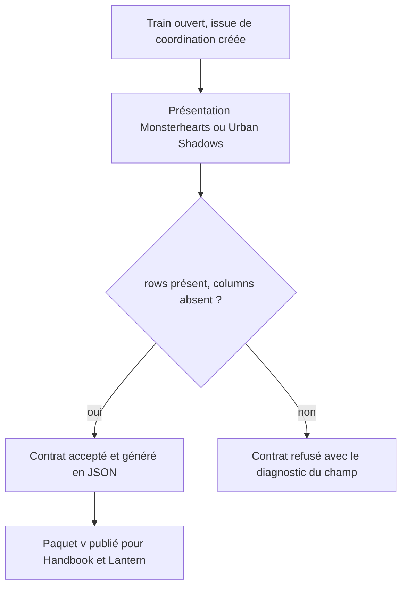
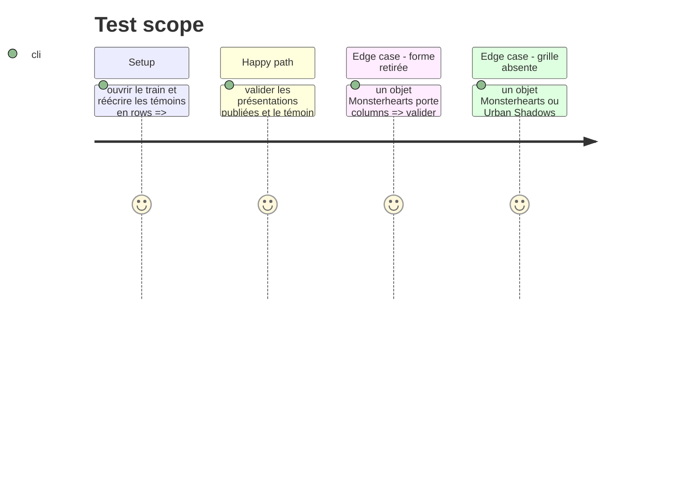

# Instruction: Resserrer le contrat de disposition dans schema-pbta

## Architecture projection

> Tree of the final files. ✅ create · ✏️ modify · ❌ delete

```txt
../obsidian-handbook/
└── supervisor/trains/contract-layout-residues.json ✅ écrit par `pnpm supervise open`, avec l'issue de coordination
../schema-pbta/
├── src/presentation/monsterhearts-playbook.ts ✏️ retirer `columns` ; `rows` obligatoire ; la garde de doublons ne lit plus que `rows`
├── src/presentation/urban-shadows-playbook.ts ✏️ `rows` obligatoire ; les lectures `rows?.` / `rows ??` deviennent directes
├── corpus/presentation/valid/monsterhearts-layout-unplaced.json ✏️ `rows` d'une ligne de trois colonnes : `monsterhearts-opening`, `character-identity`, `stat-profiles` ; `game-identity` reste l'en-tête hors grille, toutes les autres régions non placées
├── corpus/presentation/invalid/monsterhearts-layout-duplicate-region.json ✏️ exprimé en `rows`
├── corpus/presentation/invalid/monsterhearts-layout-empty-column.json ✏️ exprimé en `rows`
├── corpus/presentation/invalid/monsterhearts-layout-unknown-region.json ✏️ exprimé en `rows`
├── corpus/presentation/invalid/monsterhearts-layout-legacy-columns.json ✅ un objet qui porte encore `columns` est refusé
├── tools/validate-presentation-contract.ts ✏️ affirmer `rows` sur le témoin non placé, rejouer les quatre refus Monsterhearts en fichier, et refuser pour les deux jeux une présentation construite sans la clé `rows`
├── README.md ✏️ « optional ordered columns » devient « required ordered rows »
└── CHANGELOG.md ✏️ section de la majeure v<N+1> : retrait de `columns`, `rows` obligatoire
```

## User Journey



## Test Scope



## Tasks to do

### `1)` Ouvrir le train

> Les trois dépôts avancent sous un train, et chaque commit ferme son issue.

1. Depuis Handbook, lancer `pnpm supervise open contract-layout-residues --title "PbtA layout contract: one required grid, no dead layout code"`.
2. Rattacher les dépôts, avec `--yes` puisque la session n'a pas de terminal : `pnpm supervise link schema-pbta --create --title "<titre>" --yes`, puis `link obsidian-handbook --create --title "<titre>" --yes --depends-on schema-pbta` et `link lantern --create --title "<titre>" --yes --depends-on schema-pbta`.
3. Chaque commit du train finit par `Closes #<issue>`, l'issue que le train lie au dépôt.

### `2)` Une seule forme de grille, obligatoire

> Le contrat ne déclare plus que ce que les packs publient et que les consommateurs lisent.

1. Monsterhearts : supprimer `columns` du schéma Zod ; `rows` perd `.optional()`.
2. Monsterhearts : la garde « duplicate / unknown region » itère sur `rows` seul.
3. Urban Shadows : `rows` perd `.optional()` ; remplacer `layout.rows?.flat(2) ?? []` et `layout.rows ?? []` par des lectures directes.
4. Régénérer les `presentation-contract.json` par le script `gen` du dépôt. Les JSON Monsterhearts et Urban Shadows doivent en ressortir identiques octet pour octet : ils portaient déjà `rows` et jamais `columns`. La rupture est dans le schéma Zod et les types exportés.

### `3)` Corpus et validateur

> Chaque refus nommé par le contrat a son témoin.

1. Réécrire le témoin non placé sous la forme de l'arbre : une ligne de trois colonnes, sur le modèle du témoin Urban Shadows. Le témoin actuel étale `columns` sur une présentation qui porte déjà `rows`, et n'a donc jamais éprouvé une grille incomplète.
2. Réécrire les trois refus Monsterhearts en `rows`. Le cas « colonne vide » devient une ligne dont une colonne est vide.
3. Ajouter le témoin refusé `legacy-columns` (Monsterhearts) et l'inscrire dans la boucle `assert.throws` existante.
4. L'absence de `rows` ne s'écrit pas en fichier : `layoutFixture` est étalé par-dessus la présentation publiée, et un JSON ne retire aucune clé. Dans le validateur, construire pour chaque jeu la présentation sans la clé (`const { rows: _rows, ...withoutRows } = presentation`) et affirmer que le schéma la refuse.
5. Affirmer que le témoin non placé n'a qu'une ligne.

### `4)` Documenter la majeure

> Un consommateur lit la rupture avant d'adopter la version.

1. README : « optional ordered columns » devient « required ordered rows ».
2. CHANGELOG : préparer la section v<N+1> qui nomme le retrait de `columns` et l'obligation de `rows`. Le numéro se pose par l'outil de version du dépôt, jamais à la main.

## Test acceptance criteria

| Task | Acceptance criteria |
| ---- | ------------------- |
| 1 | `pnpm supervise next` montre schema-pbta d'abord, puis Handbook et Lantern qui en dépendent, chacun avec son issue. L'issue de coordination existe. |
| 2 | Les JSON publiés sont inchangés. Le schéma Zod et le type TS exportés ne connaissent plus `columns` et n'admettent plus `rows` absent. |
| 3 | Un objet avec `columns` est refusé, de même qu'un objet sans `rows`, une région inconnue, dupliquée ou une colonne vide. Une grille d'une seule ligne laissant des régions non placées est acceptée. |
| 4 | README et CHANGELOG décrivent la grille obligatoire et la rupture de la majeure. |
