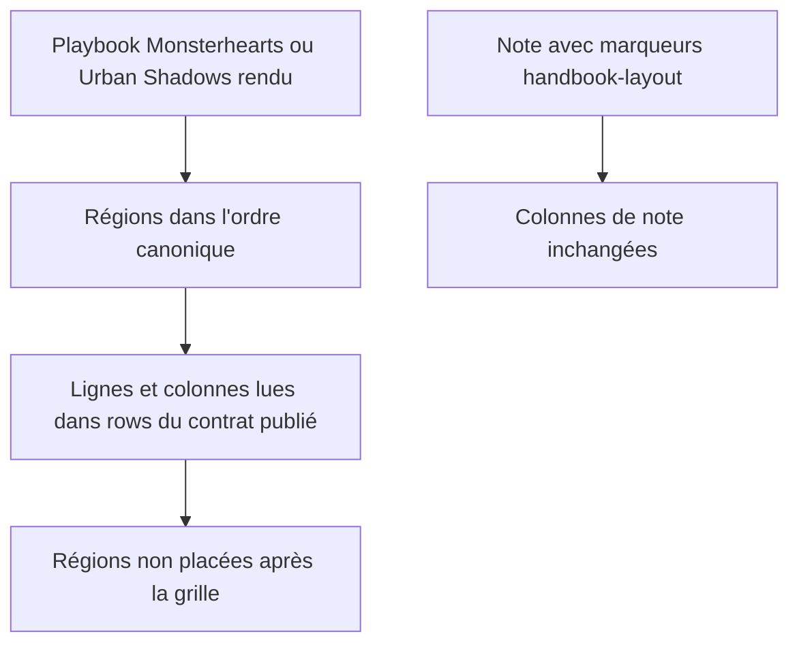
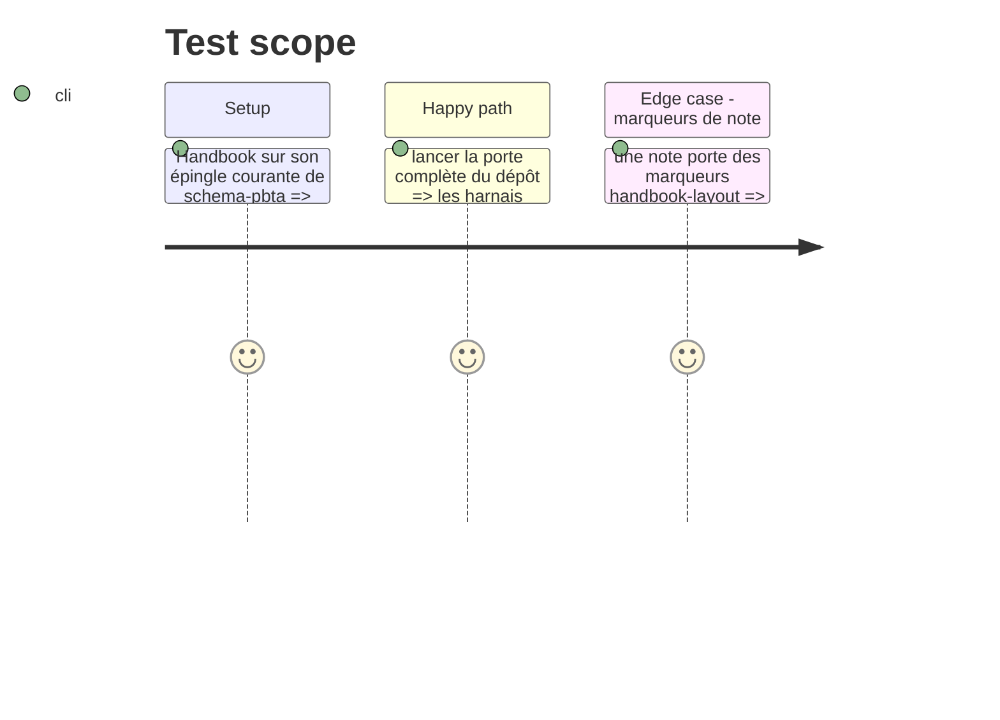

# Instruction: Retirer de Handbook le moteur générique et le repli

## Architecture projection

> Tree of the final files. ✅ create · ✏️ modify · ❌ delete

```txt
.
├── src/features/layoutRegions/contractLayout.ts ❌ `applyContractLayout`, sans appelant de production
├── src/features/pbta/monsterheartsLayout.ts ✏️ `contract.rows ?? []` devient `contract.rows`
├── tools/monsterheartsLayout.harness.mts ✏️ affirmer, ligne par ligne et colonne par colonne, les régions de `contract.rows`, puis les régions non placées dans l'ordre canonique
├── tools/layoutRegions.harness.mts ✏️ retirer l'import et le bloc « Schema layouts select rendered regions » ; le reste (marqueurs, export PDF) inchangé
├── package.json ✏️ épingle schema-pbta v<N+1>, posée par l'adoption du train
└── pnpm-lock.yaml ✏️ suit l'épingle
```

## User Journey



## Test Scope



## Tasks to do

### `1)` Retirer le moteur sans appelant

> Le code de production ne garde qu'une projection par jeu.

1. Vérifier par recherche qu'aucun fichier de `src/` n'importe `contractLayout`.
2. Supprimer `src/features/layoutRegions/contractLayout.ts`.
3. Retirer du harnais `layoutRegions.harness.mts` l'import et le bloc qui l'exerce (`contractParent` … `contractLayout`). Garder `wrapBlocksInColumns` et ses affirmations par marqueurs.

### `2)` Lire la grille obligatoire

> Le consommateur lit le contrat tel qu'il est publié.

1. `monsterheartsLayout.ts` : remplacer `(contract.rows ?? [])` par `contract.rows`.
2. Laisser `urbanShadowsLayout.ts` tel quel : il lit déjà `contract.rows` directement.
3. Dans `monsterheartsLayout.harness.mts`, affirmer que chaque `.handbook-monsterhearts-layout-row` contient des `.handbook-monsterhearts-column` dont les `data-region` sont, dans l'ordre, ceux de `contract.rows` présents dans la donnée. Affirmer aussi que les régions non placées suivent les lignes dans l'ordre de `canonicalOrder`. Ces affirmations s'écrivent avant le remplacement de 2.1 et passent avant comme après.

### `3)` Adopter le fournisseur

> L'épingle suit la publication, jamais l'inverse.

1. Laisser `ship --run` du train adopter schema-pbta v<N+1>, la release candidate puis la finale.
2. Le changement de Handbook ne dépend pas de la majeure. Le JSON importé porte déjà `rows` et ne lit pas `columns` : les portes passent sur l'épingle courante comme sur v<N+1>.
3. Avant le départ du train, rendre verts `rtk proxy pnpm build`, `eslint src --ext .ts`, `pnpm lint` et `pnpm check`.

## Test acceptance criteria

| Task | Acceptance criteria |
| ---- | ------------------- |
| 1 | `src/` ne contient plus aucune référence à `applyContractLayout`. Le harnais layout-regions affirme toujours les colonnes de note par marqueurs et l'export PDF. |
| 2 | Le harnais `assert:monsterhearts-layout`, enrichi de la répartition, passe avant et après le changement : le playbook rendu a les lignes et colonnes de `contract.rows`, et ses régions non placées suivent dans l'ordre canonique. |
| 3 | Handbook est épinglé sur la finale v<N+1>, et le build, les deux lints et la porte complète sont verts. |
