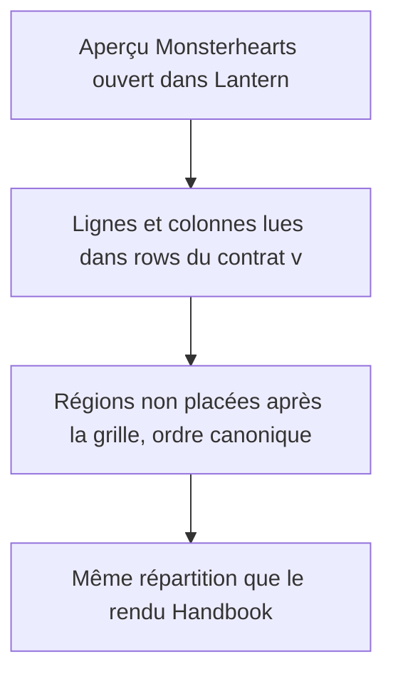
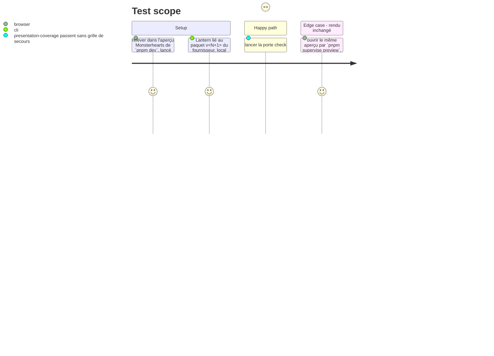

# Instruction: Retirer de Lantern le repli local

## Architecture projection

> Tree of the final files. ✅ create · ✏️ modify · ❌ delete

```txt
../lantern/
├── src/templates/monsterhearts/playbook/preview/MonsterheartsPlaybookPreview.tsx ✏️ `getMonsterheartsRegionLayout` lit `presentation.rows` sans grille de secours
├── package.json ✏️ épingle schema-pbta v<N+1>, posée par l'adoption du train
├── package-lock.json ✏️ suit l'épingle (suivi avec le lockfile pnpm, `trainFiles` de la topologie)
└── pnpm-lock.yaml ✏️ suit l'épingle
```

## User Journey



## Test Scope



## Tasks to do

### `1)` Lire la grille obligatoire

> L'aperçu ne déclare aucune grille que le contrat ne publie pas.

1. Dans `getMonsterheartsRegionLayout`, remplacer `presentation.rows ?? [[…canonicalOrder…]]` par `presentation.rows`.
2. Garder le calcul de `trailing` : il applique `fallbacks.unplaced: canonical-order` publié par le contrat.
3. Laisser `UrbanShadowsPlaybookPreview.tsx` tel quel : il lit déjà `presentation.rows` directement.

### `2)` Adopter le fournisseur

> L'épingle suit la publication.

1. Laisser `ship --run` du train adopter schema-pbta v<N+1>, la release candidate puis la finale. Lantern échoue au typecheck tant que son épingle précède la majeure : c'est l'ordre attendu.
2. Avant le départ du train, rendre verte la porte `check:project` sur l'épingle locale du fournisseur.

## Test acceptance criteria

| Task | Acceptance criteria |
| ---- | ------------------- |
| 1 | `MonsterheartsPlaybookPreview.tsx` ne construit plus aucune grille par lui-même. L'aperçu Monsterhearts montre, région pour région, la répartition relevée au Setup. |
| 2 | Lantern est épinglé sur la finale v<N+1> dans ses deux lockfiles, et `check:project` est vert. |
