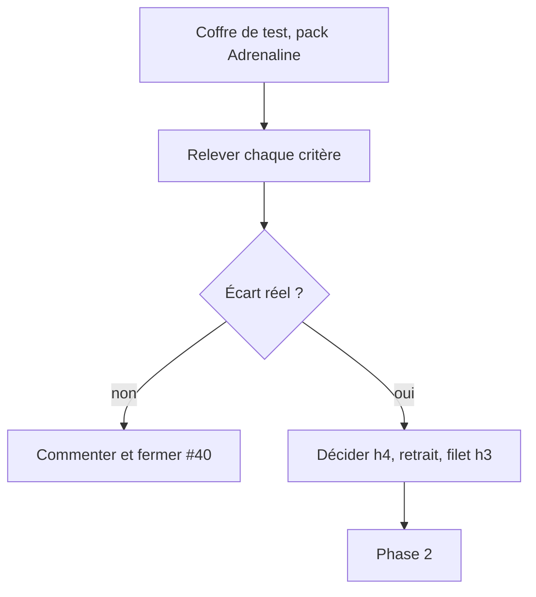
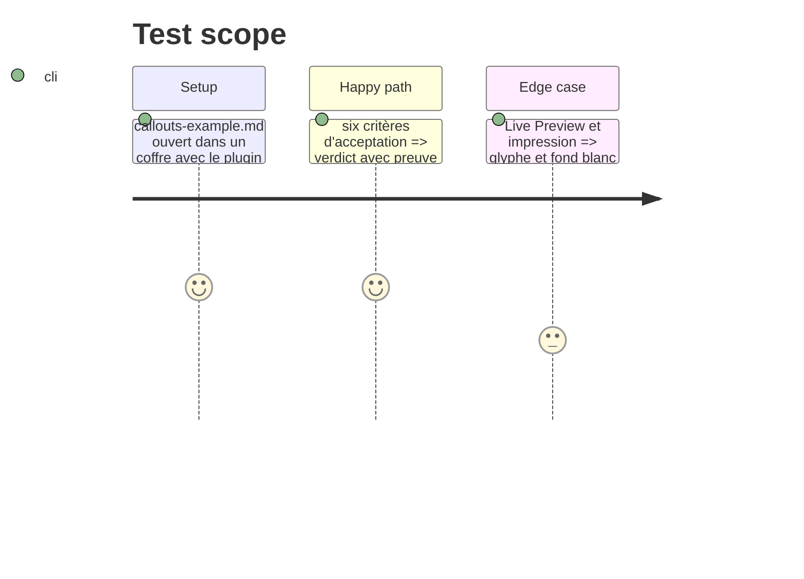

# Instruction: Audit des critères d'acceptation et décisions

## Architecture projection

```txt
#40 (commentaire GitHub)   ✅ tableau critère / preuve / verdict ; aucun fichier ajouté au dépôt
```

## User Journey



## Test Scope



## Tasks to do

### `1)` Vérifier les six critères

1. Critère 1 (fenêtre **Adrenaline System features**) : lire `nativeCallouts.ts` et ouvrir la fenêtre ; les 8 callouts apparaissent avec `[!alias]`
2. Critère 2 (jetons light et dark) : `npm run validate:pack` dans schema-adrenaline, relever le nombre de paires vérifiées
3. Critère 3 (h3 et h4) : rendre `callouts-example.md` en lecture, Live Preview et impression ; comparer à `titre3.jpg` et `titre4.jpg`
4. Critère 4 (`ol` et `►`) : liste numérotée et liste à puces en lecture et en Live Preview
5. Critère 5 (exemple Markdown) : `callouts-example.md` couvre chaque callout, h1 à h5 et une liste imbriquée
6. Critère 6 (issue sœur) : constater son absence et décider

### `2)` Trancher les écarts (a) à (f) du plan

1. Une décision écrite par écart : corriger, documenter comme voulu, ou hors périmètre
2. Poster le tableau dans #40 (commentaire)

## Test acceptance criteria

| Task | Acceptance criteria |
| ---- | ------------------- |
| 1    | Chaque critère porte un verdict et une capture ou une sortie de commande |
| 2    | Chaque écart a une décision ; aucun « à voir » |
