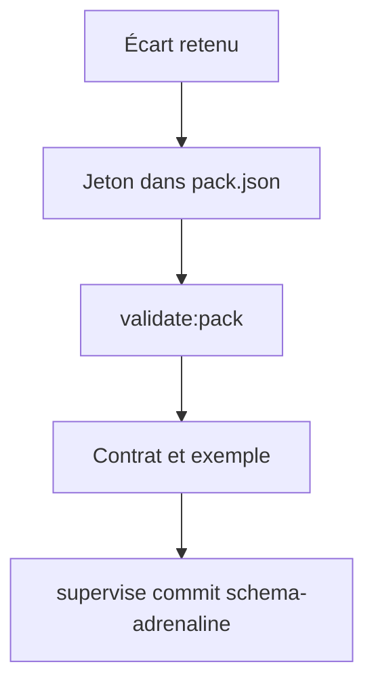
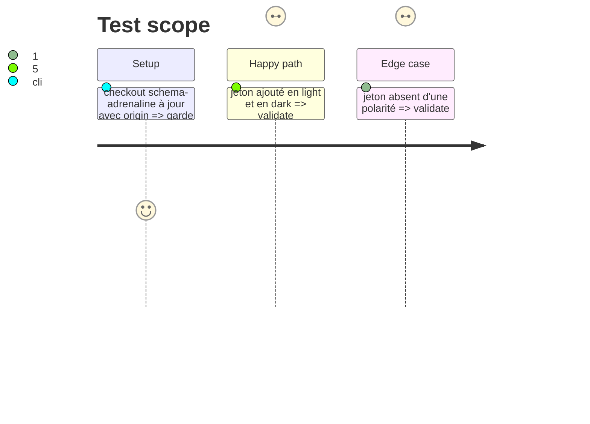

# Instruction: schema-adrenaline — jetons, exemple et contrat des écarts retenus

Ne s'exécute que si la phase 1 retient au moins un écart qui demande une valeur du pack. Sinon, passer à la phase 3 (preuve seule) ou à la phase 4, tâche 2 si rien n'est à coder.

## Architecture projection

```txt
schema-adrenaline/
├── handbook/adrenaline/pack.json            ✏️ jetons retenus (retrait de liste, filet de h4) en light et en dark
├── handbook/adrenaline/callout-contract.md  ✏️ table « Titres et texte courant »
├── handbook/adrenaline/callouts-example.md  ✏️ cas qui couvre l'écart (liste imbriquée longue, h4)
└── tools/validate-handbook-pack.ts          ✏️ paire encre/fond du filet s'il est coloré
```

## User Journey



## Test Scope



## Tasks to do

### `1)` Écrire les jetons

1. Ajouter les jetons décidés (noms `--adrenaline-*`) dans les deux polarités
2. Mettre à jour le contrat et l'exemple

### `2)` Valider

1. `npm run validate:pack`, `validate:presentation`, `validate:contract`, `build`
2. Commit par `pnpm supervise commit schema-adrenaline` depuis Handbook

## Test acceptance criteria

| Task | Acceptance criteria |
| ---- | ------------------- |
| 1    | Chaque jeton existe en light et en dark ; le contrat et l'exemple le citent |
| 2    | Toutes les validations vertes ; commit poussé par le superviseur |
