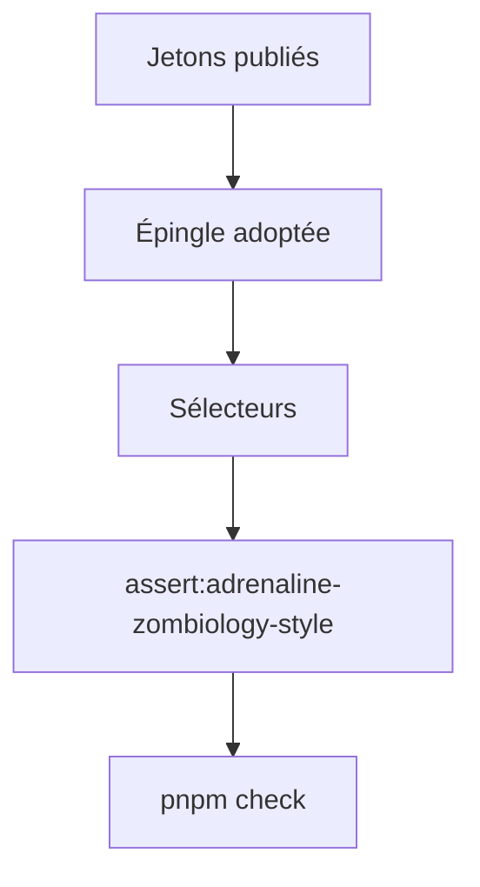
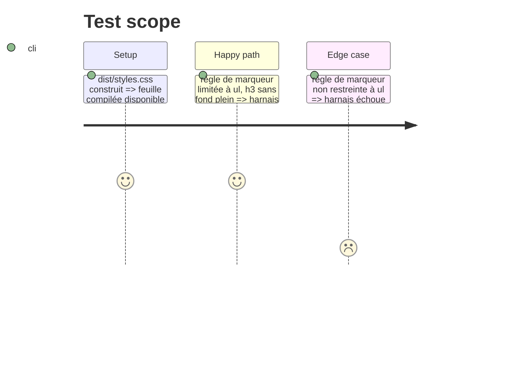

# Instruction: Handbook — sélecteurs, preuves automatiques, issue sœur

## Architecture projection

```txt
obsidian-handbook/
├── src/styles/adrenaline/_content.scss        ✏️ retrait suspendu des listes, filet de h4 d'après la décision
└── tools/assertAdrenalineZombiologyStyle.harness.mts  ✏️ complété : ol garde ses numéros, retrait lu via jeton, 8 callouts listés
    (déjà câblé par assert:adrenaline-zombiology-style et tools/check.mjs ; aucun nouveau script)
```

## User Journey



## Test Scope



## Tasks to do

### `1)` Adopter et styler

1. Adopter la version publiée du pack (candidate puis finale) par la voie du superviseur, sans réécrire un lockfile à la main
2. Écrire les sélecteurs d'après les jetons ; cible ES basse (ni `Object.values` ni `flat`)

### `2)` Prouver

1. Compléter `assertAdrenalineZombiologyStyle.harness.mts` (il affirme des rôles, pas des chiffres) ; vérifier d'abord ce qu'il couvre déjà
2. Ouvrir l'issue sœur Handbook seulement si un sélecteur a changé, avec lien vers #40 ; sinon l'écrire dans le commentaire de #40

### `3)` Portes

1. `rtk proxy pnpm build`, `pnpm lint` et `eslint src --ext .ts` à zéro erreur, `pnpm check`

## Test acceptance criteria

| Task | Acceptance criteria |
| ---- | ------------------- |
| 1    | Épingle adoptée par le superviseur ; les sélecteurs lisent les jetons du pack |
| 2    | Le harnais échoue sur une règle de marqueur non restreinte à `ul` et passe sinon |
| 3    | Build vert, deux portées de lint à zéro, `pnpm check` vert |
