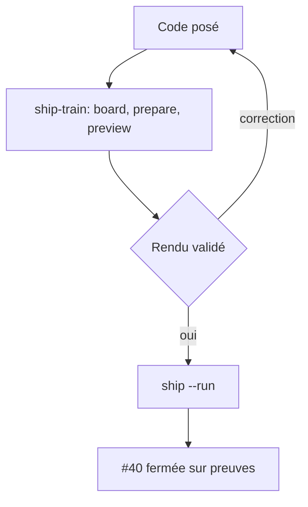
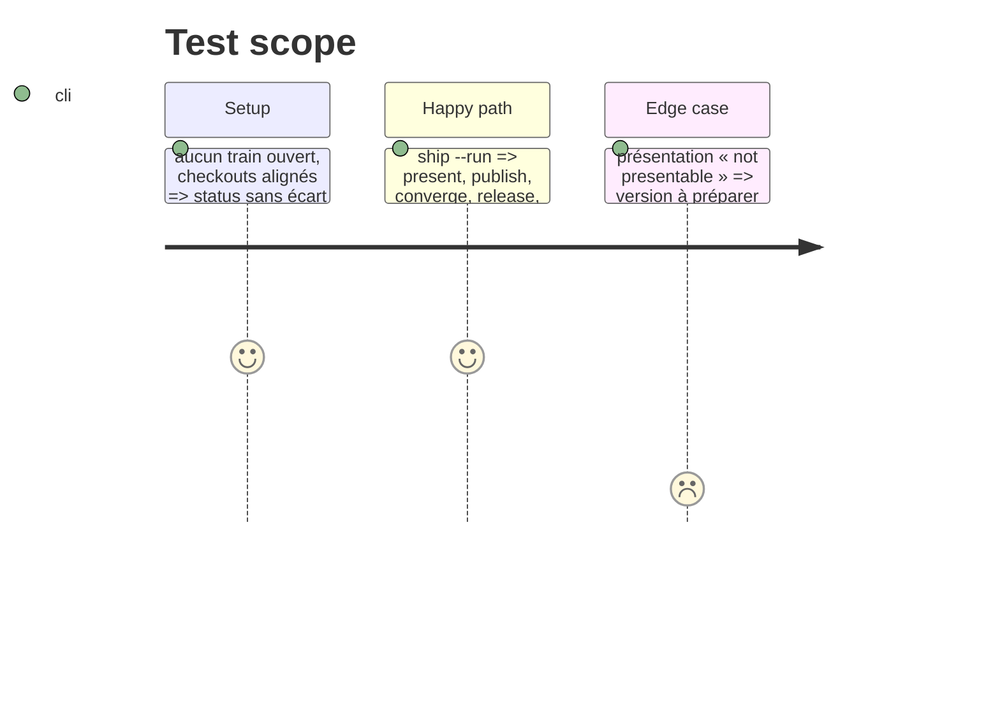

# Instruction: Train, rendu validé, livraison et fermeture de #40

## Architecture projection

```txt
obsidian-handbook/
├── supervisor/trains/adrenaline-callouts-gap-closure.json   ✅ créé par le superviseur
└── CHANGELOG.md, package.json, manifest.json, versions.json ✏️ version de Handbook, par pnpm version
```

## User Journey



## Test Scope



## Tasks to do

### `1)` Ouvrir et présenter

1. Vérifier qu'aucun train n'est actif (`pnpm supervise status`), puis `ship-train` : `board`, `prepare` (version de Handbook par `pnpm version`, jamais à la main)
2. `preview` : l'utilisateur valide le rendu sur `callouts-example.md`

### `2)` Livrer et fermer

1. `pnpm supervise ship --run` ; lire tout échec dans le journal complet que nomme `Whole output:`
2. Le train ferme #40 ; sans train (audit propre), fermer #40 avec le tableau d'audit

## Test acceptance criteria

| Task | Acceptance criteria |
| ---- | ------------------- |
| 1    | Rendu validé par l'utilisateur avant toute publication |
| 2    | `ship` sort 0, train `closed`, #40 fermée avec preuves |
