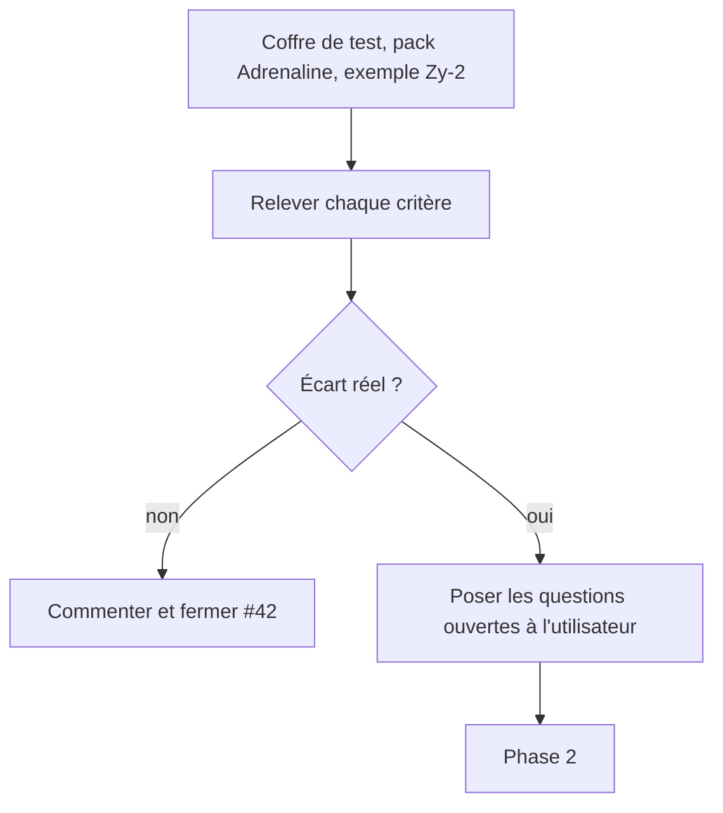
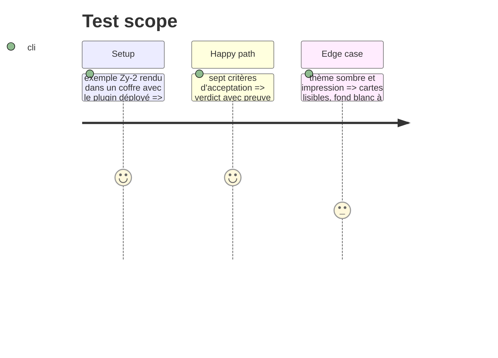

# Instruction: Audit des critères d'acceptation et décisions

## Architecture projection

```txt
#42 (commentaire GitHub)   ✅ tableau critère / preuve / verdict ; aucun fichier ajouté au dépôt
```

## User Journey



## Test Scope



## Tasks to do

### `1)` Vérifier les critères

1. Type `Degats` commun : lire `degats.ts` et confirmer son usage par `ActionDeCreature` (aussi par #41) ; relever ce qui manque de la ligne 7 de l'issue (« 2d10 au contact »)
2. `etatDeBase`, `etatsPermanents`, `categorie`, `malusAvantHs` : présents dans `monstre.ts`, validés par `validate:contract`
3. `DefenseDeCreature` : niveaux (`oui`, `expose`, `non`) et sens de `bonus`
4. Exemple : `infecte-zy-2.toml` valide (`pnpm validate` dans schema-adrenaline) ; aucun exemple ne garde `etatAlternatif` (relevé), rien à migrer
5. `MONSTRE_PRESENTATION` : cartes, `state-header`, titres composés, déclencheurs
6. Rendu (y compris : « Insensible » dans Santé, propriétés des dégâts sur leur ligne, Malus avant HS sous forme de cercles ou de valeur) : ouvrir l'exemple dans un coffre de test, comparer à `preview.html` (structure, pas pixel), en clair, en sombre, à l'impression
7. Issue sœur Handbook : rattacher #64 (ouverte) ; n'en ouvrir une que si un écart retenu sort de son périmètre

### `2)` Trancher

1. Poser à l'utilisateur, une seule fois et avec la capture du rendu, les questions que le code ne tranche pas : cercles Malus (dérivés ou saisis), retrait d'Art martial et de Bave (règle ou mise en page), où imprimer `comportement[]`, `traitsSpeciaux` et `contagion`, valeurs de la maquette contre les règles
2. Une décision écrite par écart : corriger, documenter comme voulu, ou hors périmètre
3. Poster le tableau dans #42 (commentaire)

## Test acceptance criteria

| Task | Acceptance criteria |
| ---- | ------------------- |
| 1    | Chaque critère porte un verdict et une capture ou une sortie de commande |
| 2    | Chaque écart a une décision ; aucun « à voir » |
