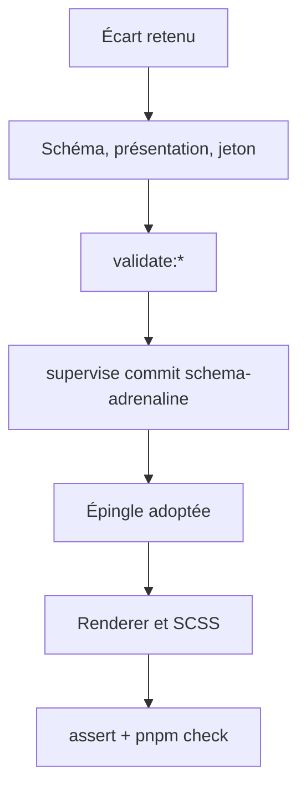
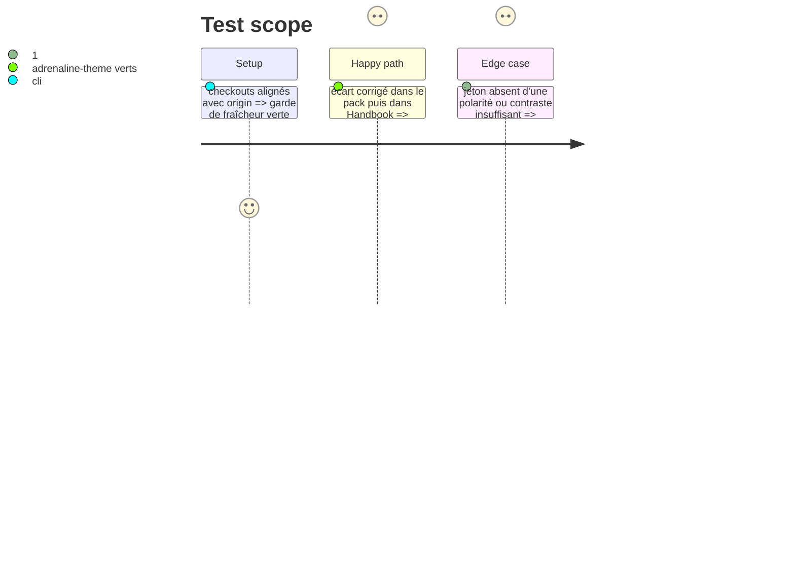

# Instruction: Corrections retenues (schéma, présentation, jetons, Handbook)

Ne s'exécute que si la phase 1 retient au moins un écart. Sinon, passer à la phase 3, tâche 3.

## Architecture projection

```txt
schema-adrenaline/
├── src/zod/…, src/presentation.ts           ✏️ champs ou disposition retenus
├── handbook/adrenaline/pack.json            ✏️ jetons retenus (les jetons de pastille de déclencheur existent déjà) en light et en dark
├── examples/adrenaline/monstre/*.toml       ✏️ exemple aligné sur la décision
└── tools/validate-*.ts                      ✏️ paires encre/fond des nouveaux jetons

obsidian-handbook/
├── src/features/adrenalineMonstre/renderer.ts, src/features/adrenaline/compactCard.ts  ✏️ si un champ ou une forme change
├── src/styles/adrenaline/_monstre.scss      ✏️ sélecteurs
└── tools/assertAdrenalineTheme.harness.mts  ✏️ un rôle affirmé par écart corrigé
```

## User Journey



## Test Scope



## Tasks to do

### `1)` Pack (schema-adrenaline)

1. Étendre le schéma **avant** le travail consommateur ; champs facultatifs, jamais de renommage sans chemin de lecture de l'ancienne forme
2. Mettre à jour la présentation, l'exemple et les jetons retenus (deux polarités) ; `validate:pack` vérifie la paire encre/fond de chaque nouveau jeton
3. `npm run validate:pack`, `validate:presentation`, `validate:contract`, `build` ; commit par `pnpm supervise commit schema-adrenaline`

### `2)` Handbook

1. Adopter la version publiée par la voie du superviseur (pas de lockfile écrit à la main)
2. Adapter renderer et SCSS ; cible ES basse (ni `Object.values` ni `flat`)
3. Compléter `assertAdrenalineTheme.harness.mts` (qui couvre déjà cartes, déclencheurs, badges, suites) pour affirmer le rôle de chaque écart corrigé, en priorité « Insensible », propriétés des dégâts et piste Malus (rôle, jamais chiffre)
4. Portes : `rtk proxy pnpm build`, `pnpm lint`, `eslint src --ext .ts`, `pnpm check`

## Test acceptance criteria

| Task | Acceptance criteria |
| ---- | ------------------- |
| 1    | Toutes les validations vertes ; commit poussé par le superviseur |
| 2    | Build vert, deux portées de lint à zéro, `pnpm check` vert ; le harnais échoue si le rôle corrigé régresse |
