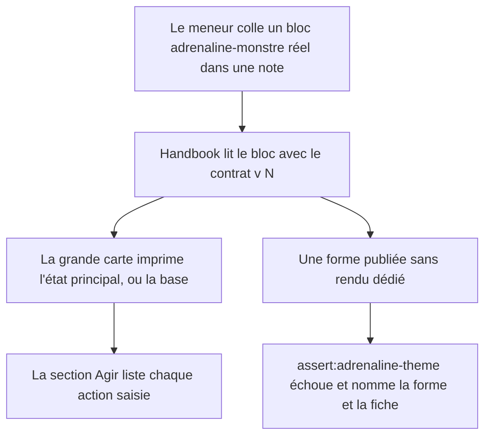
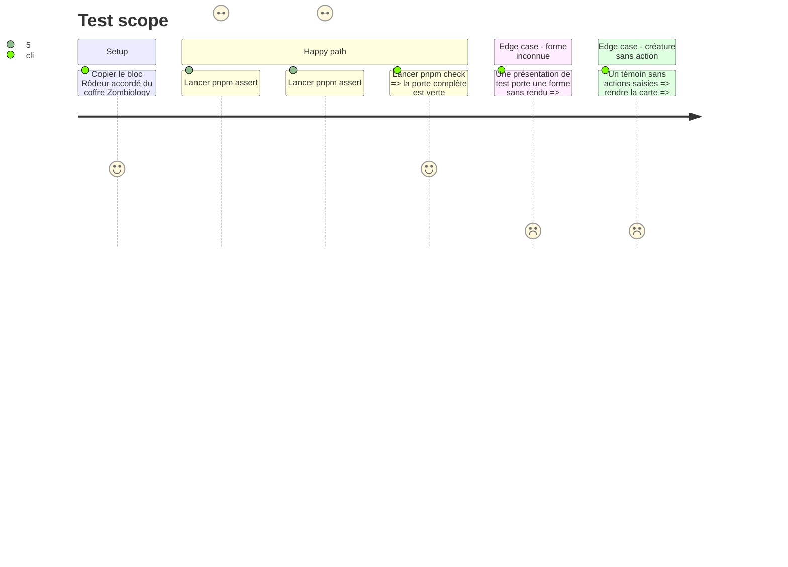

<!-- Fill or omit these sections; never add, rename, or reorder one. -->

# Instruction: Garde de couverture des formes et diagnostic « Agir » (Handbook, contrat v<N>)

## Architecture projection

> Tree of the final files. ✅ create · ✏️ modify · ❌ delete

```txt
obsidian-handbook/
├── src/
│   └── features/
│       ├── adrenaline/
│       │   └── compactCard.ts                      ✏️ seulement si le diagnostic « Agir » y trouve la cause
│       └── adrenalineMonstre/
│           ├── renderer.ts                         ✏️ seulement si le diagnostic « Agir » y trouve la cause
│           └── schema.ts                           ✏️ seulement si le diagnostic « Agir » y trouve la cause
├── tools/
│   ├── fixtures/
│   │   └── adrenaline-monstre-rodeur-accorde.md    ✅ bloc réel du coffre Zombiology (actions en base, un état sans etatPrincipal)
│   └── assertAdrenalineTheme.harness.mts           ✏️ garde de couverture + témoin « Agir »
└── CHANGELOG.md                                    ✏️ entrée de la version en cours
```

## User Journey



## Test Scope



## Tasks to do

### `1)` Garde de couverture des formes

> Toute forme que `schema-adrenaline` publie pour une fiche est dessinée par le rendu Handbook de cette fiche.

1. Lire `tools/assertAdrenalineTheme.harness.mts` et la garde jumelle de Lantern (`lantern/tools/assert-adrenaline-coverage.mjs`) : même rôle, même message.
2. Dans le harnais, parcourir `PJ_PRESENTATION`, `PNJ_PRESENTATION` et `MONSTRE_PRESENTATION` importées du paquet installé, et rendre les exemples publiés des trois fiches (ceux que le harnais lit déjà dans `examples/adrenaline/`).
3. Observer le repli par le comportement, pas par la lecture du source : `log.setLevel("warn")`, capture des avertissements pendant le rendu, échec au premier avertissement « no dedicated rendering » (carte compacte) ou au premier `renderUnknown` (fiche PJ).
4. Une forme publiée qu'aucun exemple ne remplit n'est pas prouvée : la garde l'imprime comme constat sans échouer (tolérance asymétrique : l'exemple appartient à l'amont).
5. Preuve négative : une présentation de test dont un bloc porte une forme que le rendu ne connaît pas fait échouer la garde, qui nomme la fiche, la forme et le bloc.
6. Aucun littéral de forme publiée dans la garde : la liste vient de la présentation publiée (`pnpm assert:guards-by-role` doit rester vert).
7. Si une forme publiée par v<N> n'est pas dessinée aujourd'hui, la dessiner dans cette phase et le noter au tableau Decisions du plan.

### `2)` Diagnostic « Agir » sur un bloc réel

> Savoir pourquoi « Agir » manque sur un vrai Zy-2, et le corriger si la cause est dans Handbook.

1. Créer le témoin `tools/fixtures/adrenaline-monstre-rodeur-accorde.md` (lu comme `adrenaline-visual.md`, hors de `corpus/` que `pnpm assert:corpus` réserve aux formats locaux) à partir du bloc « Rôdeur accordé » (`zombiology/2026/09/prochain-arret-japon/3. attention-au-depart/scenario/03-acte-i.md`).
2. Rendre le témoin dans le harnais et constater : section `agir` présente ou non sur la carte `principal`, nombre d'actions, forme des actions (`nom`, `desDeDegats`, `effets` à l'ancienne, sans `degats` ni `suites`).
3. Trois issues possibles, à écrire au tableau Decisions : (a) le rendu est correct et l'écart venait d'une version installée périmée dans le coffre ; (b) la projection `monsterToDocument` ou la lecture perd `actions` ; (c) le bloc réel sort du contrat v<N> (clé refusée, par exemple `defense.active` là où l'exemple publié écrit `defense.niveau`) et la carte se replie.
4. Cas (b) : corriger dans `adrenalineMonstre/schema.ts` ou `renderer.ts`, sans calcul ni valeur déduite. Cas (c) : ne rien assouplir, consigner la clé fautive dans #101 pour la phase 3.
5. Affirmer dans le harnais : le témoin imprime « Agir » avec ses deux actions sur la grande carte, et rien sur la petite.

### `3)` Vérification et journal

> La phase se ferme sur un dépôt vert.

1. `rtk proxy pnpm build`, `./node_modules/.bin/eslint src --ext .ts`, `pnpm lint`, puis `pnpm check`.
2. Ajouter l'entrée au `CHANGELOG.md` de la version en cours (celle que le train ouvert publie).
3. Déployer `dist/` dans le coffre de test sans toucher `data.json`, recharger, et regarder le bloc réel.
4. Cocher dans #101 §2 : « Agir » et la garde Handbook.

## Test acceptance criteria

| Task | Acceptance criteria |
| ---- | ------------------- |
| 1 | `pnpm assert:adrenaline-theme` échoue en nommant la fiche, la forme et le bloc dès qu'un exemple publié rendu tombe sur une forme sans rendu dédié ; il est vert sur le contrat v<N> installé et liste les formes qu'aucun exemple ne remplit. |
| 1 | `pnpm assert:guards-by-role` reste vert : la garde ne contient aucune liste de formes recopiée. |
| 2 | Le témoin « Rôdeur accordé » affiche une section « Agir » listant « Dégoût zombie » et « Morsure » sur la grande carte, et aucune section « Agir » sur la petite. |
| 2 | La cause de l'écart est écrite au tableau Decisions du plan, avec l'issue retenue (a), (b) ou (c). |
| 3 | `pnpm check` est vert et les deux portées de lint sont à zéro erreur. |
