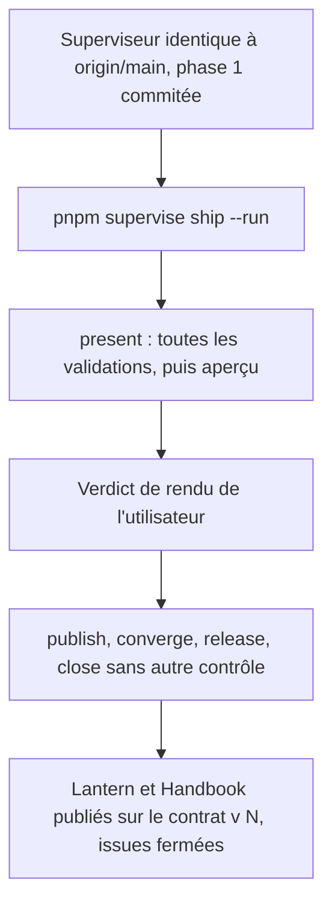
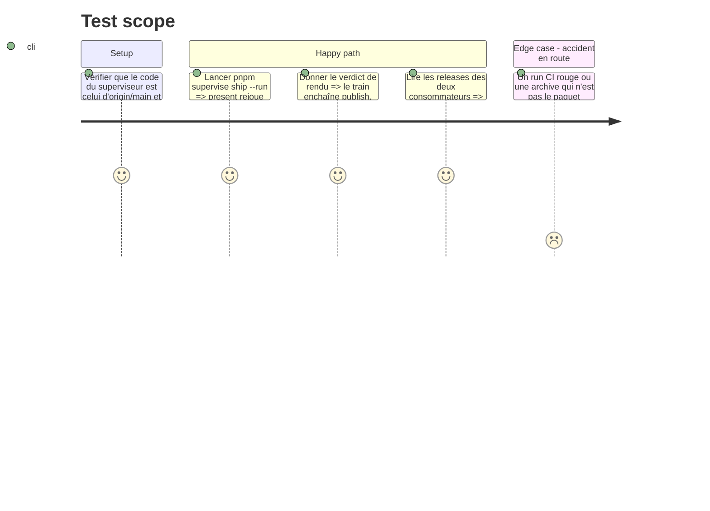

<!-- Fill or omit these sections; never add, rename, or reorder one. -->

# Instruction: Reprise du train ouvert `adrenaline-monstre-ecarts`

## Architecture projection

> Tree of the final files. ✅ create · ✏️ modify · ❌ delete

```txt
obsidian-handbook/
└── supervisor/
    └── trains/
        └── adrenaline-monstre-ecarts.json   ✏️ écrit par le superviseur seul (présentation, publication, clôture)
```

Aucun fichier de code n'est écrit dans cette phase : le superviseur exécute.

## User Journey



## Test Scope



## Tasks to do

### `1)` Préalables au départ

> Le train ne part que d'un état que le superviseur accepte.

1. Vérifier que la comparaison d'empreintes du superviseur (#101 §1) est commitée et poussée : le superviseur refuse de tourner si son code diffère d'`origin/main`.
2. Vérifier que la phase 1 est commitée dans Handbook et que Lantern et `schema-adrenaline` sont propres et alignés sur `origin/main`.
3. Relire `doc/supervisor.fr.md` (§ reprise de `ship --run`) : une présentation périmée est rejouée, une finale publiée ne l'est pas.

### `2)` Départ et verdict de rendu

> Un seul arrêt humain : le rendu.

1. Lancer `pnpm supervise ship --run` ; laisser `present` rejouer ce qui doit l'être.
2. À l'aperçu, comparer aux références de rendu du plan ; seul l'utilisateur donne le verdict.
3. Après le verdict, ne rien contrôler en route ; sur un arrêt, lire le journal complet nommé par `Whole output:`.

### `3)` Constat d'arrivée

> Le train est clos et tracé.

1. Constater les releases de Lantern et de Handbook, et la clôture du train dans son dossier.
2. Constater la fermeture de `obsidian-handbook#99`, `schema-adrenaline#42`, `obsidian-handbook#64`, `lantern#61`.
3. Mettre à jour « État du train » dans #101.

## Test acceptance criteria

| Task | Acceptance criteria |
| ---- | ------------------- |
| 1 | `pnpm supervise ship` sans `--run` annonce le parcours restant sans refus lié au code du superviseur ni à un dépôt sale. |
| 2 | `present` se termine vert et l'aperçu est montré ; le verdict de rendu est le seul arrêt demandé à l'utilisateur. |
| 3 | Le dossier du train est à l'état clos ; Lantern et Handbook ont chacun une release dont la version est celle de leur `package.json` ; les quatre issues sont fermées. |
