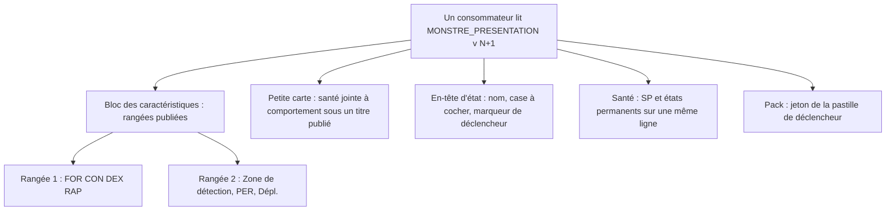
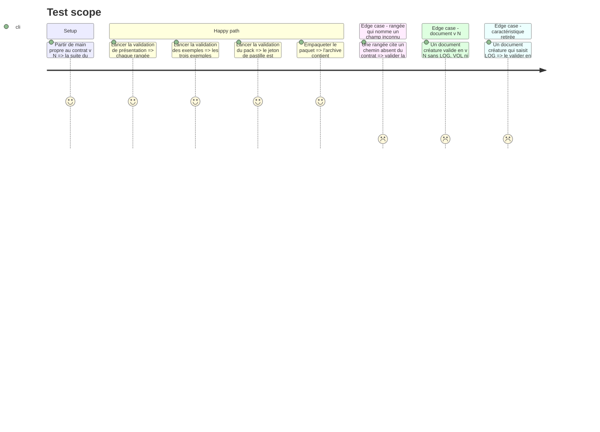

<!-- Fill or omit these sections; never add, rename, or reorder one. -->

# Instruction: Contrat v<N+1> — écarts des cartes compactes

## Architecture projection

> Tree of the final files. ✅ create · ✏️ modify · ❌ delete

```txt
schema-adrenaline/
├── src/
│   ├── zod/
│   │   └── common/
│   │       └── etat-monstre.ts                 ✏️ caractéristiques de créature : les quatre physiques et PER
│   ├── index.ts                                ✏️ seulement si un type exporté change de nom
│   └── presentation.ts                         ✏️ MONSTRE_PRESENTATION : rangées des caractéristiques, en-tête d'état, ligne SP + état, section « Comportement et santé » de la petite carte
├── schemas/
│   └── adrenaline/
│       └── monstre.schema.json                 ✏️ régénéré, jamais édité à la main
├── examples/
│   └── adrenaline/
│       └── monstre/
│           └── infecte-zy-2.toml               ✏️ seulement si la maquette demande une valeur absente
├── handbook/
│   └── adrenaline/
│       └── pack.json                           ✏️ jeton de carte pour la pastille de déclencheur
├── tools/
│   └── validate-presentation.ts                ✏️ règles des nouvelles publications
├── CHANGELOG.md                                ✏️ section v<N+1>
└── package.json                                ✏️ version v<N+1>, par l'outil de préparation de release
```

## User Journey



## Test Scope



## Wireframe

```txt
┌──────────────────────────────────────────────┐
│ (1) Bandeau catégorie                         │
│ (2) Nom · instinct · type de corps      ND    │
│ (3) Description                               │
├──────────────────────────────────────────────┤
│ (4) État : nom                          [ ]   │
│     (o) déclencheur                           │
│ (5) FOR      CON      DEX      RAP            │
│     Zone de détection   PER    Dépl.          │
├──────────────────────────────────────────────┤
│ (6) Santé                                     │
│     SP a / b / c / d        État  …           │
│     Malus  O O O  HS                          │
├──────────────────────────────────────────────┤
│ (7) Comportement (instinct)                   │
│     Actions n/round         Défense …         │
├──────────────────────────────────────────────┤
│ (8) Agir (type d'infecté)                     │
│     action ........................... %      │
│       suite .......................... %      │
└──────────────────────────────────────────────┘
┌──────────────────────────────────────────────┐
│ (9) État : nom (pas de case)                  │
│     (o) déclencheur                           │
│     caractéristiques, mêmes rangées           │
├──────────────────────────────────────────────┤
│ (10) Comportement et santé                    │
├──────────────────────────────────────────────┤
│ (11) Équipement                               │
└──────────────────────────────────────────────┘
```

1. Bandeau : la catégorie, variante de couleur publiée.
2. Carte de nom : identité de la créature et niveau de danger.
3. Description : texte saisi.
4. En-tête d'état : nom de l'état, case à cocher à droite sur la grande carte seulement (cochée si l'état actuel saisi est celui-ci), marqueur rond devant chaque déclencheur.
5. Caractéristiques : quatre colonnes ; la deuxième rangée loge détection, PER et déplacement. Une créature n'a pas d'autre caractéristique.
6. Santé : seuils et états permanents sur une ligne, cercles de Malus saisis puis « HS ».
7. Comportement : actions par round et défense.
8. Agir : actions et suites, sur la grande carte seulement.
9. Petite carte : l'autre état, en-tête sans case, mêmes rangées publiées.
10. « Comportement et santé » : une seule section sur la petite carte, là où la grande en a deux ; elle imprime SP, État, Actions et Défense, sans la ligne de Malus.
11. Équipement : sur la petite carte seulement, comme aujourd'hui ; pas de « Agir ».

## Tasks to do

### `1)` Rangées du bloc des caractéristiques

> Détection et déplacement se lisent sur la rangée de PER, par publication.

1. Lire `aidd_docs/guidelines/schema-design.md` côté Handbook et `tools/validate-presentation.ts` côté schéma avant d'étendre un type.
2. Ajouter au type de bloc une propriété de rangées de pointeurs JSON (`fieldRows` reste réservé à l'identité : un seul chemin, noms de propriété). Le bloc `caracteristiques` de la section `corps` (créature) lit alors `/caracteristiques`, `/zoneDeDetection` et `/deplacement` et publie deux rangées : FOR CON DEX RAP ; zone de détection, PER, déplacement. Une cellule sans valeur saisie n'est pas imprimée.
3. Retirer LOG, VOL et CHA de `CaracteristiquesDeCreature` (`src/zod/common/etat-monstre.ts`) : les quatre physiques requises, PER facultative ; `Caracteristiques` des PJ et PNJ ne change pas. Régénérer `monstre.schema.json` ; écrire la rupture au `CHANGELOG` ; choisir le rang de version qu'une rupture demande selon la règle de versionnage du dépôt.
4. Retirer les blocs séparés `detection` et `deplacement` de la section ; libellés publiés « Zone de détection » et « Dépl. ».
5. PNJ : la présentation ne change pas sur ce point ; sa carte garde huit caractéristiques sur deux lignes, sans détection ni déplacement.
6. Armes : scinder `Equipement` (`src/zod/common/equipement.ts`) par fiche. La créature remplace `armesMentales` par `armesPsychologiques`, même forme de ligne ; le PNJ perd le champ ; le PJ garde `armesMentales` jusqu'à v<N+2>. Présentations créature et PNJ, exemples et schémas JSON régénérés suivent ; la rupture va au `CHANGELOG` avec celle des caractéristiques.
6. Étendre `validate-presentation.ts` : chaque pointeur d'une rangée descend d'un chemin du bloc et existe au contrat ; aucun pointeur n'est placé deux fois ; une rangée tient dans les colonnes du bloc.

### `2)` En-tête d'état

> La case à cocher et le marqueur de déclencheur sont déclarés, pas devinés.

1. Publier sur le bloc `etat` une `decoration` d'un genre neuf (le mécanisme existe, la liste des genres est fermée dans `validate-presentation.ts`) : marqueur devant chaque déclencheur, et case de l'état actuel (liée à `etatActif`, valeur saisie) avec les cartes qui la portent, ici la principale seule.
2. Ajouter au `pack.json` le jeton `--adrenaline-card-*` de la pastille (cyan sur la maquette), dans chaque polarité déclarée par le pack ; le nom passe la validation des jetons.
3. Vérifier que la garde de Lantern (tout jeton de carte publié est lu par les styles) le verra : c'est elle qui forcera le dessin en phase 4.

### `3)` Ligne « SP » et « État »

> « Insensible » s'imprime à côté des seuils, comme sur la maquette.

1. Dans la section `sante`, placer les blocs `sante` et `etats-permanents` sur la même rangée par `placement` (mécanisme déjà publié pour la fiche PJ) ; la section déclare le nombre de colonnes que la validation de `placement` exige ; le libellé du second devient « État ».
2. Relever dans les blocs réels du coffre la forme `traitsSpeciaux = [ "État Insensible." ]` : elle reste un trait spécial ; ne pas la convertir, ne rien déduire. L'écrire dans le `CHANGELOG` comme forme à ressaisir en `etatsPermanents`.
3. Vérifier que l'exemple `infecte-zy-2.toml` produit bien les deux cartes de la maquette avec les publications ci-dessus ; ne le modifier que pour une valeur manquante.

### `4)` Section « Comportement et santé » de la petite carte

> La petite carte regroupe ce que la grande sépare, par publication.

1. Lire comment `sante` et `comportement` déclarent aujourd'hui leurs cartes (`cards` principal et secondaire) dans `src/presentation.ts`.
2. Ne pas dupliquer de section : `validate-presentation.ts` exige des identifiants de bloc et des chemins uniques par fiche. Ajouter au type de section une propriété de jonction : sur la carte nommée, la section s'imprime à la suite d'une autre sous un titre publié. `sante` la porte pour la carte secondaire, jointe à `comportement`, titre « Comportement et santé » ; la carte principale garde ses deux sections.
3. Le bloc `malus` n'est publié que pour la carte principale : la petite carte de la maquette ne l'imprime pas.
4. Étendre `validate-presentation.ts` : la jonction nomme une section existante, imprimée sur la même carte, et un titre non vide.

### `5)` Version et preuves du fournisseur

> Le contrat v<N+1> est prêt à être présenté.

1. Préparer la version par l'outil du dépôt (`npm run release:prepare`, soit `tools/prepare-release.ts`), jamais à la main ; section v<N+1> du `CHANGELOG`.
2. Jouer la suite complète du dépôt (présentation, exemples, pack, paquet, versionnage).
3. Empaqueter localement pour la phase 4 ; ne rien publier ici : la candidate sort par le train.
4. Si la phase 1 a consigné une clé de bloc réel refusée par le contrat (issue (c)), trancher ici : l'ajouter au contrat ou la laisser refusée, et l'écrire au tableau Decisions.

## Test acceptance criteria

| Task | Acceptance criteria |
| ---- | ------------------- |
| 1 | La présentation créature ne publie plus de bloc `detection` ni `deplacement` isolé ; le bloc des caractéristiques publie deux rangées dont la deuxième place détection, PER, déplacement dans cet ordre, et chaque caractéristique du contrat créature figure dans une rangée. |
| 1 | Le contrat créature refuse `log`, `vol` et `cha` en nommant la clé ; les exemples PNJ, qui les saisissent, restent valides. |
| 1 | Une rangée citant un pointeur absent du contrat, ou deux fois le même, fait échouer la validation de présentation avec le nom du bloc et du pointeur. |
| 2 | Le bloc d'en-tête d'état déclare par sa décoration le marqueur de déclencheur, et la case de l'état actuel pour la carte principale seulement ; le pack publie un jeton de carte pour la pastille dans chaque polarité déclarée. |
| 3 | Dans la section santé de la créature, les blocs des seuils et des états permanents ont le même numéro de rangée, et le second est libellé « État ». |
| 4 | La section santé déclare sa jonction à la section comportement sur la carte secondaire, sous le titre « Comportement et santé » ; aucun identifiant de bloc ni chemin n'est publié deux fois ; une jonction vers une section absente fait échouer la validation. |
| 1 | Une créature qui saisit `armesPsychologiques` est valide ; une créature ou un PNJ qui saisit `armesMentales` est refusé en nommant la clé ; un PJ qui la saisit reste valide. |
| 5 | Tout document valide en v<N> reste valide en v<N+1>, sauf une créature qui saisit LOG, VOL ou CHA et une créature ou un PNJ qui saisit `armesMentales` ; la suite complète du dépôt est verte ; l'archive locale porte la version v<N+1> lue dans `package.json`. |
