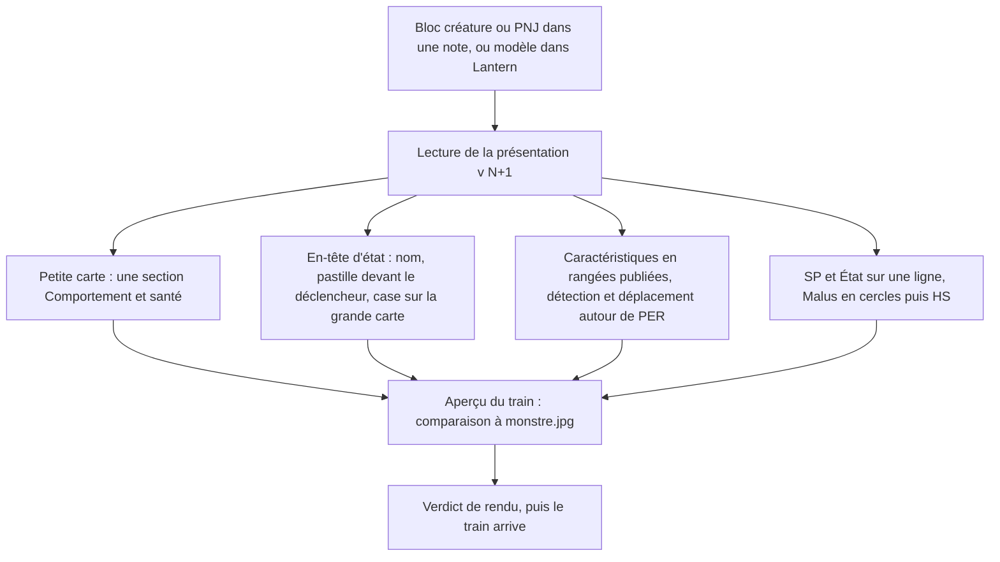
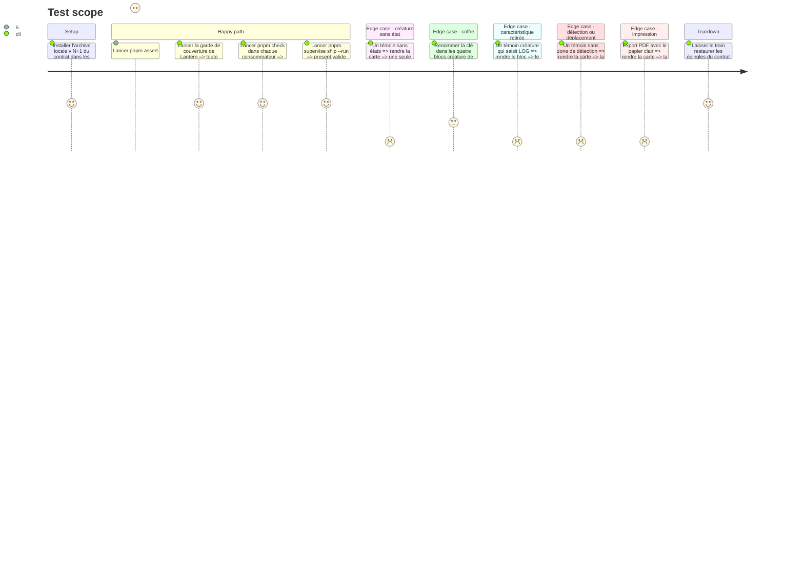

<!-- Fill or omit these sections; never add, rename, or reorder one. -->

# Instruction: Lantern et Handbook dessinent les cartes v<N+1>, puis le train part

## Architecture projection

> Tree of the final files. ✅ create · ✏️ modify · ❌ delete

```txt
obsidian-handbook/
├── src/
│   ├── features/
│   │   ├── adrenaline/
│   │   │   └── compactCard.ts                 ✏️ rangées publiées, en-tête d'état, ligne SP + état
│   │   └── adrenalineMonstre/
│   │       ├── schema.ts                      ✏️ lecture alignée sur le contrat créature
│   │       └── shape.ts                       ✏️ si une zone change
│   └── styles/
│       └── adrenaline/
│           ├── _short-sheet.scss              ✏️ grille à rangées, pastille, case à cocher
│           └── _monstre.scss                  ✏️ en-tête d'état
├── tools/
│   └── assertAdrenalineTheme.harness.mts      ✏️ affirmations de la maquette
├── supervisor/
│   └── trains/
│       └── <train des cartes>.json            ✅ écrit par le superviseur
├── CHANGELOG.md                               ✏️
└── package.json                               ✏️ version par pnpm version ; épingle du contrat par le train

lantern/
├── src/
│   ├── templates/
│   │   └── adrenaline/
│   │       ├── shared/
│   │       │   └── preview/
│   │       │       ├── CompactCard.tsx        ✏️ mêmes quatre écarts
│   │       │       └── compactCard.css        ✏️ lit le jeton de pastille
│   │       └── monstre/
│   │           ├── descriptor.ts              ✏️ le formulaire ne propose plus LOG, VOL ni CHA
│   │           ├── toml.ts                    ✏️ idem à l'écriture
│   │           └── sample.ts                  ✏️ si l'exemple publié change
│   └── i18n/
│       └── locales/
│           ├── fr/adrenaline.ts               ✏️ libellés, français d'abord
│           └── en/adrenaline.ts               ✏️
└── package.json                               ✏️ version ; épingle du contrat par le train
```

## User Journey



## Test Scope



## Wireframe

```txt
┌──────────────────────────────────────────────┐
│ (1) État : nom                          [x]   │
│     (o) déclencheur                           │
├──────────────────────────────────────────────┤
│ (2) FOR  %    CON  %    DEX  %    RAP  %      │
│     Zone de détection  m    PER  %   Dépl. m  │
├──────────────────────────────────────────────┤
│ (3) SP a / b / c / d        État  …           │
│     Malus  O O O  HS                          │
└──────────────────────────────────────────────┘
```

1. En-tête d'état : pastille ronde devant chaque déclencheur ; case à droite sur la grande carte seulement, cochée quand l'état actuel saisi est celui-ci.
2. Caractéristiques : les rangées publiées ; la deuxième aligne détection, PER, déplacement sur la grille de la première.
3. Santé : seuils et états permanents sur une ligne ; cercles de Malus saisis, puis « HS ».
4. Petite carte (non dessinée ici) : en-tête sans case, mêmes rangées, puis « Comportement et santé » en une section et « Équipement ».

## Tasks to do

### `1)` Handbook : rendu des quatre écarts

> La carte suit la présentation v<N+1>, sans règle locale.

1. `renderCompactRows` lit les rangées publiées ; plus de bloc `detection` ni `deplacement` attendu ; cellule sans valeur non imprimée ; aucun traitement local de LOG, VOL, CHA pour une créature ; `compactCard.ts` et `document.ts` lisent `armesPsychologiques` pour la créature et plus rien de mental pour le PNJ, sans alias de l'ancienne clé.
2. `renderStateHeader` : pastille devant chaque déclencheur ; sur la carte que la décoration publiée désigne, case à cocher (non interactive, reflète `etatActif`) à la place du texte « État actuel », libellé accessible conservé ; aucune case ailleurs.
3. Petite carte : la jonction publiée (portée par la section comportement, vers la section santé) imprime la santé d'abord puis le comportement sous le titre « Comportement et santé », sans la ligne de Malus ni les protections que la présentation réserve à la grande carte ; aucun regroupement décidé dans Handbook. La petite carte n'existe que si la déclaration de cartes publiée le dit (un état saisi en plus de la base) ; sinon la créature n'a qu'une carte et la section d'équipement s'y imprime, à son rang, par la carte de repli publiée. Aucune de ces règles n'est recopiée en dur : elles se lisent dans la présentation installée.
4. Ligne « SP » + « État » : la carte compacte apprend à lire `placement` (seule la fiche PJ le lit aujourd'hui, `adrenalinePj/renderer.ts`) et pose les deux blocs sur la rangée publiée ; valeurs telles que saisies.
5. SCSS : grille partagée par `@mixin` entre les rangées ; couleur de pastille par le jeton du pack ; toute règle sombre derrière `.theme-dark` ou `.brumes--colour-dark` (`pnpm assert:style-scope`).
6. Harnais : affirmer sur l'exemple Zy-2 l'ordre de la deuxième rangée, une case sur la grande carte et aucune sur la petite, la ligne « État », la section « Comportement et santé » de la petite carte.
7. Ligne « N actions par round » : elle est un `<p>` (`renderCombat`, `compactCard.ts`) et prend les marges de paragraphe d'Obsidian, d'où un vide au-dessus et au-dessous (constaté à l'aperçu du 2026-10-11) ; la rendre comme les autres lignes de la carte.

### `2)` Lantern : mêmes écarts

> Lantern et Handbook dessinent la même carte.

1. `CompactCard.tsx` et `compactCard.css` : mêmes quatre écarts, la petite carte et la carte unique lues dans la présentation comme dans Handbook (tâche 1, item 3), dont la lecture de `placement` que seul `PresentationBlocks.tsx` fait aujourd'hui ; le formulaire créature ne propose plus LOG, VOL ni CHA ; `AdrenalineFields.tsx`, `legacyRanges.ts` et `CompactCard.tsx` passent à `armesPsychologiques` pour la créature et retirent le champ du PNJ ; le jeton de pastille est lu par `var(...)`, ce que la garde de couverture exige.
2. Libellés par i18n, français d'abord, anglais ensuite.
3. « Partir de l'exemple » charge toujours l'exemple publié.

### `3)` Versions, journal, train

> Tout est contrôlé avant le départ.

1. Version de chaque consommateur par `pnpm version`, `CHANGELOG` avec le changement.
2. `rtk proxy pnpm build`, les deux lints, `pnpm check` dans chaque dépôt.
3. Ouvrir le train des cartes par le superviseur (fournisseur `schema-adrenaline`, consommateurs Lantern et Handbook), issue de coordination liée à #101.
4. `pnpm supervise ship --message "<message>" --run` ; verdict de rendu contre `monstre.jpg` et `pnj.jpg` ; puis constat d'arrivée.
5. Cocher #101 §2 : en-tête d'état, « Insensible », détection et déplacement.

### `4)` Coffre Zombiology : repasser sur les blocs et les modèles

> Le TOML change avec le contrat : les notes écrites avant ne sont plus à jour. Décidé le 2026-10-11 : la mise en place générale passe d'abord ; le TOML de chaque coffre se reprend ensuite au cas par cas, après l'arrivée du train. `terre-contre-fer` est une adaptation : elle suivra une variante de pack et n'est pas ressaisie au gabarit du livre de base (sa note a été remise dans son état d'origine).

1. Déployer le plugin publié dans le coffre (`C:/Users/fxgui/Documents/Perso/RPG/zombiology`), sans toucher à son `data.json`.
2. Relever chaque bloc `adrenaline-monstre` et `adrenaline-pnj` du coffre par recherche, modèles compris (`template_pnj.md`, `Handbook - Test cartes compactes.md`, `Test Handbook — Adrenaline.md` à la racine) ; laisser `aidd_docs/` du coffre, qui garde des copies d'archive.
3. Appliquer les ruptures de v<N+1> : `armesMentales` devient `armesPsychologiques` dans les blocs créature ; LOG, VOL, CHA et `armesMentales` ne restent dans aucun bloc où le contrat les refuse ; détection et déplacement gardent leurs valeurs saisies.
4. Régénérer les modèles de bloc depuis le modèle Lantern publié plutôt que les retoucher à la main, pour qu'ils portent la forme courante du TOML.
5. Ressaisir les blocs créature qui ne suivent pas le gabarit du livre de base (p. 94 à 101 : grande carte « Stimulé », petite carte « Non stimulé (type de corps) ») : la base porte le profil non stimulé, un seul état « Stimulé » est l'état principal. « Rôdeur accordé » (`3. attention-au-depart/scenario/03-acte-i.md`) est le cas constaté : sa base porte le profil stimulé et ses trois états (« Accordé », « Figé », « Au froid ») sont des circonstances de scénario ; elles passent en traits spéciaux ou en texte de la scène, valeurs telles qu'écrites. Relevé du 2026-10-11 (16 blocs créature hors `aidd_docs/`, 10 à ressaisir) : états de circonstance sur une base stimulée — « Rôdeur accordé », « Traqueur détaché » (`3. attention-au-depart`, actes I et II) ; gabarit inversé, « Non stimulé » saisi comme état — « Revenu de cohorte » (`3. viventes-te-salutant`, `03-acte-i.md` et `PAJ1.md`), « Mort de Nagasaki » (`4. croisiere-sans-fin`) ; ancienne forme `etatAlternatif` — « Homme-bête », « Commandeur spectral », « Vampire ailé » (`terre-contre-fer`, `05-08-mecaniques-des-tenebres.md`) ; incomplets, sans `etatDeBase` ni `etatPrincipal` — « Rôdeur » et « Le Guetteur du silo » des deux bancs d'essai. Au même passage, les états écrits en `traitsSpeciaux` (« État Insensible. ») se ressaisissent en `etatsPermanents` quand ce sont de simples permanents.
6. Recharger le plugin et ouvrir chaque note touchée : aucun bloc refusé, aucun avertissement de clé inconnue.

## Test acceptance criteria

| Task | Acceptance criteria |
| ---- | ------------------- |
| 1 | Sur l'exemple Zy-2, la grande carte affiche « Zone de détection », PER et « Dépl. » sur la deuxième rangée dans cet ordre, alignés sur la grille des quatre caractéristiques. |
| 1 | La grande carte porte une case d'état, cochée quand `etatActif` désigne son état ; la petite n'en porte pas ; chaque déclencheur est précédé d'une pastille dont la couleur vient du jeton du pack. |
| 1 | La petite carte affiche une section « Comportement et santé » puis « Équipement », sans section « Santé » ni « Comportement » séparée. |
| 1 | Une créature sans état en plus de sa base se rend en une seule carte, qui porte son équipement ; sur la petite carte la santé précède le comportement et ni Malus ni protections n'y figurent. |
| 1 | « État Insensible » s'affiche sur la ligne des seuils ; les cercles de Malus et « HS » restent inchangés. |
| 1 | `pnpm assert:style-scope` et `pnpm assert:adrenaline-theme` sont verts ; à l'export PDF clair la carte reste lisible. |
| 2 | La garde de couverture de Lantern est verte ; l'aperçu Lantern et le rendu Handbook de l'exemple Zy-2 montrent les mêmes régions dans le même ordre. |
| 4 | Dans le coffre Zombiology, chaque bloc créature et PNJ hors `aidd_docs/` se rend sans refus, et `template_pnj.md` produit un bloc valide en v<N+1>. |
| 3 | `present` est vert, l'utilisateur valide le rendu, le train se clôt, et aucun `package.json` ne garde un chemin d'archive locale. |
