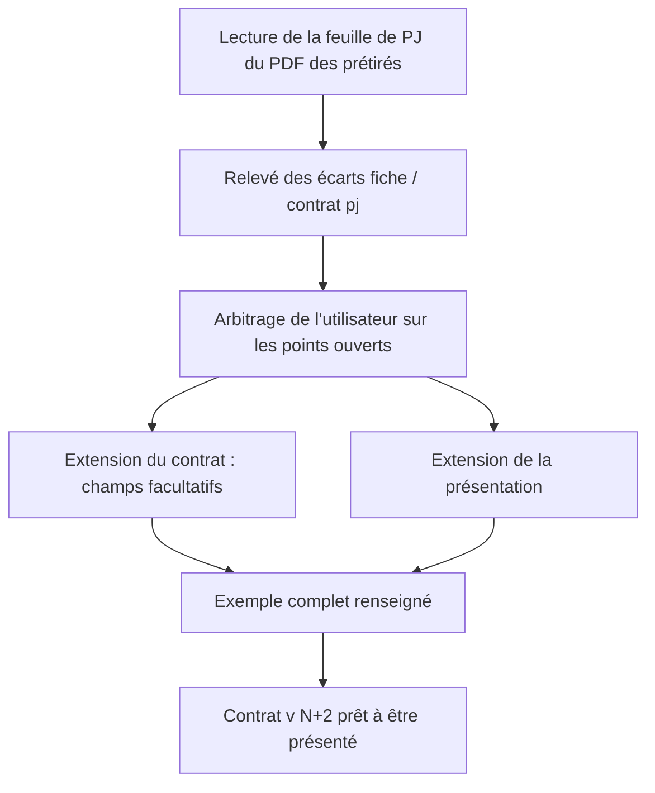
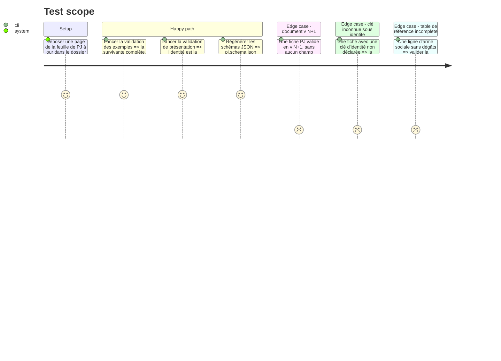

<!-- Fill or omit these sections; never add, rename, or reorder one. -->

# Instruction: Contrat v<N+2> — fiche PJ

## Architecture projection

> Tree of the final files. ✅ create · ✏️ modify · ❌ delete

```txt
schema-adrenaline/
├── aidd_docs/
│   └── tasks/
│       └── <dossier de la fiche PJ>/
│           ├── fiche-pj-a-jour.jpg              ✅ une page « Feuille de PJ » extraite du PDF des prétirés (référence versionnée)
│           └── ecarts-fiche-pj.md               ✅ relevé fiche à jour / contrat pj
├── src/
│   ├── zod/
│   │   ├── adrenaline/
│   │   │   └── pj.ts                            ✏️ parametresDuJeu.scenario
│   │   └── common/
│   │       ├── identite.ts                      ✏️ contraintes, historique, personnalite
│   │       └── etat-de-partie.ts                ✏️ seulement si le relevé montre un champ de blessure manquant
│   └── presentation.ts                          ✏️ PJ_PRESENTATION : en-tête, identité escamotable en fin, armes sociales, localisations, caractère, blessures, lignes
├── schemas/
│   └── adrenaline/
│       └── pj.schema.json                       ✏️ régénéré, jamais édité à la main
├── examples/
│   └── adrenaline/
│       └── pj/
│           ├── survivante-complete.toml         ✏️ renseigne les nouveaux champs
│           └── figurant-minimal.toml            ✏️ seulement si un champ devient requis (aucun ne le devient)
├── tools/
│   └── validate-presentation.ts                 ✏️ règles de la table de référence et des lignes imprimées
├── docs/
│   └── images/                                  ✏️ captures de la fiche, refaites après la phase 6
├── CHANGELOG.md                                 ✏️ section v<N+2>
└── package.json                                 ✏️ version v<N+2>, par l'outil de préparation de release
```

## User Journey



## Test Scope



## Wireframe

```txt
┌────────────────────────────────────────────────────────────────┐
│ (1) Nom du personnage                                           │
│ (2) Joueuse/Joueur · Type de création · Format · Scénario · PX  │
├────────────────────────────────────────────────────────────────┤
│ (3) Formations et compétences (trois colonnes)                  │
├───────────────────────────────┬────────────────────────────────┤
│ (4) Caractéristiques           │ (5) Localisations corporelles  │
│                                │     (d10) et émotionnelles     │
│                                │ (6) Caractère                  │
├───────────────────────────────┴────────────────────────────────┤
│ (7) Possessions (+1 ou 2 lignes) │ (8) Armes physiques (+1 ou 2)│
│ (9) Armes sociales : table compacte, à la place d'Armes mentales│
│     * note en tête                                              │
│     Armes sociales │ Dégâts │ Propriétés          (7 lignes)    │
│     légende : jaune = Choquante · rouge = Blessante             │
│ (10) Protections physiques et mentales                          │
├────────────────────────────────────────────────────────────────┤
│ (11) Santé : stress · seuils à quatre niveaux                   │
│      blessures par durée : heure │ jour │ semaine │ mois        │
│      choc · divers · total des malus                            │
├────────────────────────────────────────────────────────────────┤
│ (12) ▸ Identité (escamotable, fin de bloc)                      │
│      champs d'identité · contraintes (pro, famille,             │
│      engagements extérieurs) · historique · personnalité        │
└────────────────────────────────────────────────────────────────┘
```

1. Nom : carte de nom, inchangée.
2. Paramètres de jeu : le format (one-shot ou campagne) reste ; un champ texte facultatif « Scénario » le suit sur la ligne centrale.
3. Formations : inchangées.
4. Caractéristiques : occupent la place libérée par l'ancien tableau d'identité.
5. Localisations : les six corporelles sur leur d10, les six émotionnelles.
6. Caractère : le pendant mental de l'armure (trait, dés, points, émotions).
7. Possessions : autant de lignes qu'il en faut pour aligner le bloc sur (9).
8. Armes physiques : même règle.
9. Armes sociales : table de règles publiée ; #101 la met à la place des lignes libres « Armes mentales » que la feuille montre encore ; le champ `armesMentales` sort du contrat PJ.
10. Protections : inchangées ; « Avantages et immunités » reste à sa place.
11. Santé : recopie de la feuille — deux cadres de blessures (physiques, mentales), chacun en deux colonnes de quatre cercles heure, jour, semaine, mois ; choc en cinq cercles « round » ; divers en quatre cercles ; total de 1 à 9 puis « HS ».
12. Identité : section finale escamotable, fermée par défaut (« meneur », son ancien modèle, n'est plus repliée sur la créature et le PNJ ; l'identité du PJ le reste).

La place exacte de (4) à (6) et de (11) se cale sur la feuille du PDF : compétences avant caractéristiques, dés de stress à droite des caractéristiques, localisations et caractère sous les protections de l'équipement. Ce croquis ne fixe que ce que #101 ajoute.

## Tasks to do

### `1)` Relevé des écarts et arbitrages (préalable bloquant)

> Rien n'est étendu avant que la fiche à jour ait été lue ligne à ligne.

1. Lire la feuille de PJ de `_sources/aides-de-jeu/Z1A01_Feuille de PJ pretires.pdf` (coffre Zombiology) et en déposer une page dans le dossier de tâche ; lire aussi la page de portrait (description physique, historique).
2. Écrire `ecarts-fiche-pj.md` : pour chaque zone de la fiche, le champ du contrat `pj` et le bloc de `PJ_PRESENTATION` qui la portent, ou « absent », ou « présent au contrat, absent de la fiche ». Écarts déjà vus à confirmer : les dés de stress sont à côté des caractéristiques sur la feuille, dans la santé sur la présentation ; le choc a cinq cercles « round » sur la feuille, deux groupes (rounds, heures) sur la présentation ; le total des malus va de 1 à 9 puis « HS » sur la feuille, de 1 à 10 sur la présentation ; « Avantages et immunités » est un bloc de l'équipement sur la feuille, absent de la présentation ; les blessures par durée n'ont aucun bloc publié ; les localisations cochées et le caractère sont à vérifier dans `protection-lines`.
3. Arbitrages déjà rendus (tableau Decisions du plan) : les dés de la table des armes sociales sont tous jaunes, le rouge ne figure qu'en légende ; identité fermée par défaut ; champ « Scénario » ; nombre de lignes réglé par l'alignement ; blessures recopiées de la feuille ; la feuille fait foi sur la présentation publiée. La section Identité garde tous les champs de l'ancien tableau. `equipement.armesMentales` sort du contrat PJ, bien que la feuille imprime encore la colonne : la table des armes sociales prend sa place. Il ne reste aucun arbitrage ouvert.
4. Faire arbitrer ces points par l'utilisateur (design et fonctionnel sont ses décisions) et les reporter au tableau Decisions du plan.

### `2)` Contrat : champs ajoutés

> Uniquement des champs facultatifs ; un seul retrait, `equipement.armesMentales` du PJ (décision du 2026-10-12, tableau Decisions du plan).

1. Retirer `armesMentales` de l'équipement du PJ et son bloc de `PJ_PRESENTATION` ; l'exemple `pj/survivante-complete.toml` perd ses lignes ; rupture au `CHANGELOG`.
1. `parametresDuJeu.scenario` : texte facultatif, libellé « Scénario » ; `typeDeScenario` inchangé ; `declinaisonDeCampagne` reste déclaré.
2. `identite.contraintes` (professionnelles, familiales, engagements extérieurs), `identite.historique`, `identite.personnalite` : textes facultatifs, descriptions en français.
3. Blessures, localisations, caractère, stress : `etatDePartie` et `protections` déclarent déjà choc, divers, localisations et caractère ; n'ajouter un champ que si le relevé montre un manque ; le total reste saisi.
4. Régénérer les schémas JSON par l'outil du dépôt.

### `3)` Présentation PJ

> La fiche publiée suit la fiche à jour.

1. En-tête : ajouter le libellé de ligne « Scénario » aux paramètres de jeu, après le format.
2. Section `identite` : dernier ordre, `collapsible: true`, fermée par défaut (publier l'état par défaut si le type de section ne le porte pas), sortie de la rangée `profil` ; blocs pour les champs d'identité, les contraintes, l'historique, la personnalité ; la section `caracteristique` reprend la largeur libérée.
3. Armes sociales : nouvelle forme de table de référence publiée avec sa note, ses trois colonnes, ses sept lignes (texte de #101 §3), la nature des dés (choquante ou blessante) et la légende ; elle remplace le bloc des armes mentales dans la section équipement, selon l'arbitrage de la tâche 1.
4. Possessions et armes physiques : publier le nombre de lignes imprimées qui aligne les deux blocs sur le bas de la table des armes sociales ; ce nombre se fixe au rendu de la phase 6 et se reporte ici.
5. Localisations et caractère : selon le relevé, compléter `protection-lines` ou publier des blocs dédiés lisant `protections` ; aucun bloc neuf si la forme existante les imprime déjà.
6. Santé : blocs neufs recopiant la feuille pour les blessures physiques et mentales (deux colonnes de quatre cercles heure, jour, semaine, mois) ; choc en cinq cercles « round », divers en quatre cercles, total de 1 à 9 puis « HS », dés de stress à côté des caractéristiques, bloc « Avantages et immunités » dans l'équipement ; seuils à quatre niveaux vérifiés contre la fiche.
7. Étendre `validate-presentation.ts` aux nouvelles formes ; toute forme nouvelle entre dans la liste fermée des formes.

### `4)` Exemples, version, preuves

> Le contrat v<N+2> est prêt à être présenté.

1. `survivante-complete.toml` renseigne chaque champ nouveau ; `figurant-minimal.toml` reste minimal et valide.
2. Version par l'outil de préparation, section v<N+2> du `CHANGELOG` (dont la marche à suivre pour ressaisir une arme sociale libre).
3. Suite complète du dépôt verte ; archive locale pour la phase 6 ; rien n'est publié hors train.

## Test acceptance criteria

| Task | Acceptance criteria |
| ---- | ------------------- |
| 1 | `ecarts-fiche-pj.md` couvre chaque zone de la fiche à jour et chaque champ du contrat `pj` ; chaque point ouvert a une décision de l'utilisateur inscrite au plan. |
| 2 | Une fiche PJ valide en v<N+1> est valide en v<N+2> sans modification ; une fiche portant le scénario, les trois contraintes, l'historique et la personnalité est valide ; une clé d'identité non déclarée est refusée et nommée. |
| 3 | Dans la présentation PJ, l'identité est la dernière section et elle est escamotable ; la table des armes sociales publie la note, trois colonnes, sept lignes de Bluff à Séduction et la légende jaune et rouge. |
| 3 | Chaque zone de la feuille relevée dans `ecarts-fiche-pj.md` nomme le bloc publié qui la porte : localisations corporelles et émotionnelles, caractère, blessures physiques et mentales par durée, choc, divers, total. |
| 4 | La suite complète du dépôt est verte et l'archive locale porte la version v<N+2> lue dans `package.json`. |
