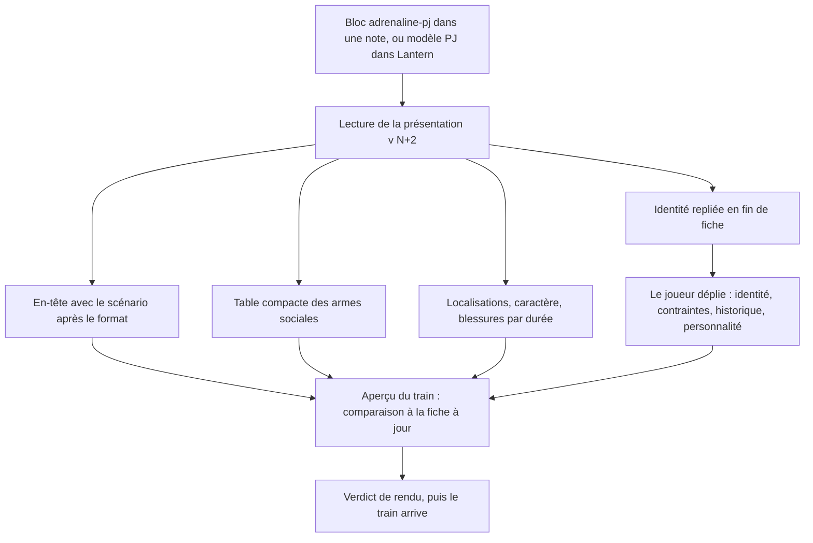
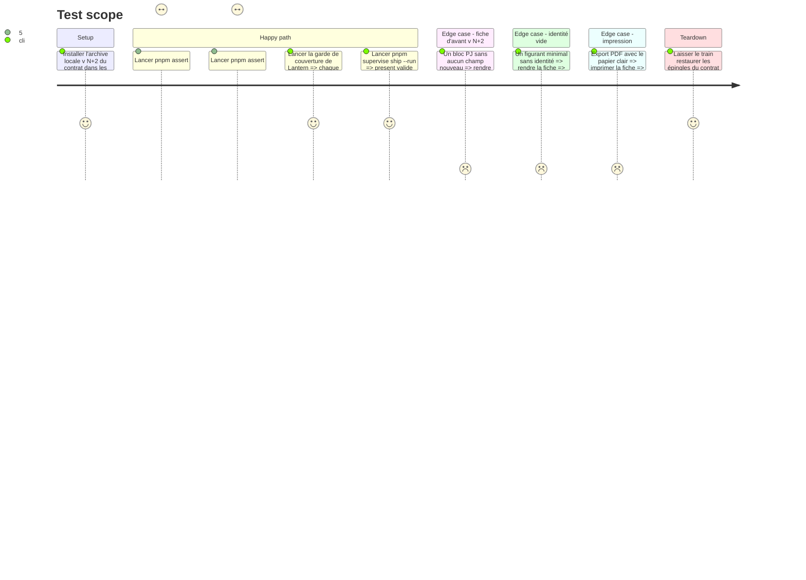

<!-- Fill or omit these sections; never add, rename, or reorder one. -->

# Instruction: Lantern et Handbook dessinent la fiche PJ v<N+2>, puis le train part

## Architecture projection

> Tree of the final files. ✅ create · ✏️ modify · ❌ delete

```txt
obsidian-handbook/
├── src/
│   ├── features/
│   │   └── adrenalinePj/
│   │       ├── renderer.ts                    ✏️ section escamotable, table des armes sociales, nouveaux blocs
│   │       ├── schema.ts                      ✏️ lecture des champs ajoutés
│   │       └── shape.ts                       ✏️ si une zone change
│   └── styles/
│       └── adrenaline/                        ✏️ feuille PJ : table compacte, surlignages, section finale
├── tools/
│   ├── assertAdrenalineTheme.harness.mts      ✏️ affirmations de la fiche
│   └── assertAdrenalineDocuments.harness.mts  ✏️ champs ajoutés
├── supervisor/
│   └── trains/
│       └── <train de la fiche PJ>.json        ✅ écrit par le superviseur
├── CHANGELOG.md                               ✏️
└── package.json                               ✏️ version par pnpm version ; épingle par le train

lantern/
├── src/
│   ├── templates/
│   │   └── adrenaline/
│   │       ├── shared/
│   │       │   ├── sections.ts                ✏️ ordre des sections PJ
│   │       │   └── preview/
│   │       │       ├── PresentationBlocks.tsx ✏️ nouvelles formes
│   │       │       └── presentationSheet.css  ✏️
│   │       └── pj/
│   │           ├── descriptor.ts              ✏️ champs ajoutés au formulaire
│   │           ├── sample.ts                  ✏️
│   │           └── toml.ts                    ✏️
│   └── i18n/
│       └── locales/
│           ├── fr/adrenaline.ts               ✏️ français d'abord
│           └── en/adrenaline.ts               ✏️
└── package.json                               ✏️ version ; épingle par le train

schema-adrenaline/
└── docs/
    └── images/
        ├── handbook-fiche-pj.png              ✏️ refaite après le verdict de rendu
        └── lantern-fiche-pj.png               ✏️ refaite après le verdict de rendu
```

## User Journey



## Test Scope



## Wireframe

```txt
┌────────────────────────────────────────────────────────────────┐
│ (1) Joueuse/Joueur │ Création │ Format │ Scénario    │ PX       │
├────────────────────────────────────────────────────────────────┤
│ (2) * note                                                      │
│     Armes sociales │ Dégâts  │ Propriétés                       │
│     Bluff          │ [1d10]  │ Influence                        │
│     …              │ …       │ …                (7 lignes)      │
│     légende : [jaune] Choquante · [rouge] Blessante             │
├────────────────────────────────────────────────────────────────┤
│ (3) Blessures │ heure │ jour │ semaine │ mois │                 │
│     Choc · Divers · Total des malus                             │
├────────────────────────────────────────────────────────────────┤
│ (4) ▸ Identité                                                  │
│     ┌────────────────────────────────────────────────────────┐ │
│     │ champs d'identité (rangées publiées)                    │ │
│     │ Contraintes : pro · famille · engagements extérieurs    │ │
│     │ Historique                                              │ │
│     │ Personnalité                                            │ │
│     └────────────────────────────────────────────────────────┘ │
└────────────────────────────────────────────────────────────────┘
```

1. En-tête : le scénario après le format, sur la ligne centrale.
2. Armes sociales : table très compacte, dés surlignés selon leur nature, légende en pied.
3. Blessures : une colonne par durée, puis choc, divers et total saisi.
4. Identité : élément repliable en fin de fiche, fermé par défaut, comme « meneur » sur la carte PNJ.

## Tasks to do

### `1)` Handbook : fiche PJ

> La fiche suit la présentation v<N+2>.

1. `renderSection` : une section `collapsible` devient un élément repliable avec son titre, comme `renderCompactSection` le fait déjà ; fermé par défaut ; rien d'imprimé si tous ses blocs sont vides.
2. Rendus à écrire ou à compléter, selon ce que la phase 5 a publié : table des armes sociales (lue dans la présentation, aucune ligne codée localement), blessures par durée, localisations et caractère, ligne « Scénario » des paramètres de jeu, lignes supplémentaires des possessions et des armes physiques ; un bloc que la phase 5 a laissé inchangé n'est pas retouché.
3. `schema.ts` : lecture des champs ajoutés ; un bloc d'avant v<N+2> se lit sans avertissement.
4. SCSS : table compacte et surlignages par jetons du pack ; géométries partagées par `@mixin` ; impression : section Identité dépliée, papier clair (`_print.scss`, `pnpm assert:style-scope`).
5. Harnais : la garde de couverture de la phase 1 doit passer d'elle-même sur les formes nouvelles ; ajouter les affirmations de la fiche sur l'exemple publié `survivante-complete.toml` (aucun témoin PJ local : le corpus appartient au contrat).

### `2)` Lantern : fiche PJ

> Même fiche, et un formulaire qui saisit les champs ajoutés.

1. `PresentationBlocks.tsx` et `presentationSheet.css` : mêmes formes ; la garde de couverture l'exige.
2. `descriptor.ts`, `toml.ts`, `sample.ts` : scénario, contraintes, historique, personnalité ; aller-retour TOML sans perte.
3. Régler le nombre de lignes des possessions et des armes physiques sur l'alignement avec la table des armes sociales, et le reporter dans la présentation avant le départ du train.
4. `sections.ts` : identité en dernier ; libellés i18n, français d'abord.

### `3)` Versions, journal, train

> Tout est contrôlé avant le départ.

1. Version de chaque consommateur par `pnpm version`, `CHANGELOG` avec le changement.
2. `rtk proxy pnpm build`, les deux lints, `pnpm check` dans chaque dépôt.
3. Ouvrir le train de la fiche PJ par le superviseur, issue de coordination liée à #101.
4. `pnpm supervise ship --message "<message>" --run` ; verdict de rendu contre la feuille de PJ du PDF des prétirés et la capture #74 ; puis constat d'arrivée.
5. Refaire les deux captures de `schema-adrenaline/docs/images/` ; mettre à jour la note mémoire sur la référence PJ ; cocher #101 §3.

### `4)` Coffre Zombiology : repasser sur les blocs et les modèles

> Le TOML change avec le contrat : les notes écrites avant ne sont plus à jour. Ce passage suit l'arrivée du train, il n'en fait pas partie.

1. Déployer le plugin publié dans le coffre (`C:/Users/fxgui/Documents/Perso/RPG/zombiology`), sans toucher à son `data.json`.
2. Relever chaque bloc `adrenaline-pj` du coffre par recherche, modèles compris (`template_pnj.md`, `Handbook - Test cartes compactes.md`, `Test Handbook — Adrenaline.md` à la racine) ; laisser `aidd_docs/` du coffre, qui garde des copies d'archive.
3. Appliquer les ruptures de v<N+2> : lister à l'utilisateur les valeurs `armesMentales` des douze blocs PJ (`07-pretires-2.md`, `PAJ1.md`) avant de les retirer — ce sont ses notes, il dit où va chaque valeur ; ajouter les champs nouveaux seulement là où il les saisit.
4. Régénérer les modèles de bloc depuis le modèle Lantern publié plutôt que les retoucher à la main, pour qu'ils portent la forme courante du TOML.
5. Recharger le plugin et ouvrir chaque note touchée : aucun bloc refusé, aucun avertissement de clé inconnue.

## Test acceptance criteria

| Task | Acceptance criteria |
| ---- | ------------------- |
| 1 | Sur l'exemple complet, la fiche Handbook affiche l'identité en dernière section, repliable, contenant les contraintes, l'historique et la personnalité ; plus aucun tableau d'identité en haut. |
| 1 | La table des armes sociales affiche la note, trois colonnes, sept lignes et la légende ; les dés sont surlignés en jaune ou en rouge selon la nature publiée ; aucune de ces lignes n'est écrite dans le code de Handbook. |
| 1 | Un bloc PJ antérieur à v<N+2> qui ne saisit pas `armesMentales` s'affiche sans erreur ni avertissement ; un figurant sans identité n'imprime pas de section Identité. |
| 1 | À l'export PDF clair, la section Identité est imprimée dépliée et `pnpm assert:style-scope` est vert. |
| 2 | La garde de couverture de Lantern est verte ; un PJ saisi dans Lantern avec les champs ajoutés ressort en TOML puis se relit à l'identique. |
| 4 | Dans le coffre Zombiology, chaque bloc PJ hors `aidd_docs/` se rend sans refus, et aucun ne porte `armesMentales`. |
| 3 | `present` est vert, l'utilisateur valide le rendu contre la fiche à jour, le train se clôt, et aucun `package.json` ne garde un chemin d'archive locale. |
