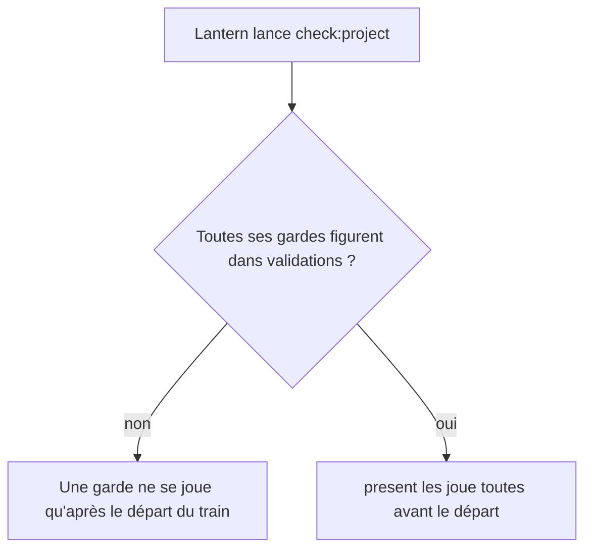
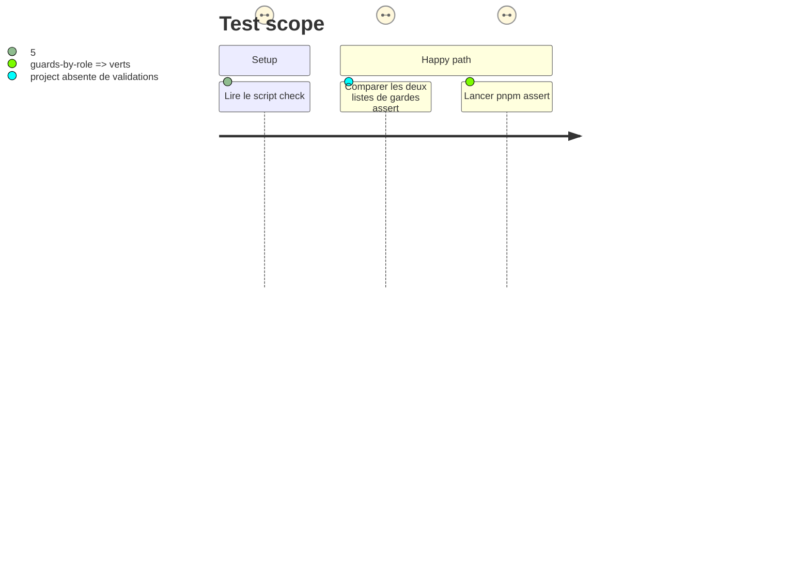

<!-- Fill or omit these sections; never add, rename, or reorder one. -->

# Instruction: Validations de la topologie : deux gardes de Lantern

## Architecture projection

> Tree of the final files. ✅ create · ✏️ modify · ❌ delete

```txt
.
└── supervisor/topology.json   ✏️ `validations` de Lantern : ajouter `assert:block-templates` et `assert:adrenaline-pj`
```

## User Journey



## Test Scope



## Tasks to do

### `1)` Écart

> Dresser la liste des gardes jouées par Lantern et absentes de la topologie, sans la présumer.

1. Lire `lantern/package.json` (`check:project`) et la liste `validations` de `lantern` dans `supervisor/topology.json`.
2. Noter chaque `assert:*` de `check:project` absent de `validations` (attendus : `assert:block-templates`, `assert:adrenaline-pj`).

### `2)` Topologie

> Tout se contrôle avant le départ : une garde d'un dépôt se joue dans `present`.

1. Jouer chaque garde manquante une fois dans `lantern` avant de l'ajouter (une garde rouge ferait rougir `present` du train suivant ; une garde rouge se signale, elle ne s'ajoute pas). Constat de départ : `assert:block-templates` et `assert:adrenaline-pj` sortent verts, sans prérequis de build.
2. Ajouter à `validations` de `lantern` une commande `npm run <garde>` par garde manquante, à la place que `check:project` leur donne : `assert:block-templates` après `assert:workspace`, `assert:adrenaline-pj` après `assert:adrenaline-coverage`.
3. Ne pas toucher à `convergence`, ni à `supervisor/trains/`, ni à `tools/supervisor/guard/`.

### `3)` Preuve

> Les harnais du superviseur et des gardes par rôle restent verts avec la nouvelle liste.

1. `pnpm assert:supervisor` et `pnpm assert:guards-by-role`.
2. `rtk proxy pnpm check` exit 0.

## Test acceptance criteria

| Task | Acceptance criteria |
| ---- | ------------------- |
| 1    | La liste des gardes absentes est écrite dans le journal d'exécution, avant toute modification. |
| 2    | Chaque `assert:*` de `check:project` de Lantern figure dans ses `validations` ; `supervisor/trains/` et les gardes n'ont aucun diff. |
| 3    | `assert:supervisor`, `assert:guards-by-role` et `pnpm check` sont verts. |
