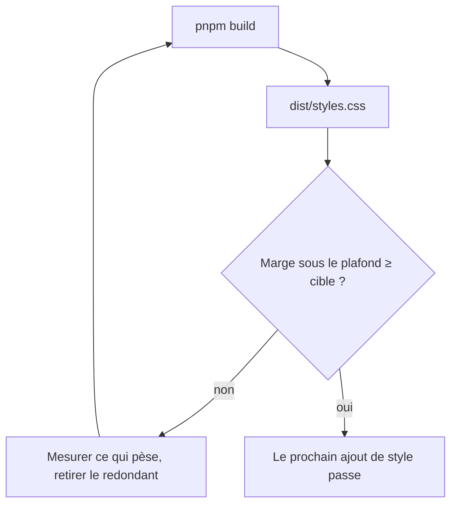
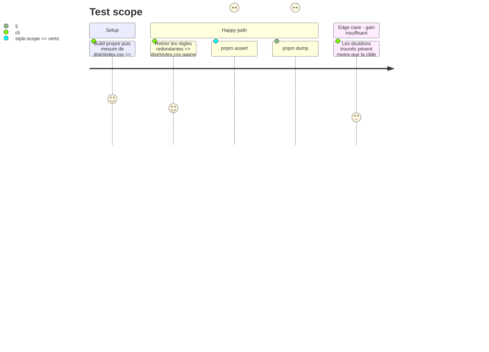

<!-- Fill or omit these sections; never add, rename, or reorder one. -->

# Instruction: Marge du plafond de `dist/styles.css`

## Architecture projection

> Tree of the final files. ✅ create · ✏️ modify · ❌ delete

```txt
.
└── src/styles/                  ✏️ règles redondantes ou mortes, repérées par mesure (surtout `adrenaline/`, 62 Ko de SCSS, et les blocs qui se répètent par jeu)
```

## User Journey



## Test Scope



## Tasks to do

### `1)` Mesure

> On ne retire que ce qu'on a mesuré.

1. Relever la taille de `dist/styles.css` et la marge au plafond que lit `assert:mist-font-packs`.
2. Isoler le poids par dossier de style (la feuille est déjà minifiée par `pnpm build` : on mesure donc le compilé, pas la source) et repérer les blocs de déclarations identiques d'une règle à l'autre, jamais par copie de valeurs.

### `2)` Réduction

> Une règle visible ne disparaît jamais pour gagner des octets.

1. Leviers qui réduisent le CSS **compilé** : regrouper en liste de sélecteurs les blocs de déclarations identiques, factoriser un préfixe de sélecteur répété (`:is(.brumes--city-of-mist,.brumes--legend-in-the-mist)`), supprimer les règles dont aucune classe n'est écrite par `src/**/*.ts` ni par les gabarits publiés. Un `@mixin` ne réduit que la source : il se développe en CSS identique, donc il ne compte pas comme gain (il reste le bon outil pour ne pas copier une géométrie, pas pour gagner des octets).
2. Une classe n'est déclarée morte qu'après recherche dans `src/`, dans les packs (`packs/`, `schemas/`) et dans le paquet publié installé (`node_modules/schema-*`) : une classe construite par concaténation (`${CARD}__…`) est vivante tant que son préfixe l'est.
3. Refaire la mesure après chaque lot ; viser une marge de 2 000 octets.
4. Garder derrière `.theme-dark` ou `.brumes--colour-dark` toute règle sombre statique.
5. Verdict de la mesure (2026-10-14) : `dist/styles.css` pèse 159 920 octets, soit 80 octets sous le plafond ; 910 règles. Le regroupement de déclarations identiques ne gagne que ~210 octets une fois exclus les regroupements qui déplaceraient une règle au-delà d'une règle voisine qui fixe la même propriété (~2 810 octets en théorie, mais l'ordre de la cascade n'est alors plus garanti). Les ~2 900 octets de règles dont la classe n'est écrite littéralement nulle part sont tous des classes construites par concaténation à partir d'énumérations publiées (`__form-<forme>`, `__layout-<disposition>`, `--values-<alignement>`, `--surface-<surface>`, `--tag-<genre>`, `--move-<genre>`) : leur non-usage n'est pas prouvable depuis ce dépôt. Aucune règle n'est donc retirée et aucun style n'est modifié ; la cible de 2 000 octets n'est pas atteinte.

### `3)` Preuve

> Le rendu ne bouge pas : `dump:dom` ne voit que le DOM, jamais le CSS, il ne suffit donc pas.

1. Avant le lot, sauvegarder `dist/styles.css` hors dépôt (dossier temporaire de session) ; après le lot, comparer les deux feuilles par un script jetable : pour chaque couple (sélecteur, déclarations) de l'ancienne feuille, le même couple existe dans la nouvelle, sauf les règles listées comme mortes avec leur preuve de non-usage (task 2.2). Le script n'entre pas dans le dépôt.
2. `pnpm dump:dom` avant et après : DOM identique (garde les classes écrites par le TypeScript).
3. `rtk proxy pnpm build`, `pnpm assert:mist-font-packs`, `pnpm assert:style-scope`, `pnpm check`.

## Test acceptance criteria

| Task | Acceptance criteria |
| ---- | ------------------- |
| 1    | La taille de départ, la marge et les trois dossiers les plus lourds sont consignés. |
| 2    | `dist/styles.css` est au moins 2 000 octets plus léger ; le plafond de la garde n'est pas modifié. |
| 3    | La comparaison (sélecteur, déclarations) ne montre aucune règle perdue hors règles mortes prouvées ; `dump:dom` ne diffère pas, `assert:mist-font-packs` et `assert:style-scope` passent, `pnpm check` est vert. |
