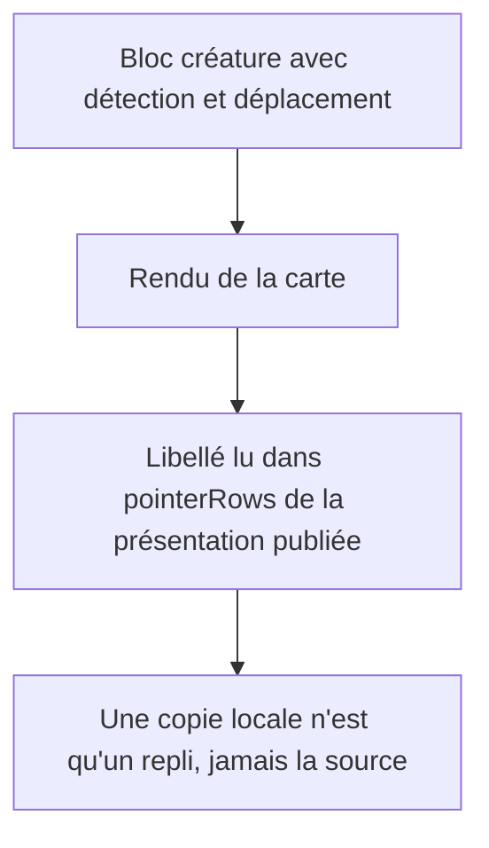
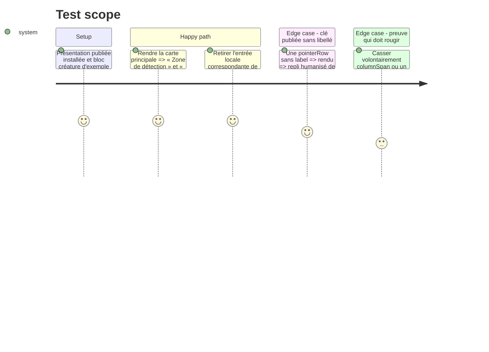

<!-- Fill or omit these sections; never add, rename, or reorder one. -->

# Instruction: Libellés recopiés et preuves de rendu manquantes

## Architecture projection

> Tree of the final files. ✅ create · ✏️ modify · ❌ delete

```txt
.
├── src/features/adrenaline/compactCard.ts    ✏️ `FIELD_LABELS` : retirer les entrées que la présentation publiée porte déjà
└── tools/assertAdrenalineTheme.harness.mts   ✏️ témoins : libellé publié lu, case d'un état, contrôles des caractéristiques d'un état
```

## User Journey



## Test Scope



## Tasks to do

### `1)` Libellés

> Un libellé que la présentation publie se lit dans la présentation.

1. Pour chaque clé de `FIELD_LABELS`, chercher si la présentation publiée la porte (`label` d'un pointeur de `pointerRows`) ; relevé de départ : `zoneDeDetection` et `deplacement` sont publiés avec un libellé, `malusAvantHs` n'est publié que comme chemin (`paths`, sans libellé : il reste), et les clés de fiche (`possessions`, `armesPhysiques`, `role`…) ne le sont pas.
2. Retirer les entrées publiées, garder les autres : le commentaire « labels the published presentation leaves to the consumer » doit rester vrai.
3. Si une entrée publiée est encore atteinte par le repli (`humanize`), le dire et ne pas la retirer.

### `2)` Preuves

> Une preuve qui n'a jamais rougi ne prouve rien.

1. Pour `columnSpan` et pour les contrôles des caractéristiques d'un état : casser le rendu (supprimer la classe ou le contrôle) et lancer `pnpm assert:adrenaline-theme`.
2. Un harnais qui reste vert reçoit un témoin ; un harnais qui rougit est déjà une preuve, rien à ajouter. Aucune fixture ne porte `niveauDeDangerNote` : y ajouter l'astérisque de la note du ND dans le même passage.
3. Rétablir le rendu après chaque mutation et vérifier `git diff` : seul le harnais change.

### `3)` Porte

> Le harnais affirme un rôle, jamais un chiffre.

1. `rtk proxy pnpm build`, `./node_modules/.bin/eslint src --ext .ts`, `pnpm lint`, `pnpm assert:adrenaline-theme`, `pnpm check`.

## Test acceptance criteria

| Task | Acceptance criteria |
| ---- | ------------------- |
| 1    | Aucune entrée de `FIELD_LABELS` ne double un libellé publié ; la carte imprime les mêmes textes qu'avant (`pnpm dump:dom` avant/après et harnais `assert:adrenaline-theme`). |
| 2    | Chaque mutation (classe `col-span`, contrôle d'un état, astérisque du ND) rougit au moins un harnais, et le rendu rétabli le fait repasser au vert. |
| 3    | Build, lint (deux portées) et `pnpm check` sont verts. |
