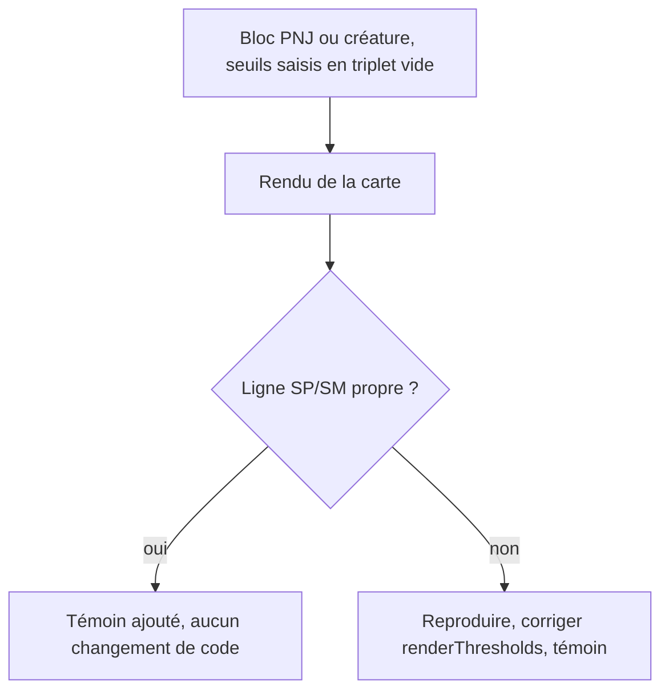
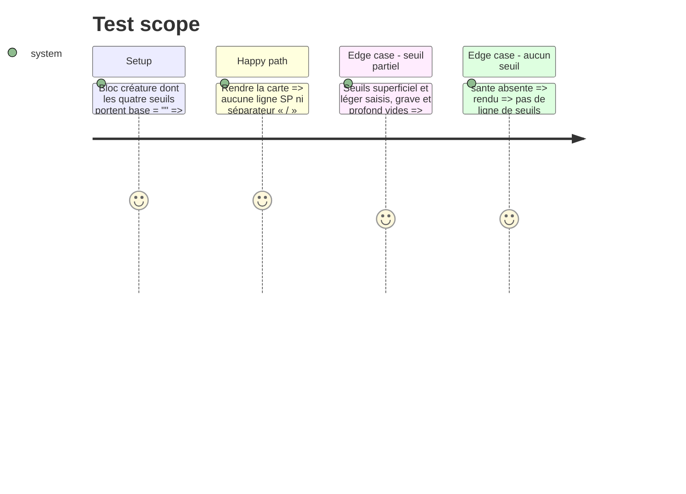

<!-- Fill or omit these sections; never add, rename, or reorder one. -->

# Instruction: Seuils PNJ et créature vides

## Architecture projection

> Tree of the final files. ✅ create · ✏️ modify · ❌ delete

```txt
.
├── src/features/adrenaline/compactCard.ts    ✏️ `renderThresholds` : seulement si la reproduction montre un défaut de Handbook
└── tools/assertAdrenalineTheme.harness.mts   ✏️ témoin d'un seuil vide, quel que soit le verdict
```

## User Journey



## Test Scope



## Tasks to do

### `1)` Reproduire

> Le symptôme est nommé, l'entrée qui le provoque ne l'est pas.

1. Construire les quatre entrées : triplet `{base, couvert, …}` entièrement vide, base vide avec `couvert` renseigné, seuils partiels, `sante` absente.
2. Les rendre avec `renderThresholds` et relever la ligne obtenue (séparateurs, ligne vide, `SP` sans nombre).

### `2)` Décider

> Pas de règle locale sans cas qui la justifie.

1. Lecture de départ : `renderThresholds` crée la ligne et écrit l'étiquette `SP`/`SM` **avant** la boucle, puis saute chaque seuil dont `base` est vide. Un côté `physique` ou `mental` présent mais dont les quatre `base` sont vides imprime donc une étiquette seule, sans nombre : c'est le symptôme nommé par l'issue, attendu à la reproduction du cas « triplet entièrement vide ».
2. Si la reproduction le confirme : corriger au plus petit en ne créant la ligne (étiquette comprise) qu'au premier seuil qui porte une `base` ; le défaut est dans l'impression, pas dans la lecture du contrat. Si un cas rend déjà proprement, ajouter son témoin et ne rien changer.
3. Si le défaut vient de ce que le schéma publié accepte une forme vide, le dire dans l'issue : c'est une demande au fournisseur.
4. Verdict de la reproduction (2026-10-14) : un côté de santé auquel il manque un seuil est refusé à la lecture (les quatre `base` sont requises), donc une étiquette seule ne peut pas atteindre la carte ; le seul triplet « vide » accepté est celui à zéro, imprimé tel que saisi (`SP 0 / 0 / 0 / 0`). Aucun défaut de Handbook : `renderThresholds` n'est pas modifié, les deux témoins sont au harnais. Que zéro veuille dire « non saisi » est une décision de contrat (schema-adrenaline) : à porter à l'utilisateur dans la phase 5.

### `3)` Porte

1. `rtk proxy pnpm build`, lint (deux portées), `pnpm assert:adrenaline-theme`, `pnpm check`.

## Test acceptance criteria

| Task | Acceptance criteria |
| ---- | ------------------- |
| 1    | Les quatre cas ont une ligne rendue consignée. |
| 2    | Le harnais porte un témoin par cas ; chaque témoin de défaut a rougi avant la correction ; le code ne change que si un cas était fautif. |
| 3    | Build, lint et `pnpm check` verts. |
