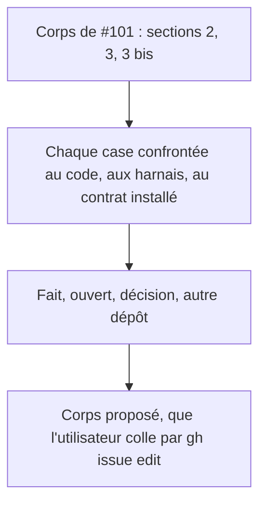

<!-- Fill or omit these sections; never add, rename, or reorder one. -->

# Instruction: Rapprocher le corps de #101 de l'état livré

## Architecture projection

> Tree of the final files. ✅ create · ✏️ modify · ❌ delete

```txt
.
└── aidd_docs/tasks/2026_10/2026_10_14_adrenaline-restes-101/rapprochement.md   ✅ corps proposé pour #101, case par case, avec la preuve de chaque case
```

## User Journey



## Test Scope

```mermaid
---
title: Test scope
---
journey
  section Setup
    Corps courant de #101 lu par gh issue view => liste des cases relevée: 5: cli
  section Happy path
    Confronter chaque case à un fichier ou à un harnais => verdict et référence par case: 5: cli
  section Edge case - case invérifiable
    Case sans preuve possible dans ce dépôt => classée « autre dépôt » ou « décision », jamais cochée: 4: cli
```

## Tasks to do

### `1)` Relevé

> Aucune case n'est cochée sans une preuve lisible.

1. Pour chaque case des sections 2, 3 et 3 bis : verdict parmi fait (preuve : fichier, harnais ou contrat installé), ouvert (renvoie à une phase de ce plan), décision (propriétaire : l'utilisateur), autre dépôt (Lantern, schema-adrenaline, coffre).
2. Mentionner en tête les restes déjà livrés par le train de la fiche PJ pour ne pas les rouvrir.

### `2)` Proposition

> L'écriture sur GitHub est un geste de l'utilisateur.

1. Écrire `rapprochement.md` : le corps proposé, les cinq décisions de contrat en liste distincte, les restes des autres dépôts avec leur dépôt.
2. Ne pas modifier l'issue : l'utilisateur la met à jour par `! gh issue edit 101 --body-file …`.

## Test acceptance criteria

| Task | Acceptance criteria |
| ---- | ------------------- |
| 1    | Chaque case a un verdict et une référence ; aucune case n'est cochée sur la foi d'une conversation. |
| 2    | `rapprochement.md` existe, ne contient ni numéro de version ni SHA en dur (désignation par rôle), et l'issue n'a pas été modifiée par ce plan. |
