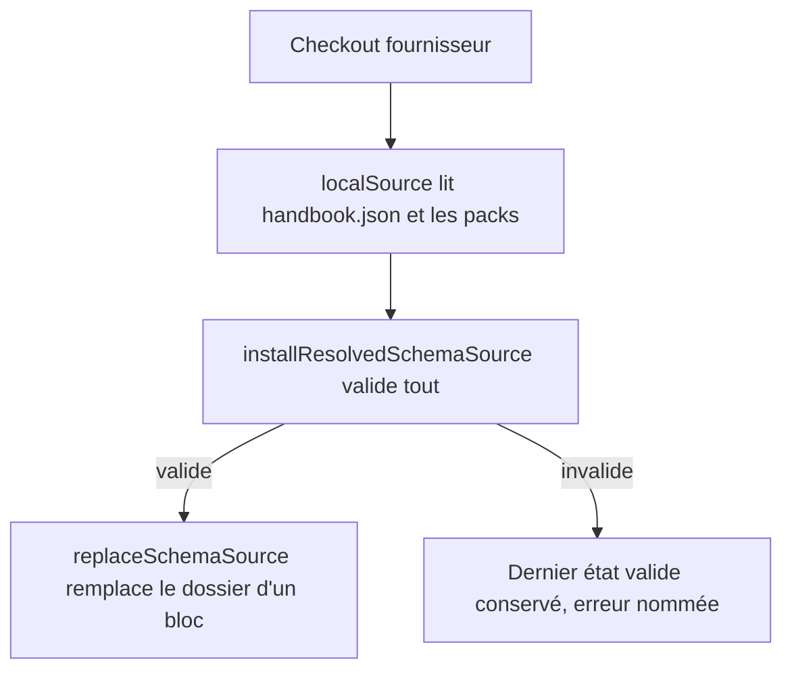
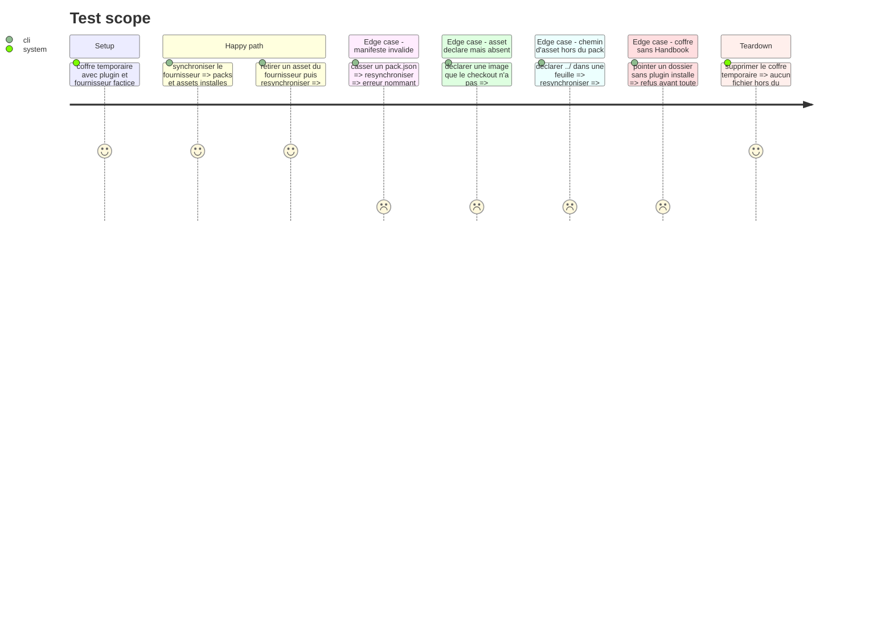

# Instruction: installateur local branché sur le code réel

## Architecture projection

> Tree of the final files. ✅ create · ✏️ modify · ❌ delete

```txt
.
├── tools/
│   ├── devSchema/
│   │   ├── nodeAdapter.mts        ✅ DataAdapter sur le disque (exists, mkdir, rmdir, rename, write, writeBinary)
│   │   ├── localSource.mts        ✅ ResolvedGithubSource lu dans un checkout local
│   │   └── sync.mts               ✅ une synchronisation : installResolvedSchemaSource sur le coffre
│   ├── devSchema.harness.mts      ✅ preuve de la synchronisation, sur un coffre temporaire
│   └── assert-dev-schema.mjs      ✅ bundle et lance le harnais (motif de assert-source-installer)
└── package.json                   ✏️ script assert:dev-schema
```

## User Journey



## Test Scope



## Tasks to do

### `1)` Adaptateur disque

> Donner à l'installateur réel un `DataAdapter` sur un dossier de coffre.

1. Implémenter `exists`, `mkdir` (récursif), `rmdir` (récursif), `rename`, `write`, `writeBinary` — les seules méthodes qu'appellent `installResolvedSchemaSource` et `replaceSchemaSource` ; toute écriture reste sous la racine du coffre fournie, un chemin qui en sort est refusé.
2. Normaliser les séparateurs : l'installateur écrit des chemins en `/`.
3. `rename` et `rmdir` reprennent quelques fois, avec une courte attente, sur `EPERM`/`EBUSY` : sous Windows Obsidian, un antivirus ou l'indexeur peuvent tenir un dossier ouvert le temps d'un instant ; au-delà, l'erreur remonte et `replaceSchemaSource` restaure le dossier précédent.

### `2)` Source locale

> Lire un checkout comme le ferait `resolveGithubSource`.

1. `readText` et `readBinary` lisent sous la racine du checkout et refusent tout chemin qui en sort.
2. `inspectBinary` renvoie `contentLength` depuis `stat`.
3. `revision` : `git rev-parse HEAD` du checkout (40 hexadécimaux, exigés par `readInstalledSchemaSource`) ; sans dépôt git, une erreur claire.

### `3)` Synchronisation

> Une passe : lire le catalogue, installer, rendre compte.

1. Refuser un coffre où `<configDir>/plugins/obsidian-handbook/manifest.json` est absent, avant toute écriture : une faute de frappe dans `--vault` ne crée rien ailleurs.
2. Construire le `Plugin` minimal (`manifest.version` lue dans ce `manifest.json`, `app.vault.configDir`, `adapter`) : c'est la version contre laquelle le plugin du coffre jugera `minimumHandbookVersion`.
3. Construire le `SchemaSource` : `repository` lu dans le `handbook.json` du checkout et validé par `isSafeSchemaSourceRepository`, `id = schemaSourceId(repository)` (le même dossier que celui du plugin, sinon le registre chargerait deux copies), `reference = { kind: "branch", value: "local" }`. Le `data.json` n'est ni lu ni écrit : avec une référence fixe, l'écran des réglages affiche `revision <sha7>` et non le nom d'un tag pour un contenu modifié.
4. Appeler `installResolvedSchemaSource` ; renvoyer les packs installés, la révision et le message d'erreur éventuel.

### `4)` Preuve

> Prouver les quatre comportements demandés par l'issue.

1. Harnais : installation, retrait d'asset, manifeste invalide, asset déclaré mais absent, chemin hors pack, coffre sans plugin ; après chaque refus, le dossier précédent est comparé octet à octet à l'original, et `data.json` du coffre factice reste identique.
2. Brancher `assert:dev-schema` : `pnpm check` le ramasse seul (tous les `assert:*`).
3. `tsc` ne couvre pas les `.mts` : le harnais exécuté et `pnpm lint` sont les seuls contrôles de ces modules, ce qui impose que le harnais touche chaque module créé.

## Test acceptance criteria

| Task | Acceptance criteria                                                                                         |
| ---- | ----------------------------------------------------------------------------------------------------------- |
| 1    | Aucun fichier n'est écrit hors de la racine du coffre de test.                                              |
| 2    | Un chemin `../` lu dans un pack est refusé avant toute écriture.                                            |
| 3    | Une source jamais installée dans le coffre est installée sous `schemaSourceId(repository)` ; `data.json` est inchangé octet pour octet ; `source.json` porte la révision locale et la référence `local`. |
| 4    | Un asset supprimé du fournisseur disparaît du coffre ; un manifeste invalide, un asset absent ou un chemin hors pack laissent le dossier précédent intact. |
