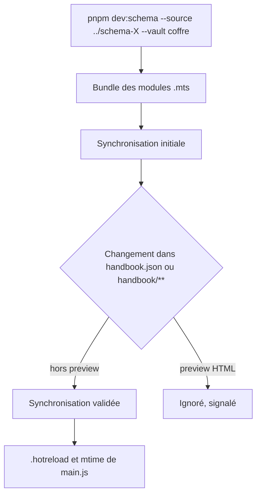
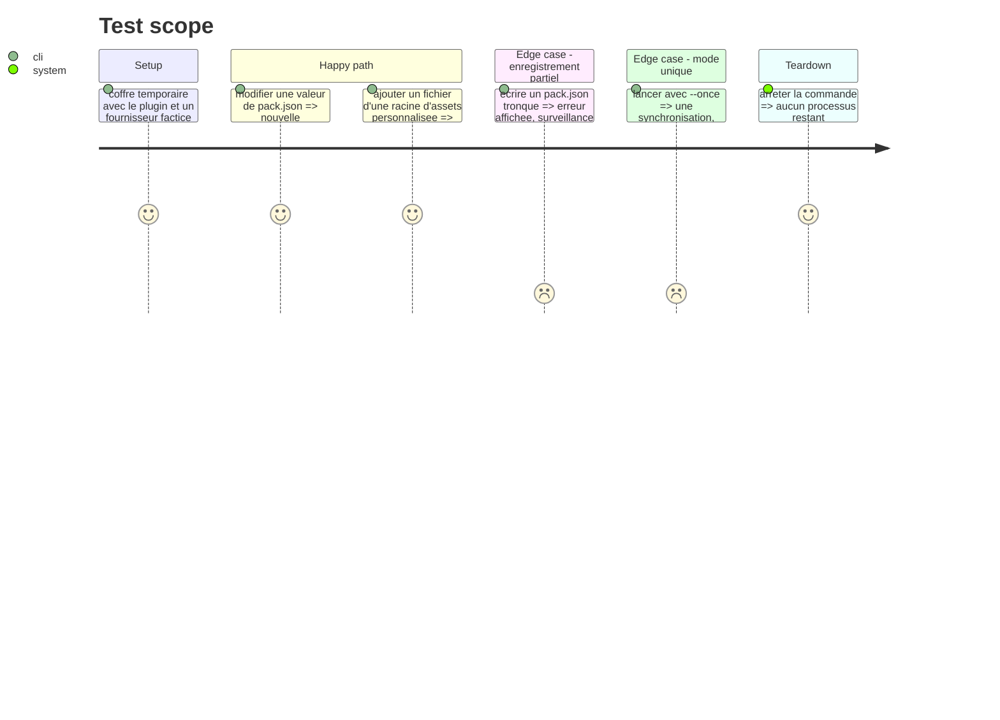

# Instruction: commande `dev:schema` et surveillance

## Architecture projection

> Tree of the final files. ✅ create · ✏️ modify · ❌ delete

```txt
.
├── tools/
│   ├── dev-schema.mjs             ✅ CLI : arguments, bundle des .mts, synchronisation, surveillance
│   ├── devSchema/watch.mts        ✅ surveillance, filtre, délai anti-rebond, marqueur Hot Reload
│   └── dev-schema-source.mjs      ❌ remplacé par dev-schema.mjs
└── package.json                   ✏️ dev:schema ; dev:schema-pbta devient un alias
```

## User Journey



## Test Scope



## Tasks to do

### `1)` CLI commune

> Une commande, trois fournisseurs.

1. Arguments : `--source <dépôt>`, `--vault <coffre>`, `--config-dir` (défaut `.obsidian`), `--once` ; le coffre reste accepté en positionnel (`pnpm dev:schema-pbta -- <coffre>`, tel que le citent `doc/supervisor.*.md`).
2. Aucun défaut propre à un jeu : l'identité de la source vient du `repository` de son `handbook.json`.
3. Bundler les `.mts` avec esbuild (`obsidian` externe) au lancement, dans un dossier temporaire supprimé à la sortie.

### `2)` Surveillance

> Resynchroniser sur tout changement installable, rien d'autre.

1. Déclencheurs : `handbook.json` et tout fichier sous `handbook/` hors `preview/` (la racine d'assets d'un pack est libre : l'ancien filtre sur `assets` la manquait).
2. Anti-rebond court ; une erreur est affichée avec le fichier en cause, la surveillance continue ; un succès affiche les packs installés (id, version) et la révision locale, pour que le silence ne soit jamais ambigu.
3. Après chaque synchronisation réussie : marqueur `.hotreload` et horodatage de `main.js`, comme aujourd'hui.

### `3)` Scripts

> Ne casser aucun plan ni aucune doc existants.

1. `dev:schema` appelle `tools/dev-schema.mjs` ; `dev:schema-pbta` reste, avec `--source ../schema-pbta`.
2. Supprimer `tools/dev-schema-source.mjs` une fois ses usages migrés.

## Test acceptance criteria

| Task | Acceptance criteria                                                                                               |
| ---- | ----------------------------------------------------------------------------------------------------------------- |
| 1    | `--source ../schema-in-the-mist`, `../schema-pbta` et `../schema-adrenaline` synchronisent chacun leur catalogue. |
| 2    | Un pack invalide affiche l'erreur et laisse le coffre sur le dernier pack valide ; la commande ne s'arrête pas.   |
| 3    | `pnpm dev:schema-pbta --vault <coffre> --once` donne le même résultat qu'avant sur un catalogue valide.           |
