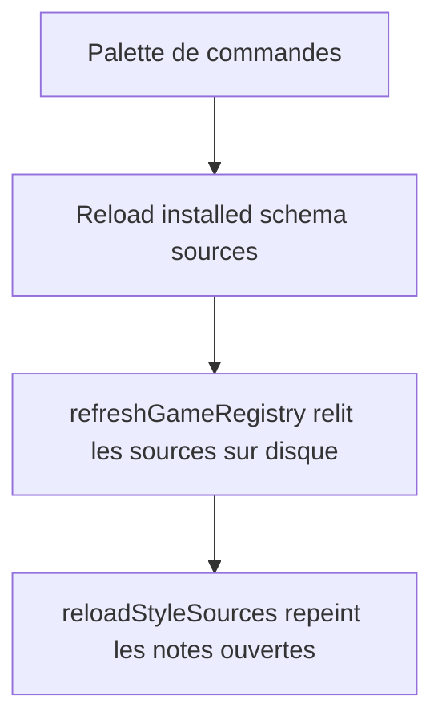
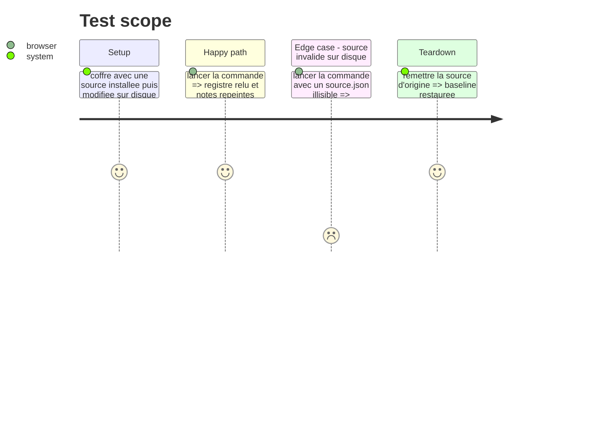

# Instruction: rechargement explicite dans Handbook

## Architecture projection

> Tree of the final files. ✅ create · ✏️ modify · ❌ delete

```txt
.
├── src/
│   ├── BrumesPlugin.ts            ✏️ commande « Reload installed schema sources »
│   └── locales/fr.ts              ✏️ libellé français
└── tools/assert-reload-styles.mjs ✏️ affirme la commande, l'ordre de ses deux appels et son libellé
```

## User Journey



## Test Scope



## Tasks to do

### `1)` Commande

> Donner à `refreshGameRegistry` une porte d'entrée.

1. Enregistrer la commande (`id: "reload-schema-sources"`) à côté de « Reload illustrations and personal overrides » : elle enchaîne `await this.refreshGameRegistry()` puis `await this.reloadStyleSources()`, car le premier remet `assets` à zéro que le second recharge.
2. Libellé en anglais, sentence case (`obsidianmd`) ; version française dans `fr.ts` (français par défaut).

### `2)` Garde

> La commande est affirmée par un contrôle de source, comme le cycle de vie du plugin.

1. Étendre `tools/assert-reload-styles.mjs`, qui lit `src/BrumesPlugin.ts` par expressions régulières (il ne couvre aujourd'hui que `onLayoutReady` et `collectDocuments`, pas les commandes) : la commande existe sous cet `id`, enchaîne les deux appels dans cet ordre, et `src/locales/fr.ts` porte son libellé.
2. Cette garde prouve l'enregistrement, pas l'effet visuel : l'effet est constaté en phase 4, par le verdict de rendu.

## Test acceptance criteria

| Task | Acceptance criteria                                                                                                     |
| ---- | ----------------------------------------------------------------------------------------------------------------------- |
| 1    | Après une synchronisation `dev:schema`, la commande fait apparaître la retouche dans une note ouverte, sans Hot Reload. |
| 2    | `pnpm check` échoue si la commande disparaît, si l'ordre des deux appels s'inverse ou si le libellé français manque.    |
