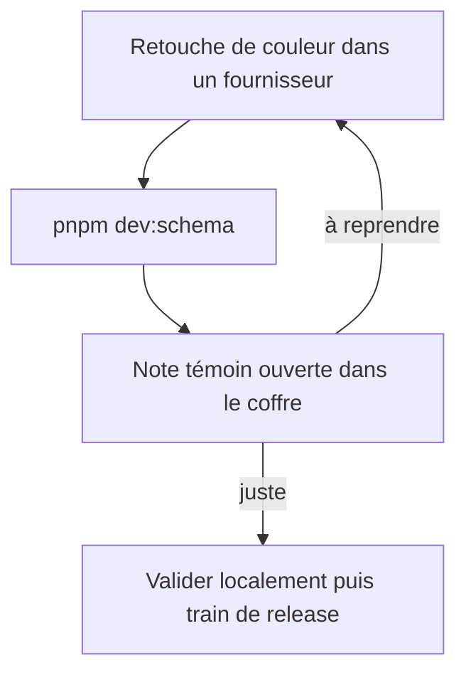
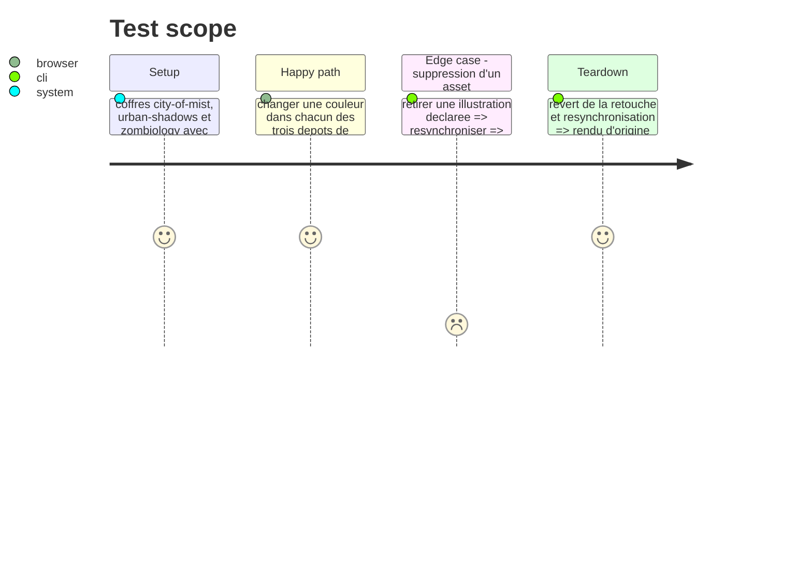

# Instruction: guide FR/EN et preuve de rendu

## Architecture projection

> Tree of the final files. ✅ create · ✏️ modify · ❌ delete

```txt
.
├── doc/
│   ├── dev-schema.fr.md           ✅ cycle modifier → voir → valider, prérequis, limites
│   ├── dev-schema.en.md           ✅ même contenu en anglais
│   ├── supervisor.fr.md           ✏️ renvoie vers le guide au lieu de dev:schema-pbta
│   └── supervisor.en.md           ✏️ idem
├── aidd_docs/memory/external/obsidian-theme-development.md ✏️ section schema-pbta : nouvelle commande, bouton inexistant retiré
├── CHANGELOG.md                   ✏️ section de la version suivante (commande ajoutée côté plugin)
└── package.json, manifest.json, versions.json ✏️ version, par `pnpm version` seulement
```

## User Journey



## Test Scope



## Tasks to do

### `1)` Guide

> Dire les commandes, prérequis et limites, et distinguer trois niveaux de preuve.

1. Prérequis : Handbook installé dans le coffre, Hot Reload ou la commande de rechargement, `data.json` jamais écrit.
2. Distinguer : prévisualisation locale (cette boucle), vérification des consommateurs (`supervise preview`), publication finale (train).
3. Limites : les feuilles `styles/*.css` du HTML de preview ne sont pas chargées par Obsidian ; `overrides.json` reste la voie rapide pour chercher une couleur.
4. Revenir à l'état publié : la source installée par la boucle est enregistrée sous la référence `local` (réglages : `revision <sha7>`) ; le bouton « Vérifier les mises à jour » des réglages (absent pour une source épinglée sur un tag) ou la commande « Installer des packs de jeu » la remplace par la version publiée. La boucle n'écrit jamais `data.json`, et une source absente de `data.json` est quand même chargée depuis le disque.
5. La révision affichée est celle de `HEAD` du dépôt fournisseur, pas celle de l'arbre de travail : une retouche non commitée change le contenu installé, pas la révision.
6. Prérequis du coffre : le plugin Handbook y est installé (la boucle refuse sinon), et la `minimumHandbookVersion` des packs doit être couverte par ce plugin.

### `2)` Documentation voisine

> Retirer les affirmations devenues fausses.

1. Remplacer l'usage `dev:schema-pbta` et le bouton « Reload installed sources » par la commande réelle.
2. Mettre à jour le renvoi des deux fichiers `supervisor.*.md`.

### `3)` Preuve de rendu

> Référence de rendu : la note témoin de chaque coffre, en thème clair puis sombre, plus l'aperçu imprimable si la couleur touche le papier.

| Fournisseur         | Coffre          | Note témoin                                              |
| ------------------- | --------------- | -------------------------------------------------------- |
| `schema-in-the-mist` | `city-of-mist`  | `Handbook - Test blocs City of Mist.md`                  |
| `schema-pbta`       | `urban-shadows` | `Handbook - Test blocs urban-shadows.md`                 |
| `schema-adrenaline` | `zombiology`    | `Test Handbook — Adrenaline.md`                          |

1. Pour chacun des trois, une retouche de couleur d'un pack, la boucle lancée, puis constat dans la note témoin (Hot Reload, ou la commande de rechargement sinon) ; l'utilisateur valide ce qu'il voit, ou le dit.
2. Dans `city-of-mist` : retirer une illustration déclarée, constater qu'elle disparaît du coffre ; casser un `pack.json`, constater l'erreur du terminal et le dernier pack valide toujours rendu.
3. Défaire les seules retouches faites pour la preuve, fichier par fichier : jamais de `git checkout` ni de `git reset` d'ensemble, un dépôt fournisseur peut porter un autre travail non commité. Comparer `git diff --stat` à celui relevé avant la preuve, puis resynchroniser.

### `4)` Version

> La commande ajoutée côté plugin est visible de l'utilisateur : elle porte une version.

1. Préparer la version suivante (mineure, rôle v<N+1>) avec `pnpm version` : il met `manifest.json` et `versions.json` à jour, `assert:release-version` refuse une section de CHANGELOG en avance sur le manifeste. Le comportement git de `pnpm version` (commit, tag) est lu avant de l'exécuter : le dépôt interdit de commiter sans demande.
2. Section CHANGELOG sous le même numéro : la boucle `dev:schema`, la commande de rechargement, le remplacement de `dev:schema-pbta` par un alias.

## Test acceptance criteria

| Task | Acceptance criteria                                                                                              |
| ---- | ---------------------------------------------------------------------------------------------------------------- |
| 1    | Le guide FR et le guide EN portent les mêmes commandes et la même distinction à trois niveaux.                   |
| 2    | Aucun fichier du dépôt ne cite plus un bouton ou une commande qui n'existe pas.                                  |
| 3    | La retouche des trois dépôts est visible dans la note témoin nommée sans changement de `package.json` ni de `pnpm-lock.yaml` de Handbook, et le `git diff --stat` de chaque dépôt est identique à celui d'avant la preuve. |
| 4    | `pnpm assert:release-version` passe avec le nouveau numéro, et `pnpm check` est vert.                           |
