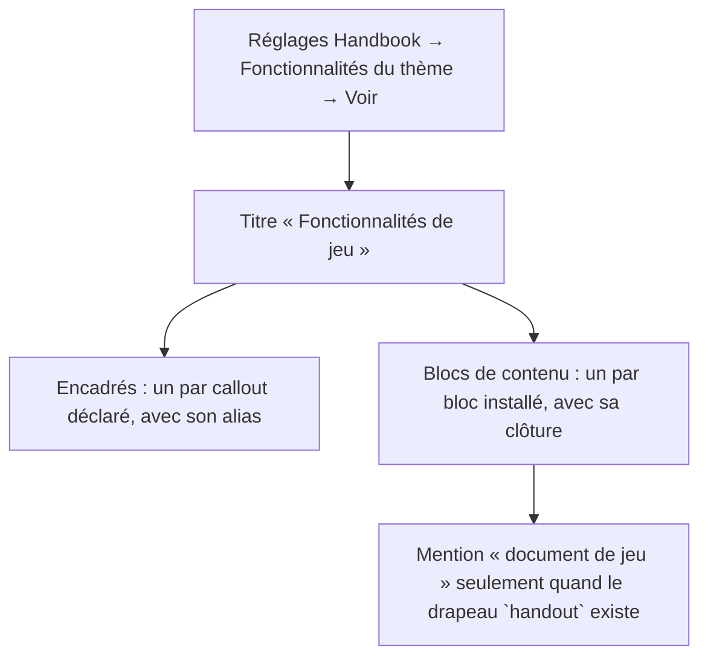
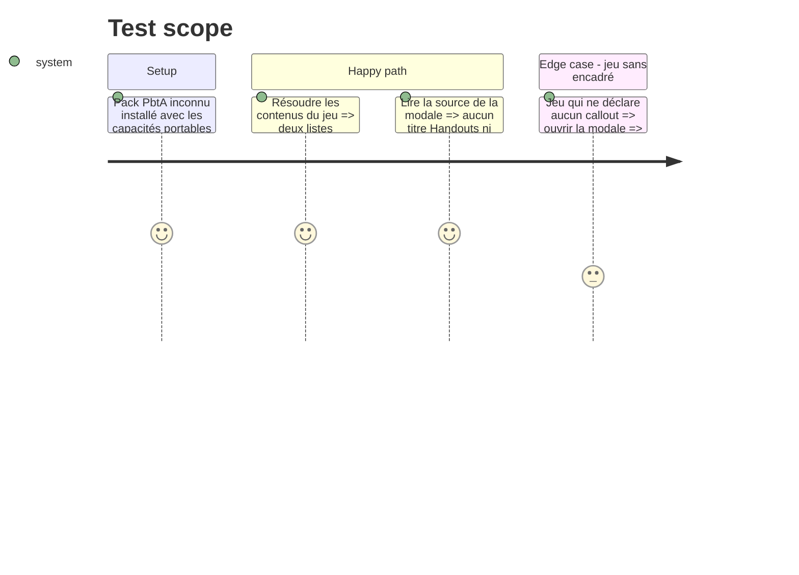

<!-- Fill or omit these sections; never add, rename, or reorder one. -->

# Instruction: Deux familles dans la modale

## Architecture projection

> Tree of the final files. ✅ create · ✏️ modify · ❌ delete

```txt
.
├── src/settings/themeContentsModal.ts   ✏️ deux sections, mention « document de jeu », plus de `handouts`
├── src/settings/generalSettings.ts      ✏️ description du bouton « Theme features »
├── src/locales/fr.ts                    ✏️ clés nouvelles, clés Handouts retirées, descriptions réalignées
├── tools/assert-settings-ui.mjs         ✏️ l'assertion `handouts: blocks.filter(…)` devient « aucune section Handouts, le drapeau nourrit la mention »
└── tools/customPacks.harness.mts        ✏️ `contents.handouts` remplacé par les blocs portant `handout`
```

## User Journey



## Test Scope



## Wireframe

```txt
┌ Fonctionnalités de Adrenaline System ─────────────┐
│ Encadrés (> [!type])                              │
│  <nom du callout>          [!alias]               │
│  …                                                │
│ Blocs de contenu (```)                            │
│  Fiche PJ Adrenaline       ```adrenaline-pj       │
│  Fiche PNJ Adrenaline      ```adrenaline-pnj      │
│  Fiche monstre Adrenaline  ```adrenaline-monstre  │
└───────────────────────────────────────────────────┘

PbtA : « PbtA character playbook  ```pbta-playbook · document de jeu »
```

## Tasks to do

### `1)` Modale

> Deux sections, plus de troisième rubrique.

1. Retirer `handouts` de `ThemeContents` et de `resolveThemeContents` ; garder `callouts` et `blocks`.
2. Titres via `t()` avec des clés nouvelles (« Callouts (> [!type]) », « Content blocks (code fence) »), sans réutiliser la clé `"Callouts"` des réglages, qui reste traduite telle quelle.
3. Pour chaque bloc, description : la clôture pour chaque id et alias, puis, si `block.handout`, « document de jeu ». Pas de mention pour `utility` : aucun bloc utilitaire n'est déclaré par une capacité `block:` (le roller ne peut pas atteindre la modale).
4. Messages vides : une clé par famille (encadrés, blocs de contenu).

### `2)` Libellés

> Le français d'abord.

1. `fr.ts` : ajouter « Encadrés », « Blocs de contenu », les deux messages vides et la mention « document de jeu » ; retirer `"Handouts"`, `"No handout is declared for this game."`, `"Code blocks"` et `"Code block: {ids}"` une fois la modale migrée (aucun autre usage dans `src/`).
2. Réaligner `"Review the callouts and code blocks declared for the active game."` (anglais et français) sur les deux familles.

### `3)` Preuves

> Les deux garde-fous qui figeaient l'ancien comportement disent le nouveau.

1. `tools/assert-settings-ui.mjs` : refuser les titres Handouts et Code blocks dans la modale, exiger que le drapeau `handout` nourrisse la mention et que `utility` ne soit pas lu par la modale.
2. `tools/customPacks.harness.mts` : le jeu PbtA inconnu expose `pbta-playbook` comme seul bloc portant `handout`, et les neuf blocs sont toujours listés.
3. `rtk proxy pnpm build`, `eslint src --ext .ts`, `pnpm lint`, `pnpm assert:settings-ui` et `pnpm assert:custom-packs` verts.

## Test acceptance criteria

| Task | Acceptance criteria |
| ---- | ------------------- |
| 1    | `ThemeContents` n'a plus de `handouts` ; la modale écrit deux sections ; une section vide affiche son propre message. |
| 2    | En français la modale ne contient ni « Handouts » ni « Bloc de code » ; `fr.ts` n'a plus de clé orpheline. |
| 3    | Les deux assertions échouent sur l'ancien code et passent sur le nouveau ; build et lint à zéro. |
