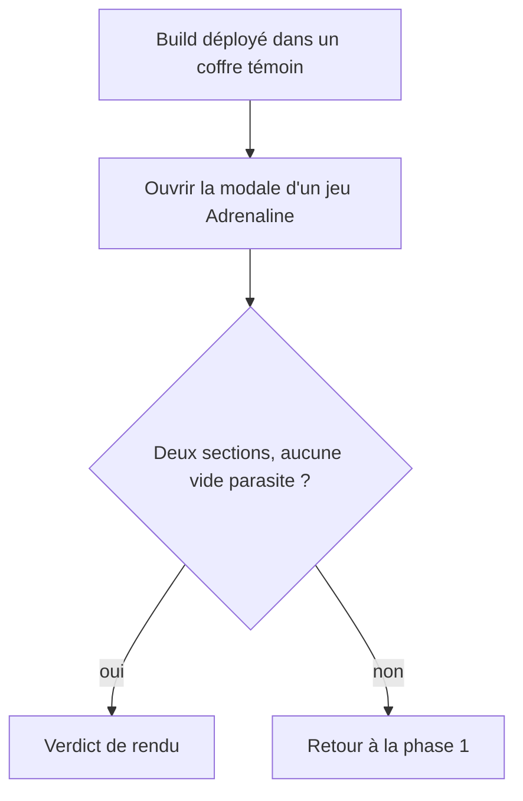
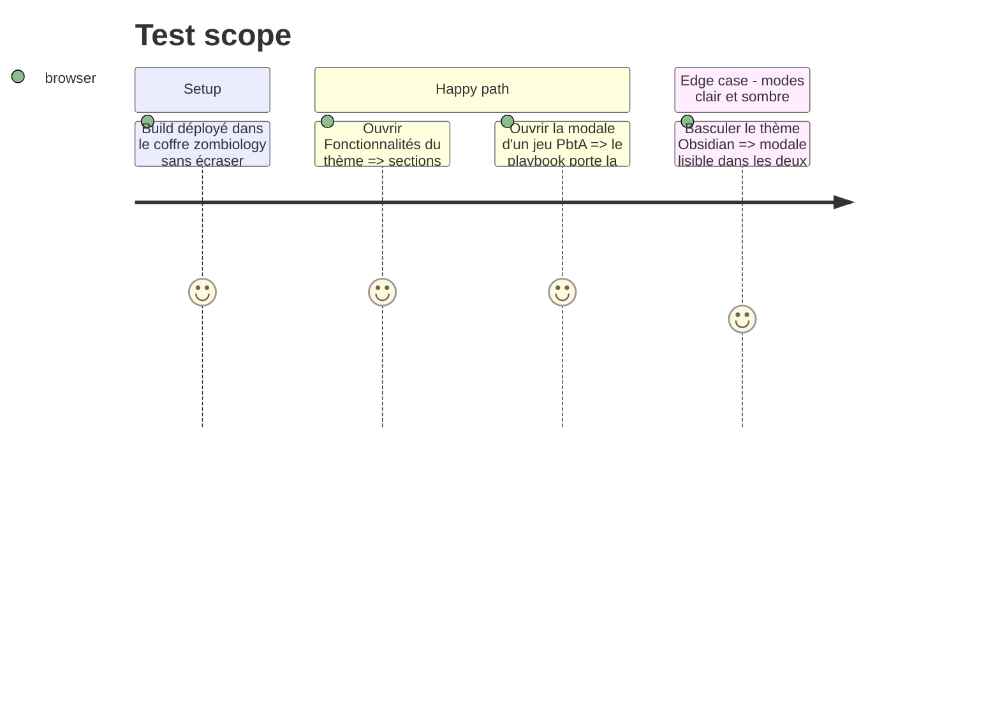

<!-- Fill or omit these sections; never add, rename, or reorder one. -->

# Instruction: Changelog, version et verdict de rendu

## Architecture projection

> Tree of the final files. ✅ create · ✏️ modify · ❌ delete

```txt
.
├── CHANGELOG.md      ✏️ entrée « Changed » dans la section de la version en préparation
├── package.json      ✏️ version, seulement si la section en préparation est déjà publiée
├── manifest.json     ✏️ idem
└── versions.json     ✏️ idem
```

## User Journey



## Test Scope



## Tasks to do

### `1)` Version

> La version se lit dans les sources, jamais en dur.

1. Lire la dernière section de `CHANGELOG.md` et la version de `manifest.json` : si le tag `v<cette version>` n'existe pas encore (`git tag --list`), la section est en préparation : y ajouter l'entrée ; sinon `pnpm version <mineure suivante> --no-git-tag-version` puis une nouvelle section.
2. Entrée « Changed » : la modale présente encadrés et blocs de contenu, sans section Handouts ; mention « document de jeu » sur le playbook PbtA.

### `2)` Porte et rendu

> Seul le verdict visuel est demandé à l'utilisateur.

1. `pnpm check` exit 0 (dont `assert:release-version`).
2. Copier `dist/main.js`, `styles.css` et `manifest.json` dans le coffre témoin (commande du `CLAUDE.md`, `data.json` jamais écrasé) et demander le verdict.

## Test acceptance criteria

| Task | Acceptance criteria |
| ---- | ------------------- |
| 1    | `assert:release-version` passe : la dernière section du changelog égale la version du manifeste. |
| 2    | `pnpm check` est vert et l'utilisateur valide la modale dans Obsidian en clair et en sombre. |
