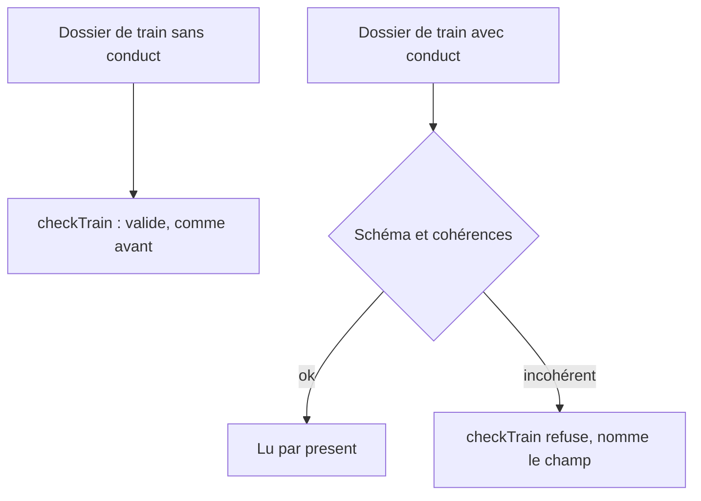
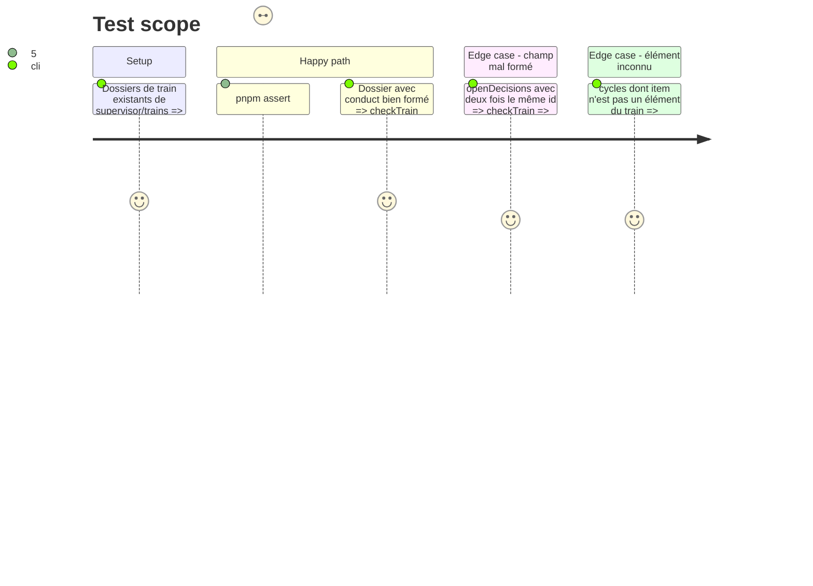

<!-- Fill or omit these sections; never add, rename, or reorder one. -->

# Instruction: Contrat : champ `conduct` de la topologie et du dossier de train

## Architecture projection

> Tree of the final files. ✅ create · ✏️ modify · ❌ delete

```txt
.
├── supervisor/topology.schema.json   ✏️ propriété optionnelle `conduct` { maxControllerCycles }
├── supervisor/topology.json          ✏️ `conduct.maxControllerCycles` (indentation par tabulations)
├── supervisor/train.schema.json      ✏️ propriété optionnelle `conduct` { openDecisions, cycles }
└── tools/supervisor/train.mjs        ✏️ `checkTrain` : cohérences du champ (identifiants uniques, éléments connus)
```

## User Journey



## Test Scope



## Tasks to do

### `1)` Topologie

> Un nombre qui se lit, jamais un littéral dans le code.

1. `topology.schema.json` : ajouter `conduct` (objet, `additionalProperties: false`, `maxControllerCycles` entier ≥ 1) parmi les propriétés racine, sans le mettre dans `required`.
2. `topology.json` : écrire `conduct.maxControllerCycles` ; le diff de la phase 1 du #101 (`validations` de Lantern) reste intact.
3. Chercher dans `tools/` toute lecture stricte des clés de la topologie (`Object.keys`, validations manuelles) que le champ ferait échouer.

### `2)` Dossier de train

> Deux listes courtes, éditées à la main, jamais écrites par une commande.

1. `train.schema.json` : `conduct` optionnel avec `openDecisions` (objets `id`, `text`, `touchesRender` booléen requis ; `decision` et `decidedAt` optionnels) et `cycles` (objets `item`, `cycle` entier ≥ 1, `at` ; `decision` optionnel).
2. `checkTrain` : refuser deux décisions de même `id`, un `cycles[].item` qui n'est pas un élément du train, un `decidedAt` sans `decision`. Messages dans la forme existante des refus de `checkTrain`.
3. Ne pas toucher `supervisor/trains/` ni `tools/supervisor/guard/`.

## Test acceptance criteria

| Task | Acceptance criteria |
| ---- | ------------------- |
| 1    | `topology.json` valide contre le schéma avec et sans `conduct` ; aucun script de `tools/` ne rejette le champ. |
| 2    | Les dossiers de `supervisor/trains/` restent valides sans diff ; chaque cohérence refusée a un message qui nomme le champ fautif. |
