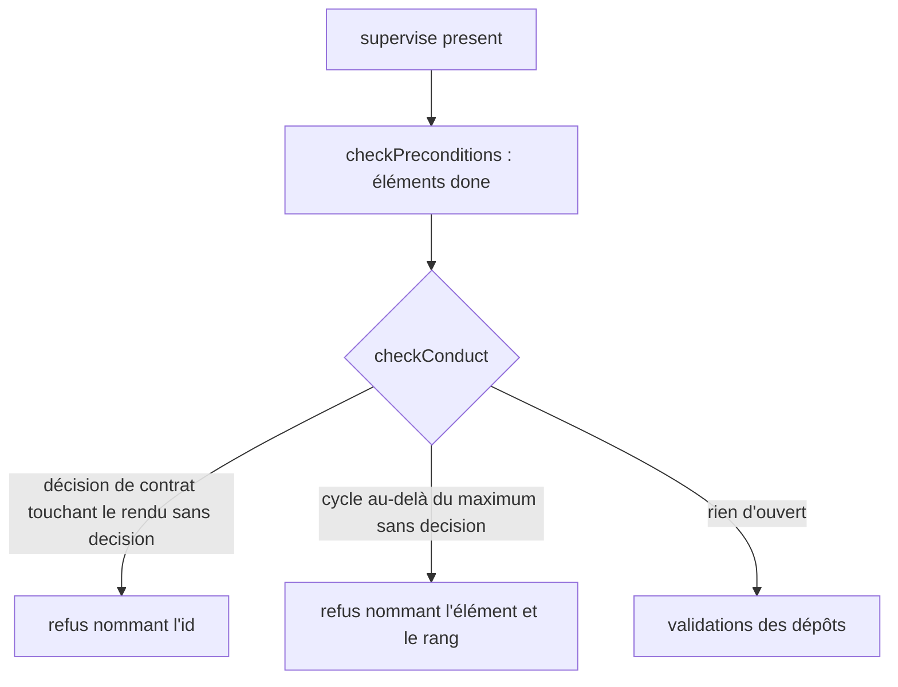
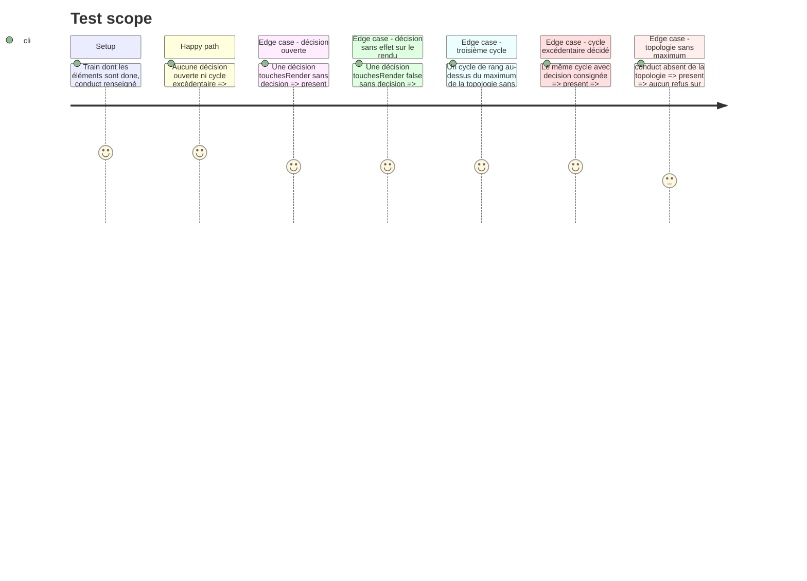

<!-- Fill or omit these sections; never add, rename, or reorder one. -->

# Instruction: Refus de `present`

## Architecture projection

> Tree of the final files. ✅ create · ✏️ modify · ❌ delete

```txt
.
└── tools/supervisor/present.mjs   ✏️ `checkConduct(topology, train)` appelée par `checkPreconditions`, avant toute validation
```

## User Journey



## Test Scope



## Tasks to do

### `1)` Garde

> Tout se contrôle avant le départ : le refus tombe avant `packProviders` et les validations.

1. Écrire `checkConduct(topology, train)` : renvoie la liste des raisons (vide si `conduct` est absent du train).
2. Raison 1 : chaque `openDecisions[]` avec `touchesRender` vrai et sans `decision`.
3. Raison 2 : si `topology.conduct.maxControllerCycles` existe, chaque `cycles[]` de rang supérieur sans `decision`. Le nombre vient de la topologie ; aucun littéral dans le code ni dans les messages d'autre part que la valeur lue.
4. L'appeler dans `checkPreconditions`, après le contrôle des éléments `done` : une `SupervisorError("present: …", 1)` qui liste toutes les raisons, dans la forme des refus voisins.

### `2)` Aucune approbation rouverte

> Le superviseur ne juge pas le rendu.

1. Ne rien ajouter à `ship`, `publish`, `converge`, `release`, `close` ; ne pas ressusciter `approval`.
2. Vérifier par lecture que `assert:guards-by-role` reste vert (aucun chiffre dans la garde).

## Test acceptance criteria

| Task | Acceptance criteria |
| ---- | ------------------- |
| 1    | Chaque raison est refusée avant la première validation et nomme son identifiant ; sans `conduct`, le comportement de `present` est inchangé. |
| 2    | `git diff` ne touche que `present.mjs` côté `tools/supervisor/` ; `assert:guards-by-role` vert. |
