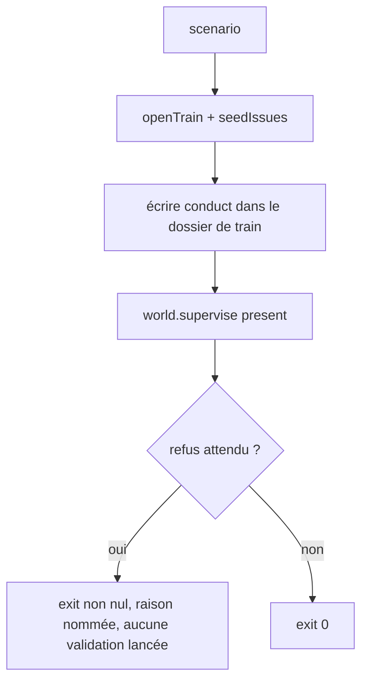
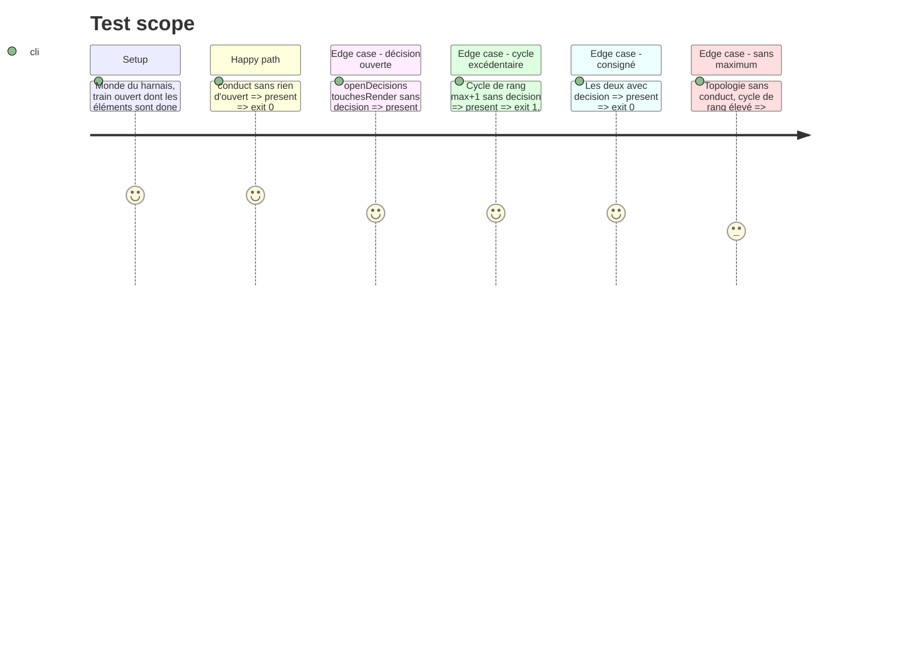

<!-- Fill or omit these sections; never add, rename, or reorder one. -->

# Instruction: Scénarios de `assert:supervisor`

## Architecture projection

> Tree of the final files. ✅ create · ✏️ modify · ❌ delete

```txt
.
└── tools/supervisor.harness.mts   ✏️ scénarios autour de `present` : un par refus, un par acceptation
```

## User Journey



## Test Scope



## Tasks to do

### `1)` Scénarios

> Chaque refus a son témoin et chaque témoin a rougi sous mutation.

1. Reprendre les helpers existants (`seedIssues`, `openTrain`, `readRecord`, `trainPath`, `world.supervise([...], { topology })`) ; une `scenario("…")` par ligne du Test Scope.
2. Le rang excédentaire se construit à partir de la valeur de la topologie du scénario (`maxControllerCycles + 1`), jamais en littéral : le harnais ne recopie pas le chiffre de la topologie réelle.
3. Pour chaque refus : vérifier que la raison nomme l'id ou l'item et qu'aucune validation n'a été lancée (journal des commandes).

### `2)` Preuve

> `assert:supervisor` compare `git status` avant et après : arbre quiescent, hors de tout autre travail.

1. Mutation : retirer le refus de `checkConduct` dans un exemplaire jetable et constater que les scénarios de refus rougissent.
2. `pnpm assert:supervisor` complet, puis `pnpm assert:guards-by-role`, puis `pnpm check`.

## Test acceptance criteria

| Task | Acceptance criteria |
| ---- | ------------------- |
| 1    | Un scénario par refus et par acceptation ; aucun nombre de cycles écrit en littéral dans le harnais. |
| 2    | Chaque scénario de refus rougit sous mutation ; `assert:supervisor`, `assert:guards-by-role` et `pnpm check` verts sur un arbre quiescent. |
