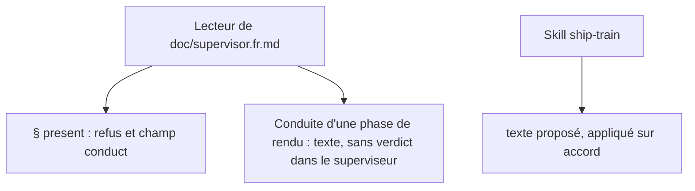
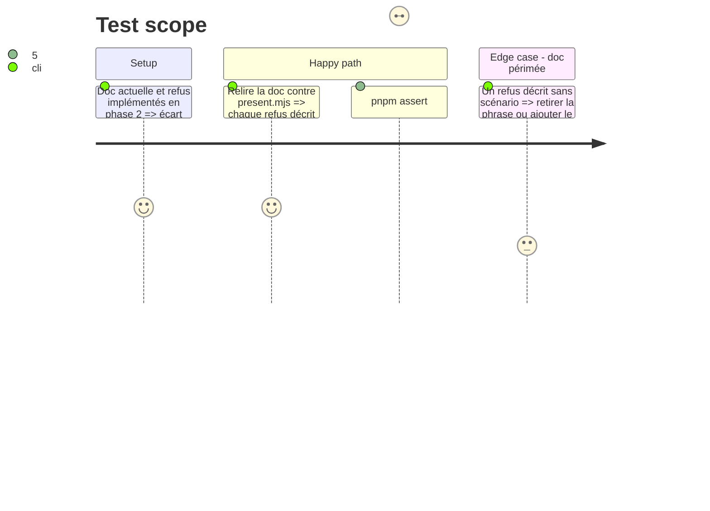

<!-- Fill or omit these sections; never add, rename, or reorder one. -->

# Instruction: Documentation et texte de conduite

## Architecture projection

> Tree of the final files. ✅ create · ✏️ modify · ❌ delete

```txt
.
├── doc/supervisor.fr.md                                  ✏️ § `present` : les deux refus et le champ `conduct` ; section « Conduite d'une phase de rendu » (points 1, 3, 5, 6)
├── doc/supervisor.en.md                                  ✏️ même contenu (CRLF)
├── CHANGELOG.md                                          ✏️ ligne sous la version en préparation
└── aidd_docs/tasks/2026_10/2026_10_15_superviseur-conduite-rendu-105/ship-train-conduite.md   ✅ texte proposé pour le skill `ship-train`
```

## User Journey



## Test Scope



## Tasks to do

### `1)` Doc du superviseur

> La doc dit ce que le superviseur fait, et nomme ce qu'il ne fait pas.

1. `doc/supervisor.fr.md` : dans la section de `present`, décrire `conduct` (`openDecisions`, `cycles`), les deux refus et le fait que `maxControllerCycles` se lit dans la topologie ; ne pas écrire la valeur.
2. Nouvelle section « Conduite d'une phase de rendu » : cible validée avant qu'un élément de rendu passe `done`, décisions papier/contrat avant le rendu, trois points de contrôle fixés d'avance, gardes lourds après le rendu validé, accord de rendu demandé dans la conversation et non par le superviseur (aucun verdict ni accord dans `ship`).
3. Reporter le texte en anglais dans `doc/supervisor.en.md` (CRLF : normaliser, éditer, ré-écrire).
4. Ajouter la ligne au `CHANGELOG.md` (CRLF) sous la version en préparation.

### `2)` Texte du skill

> Le skill vit hors du dépôt : on propose, on n'écrit pas dans `~/.claude/skills`.

1. Écrire `ship-train-conduite.md` : les ajouts proposés à `board`/`implement`/`preview` de `ship-train` (cible validée avant `done`, deux cycles au plus puis décision consignée dans `conduct.cycles`, décision de contrat ouverte consignée dans `conduct.openDecisions`).
2. Le signaler à l'utilisateur ; l'appliquer seulement sur son accord.

## Test acceptance criteria

| Task | Acceptance criteria |
| ---- | ------------------- |
| 1    | Chaque refus décrit existe dans `present.mjs` et a un scénario ; fr et en disent la même chose ; aucun chiffre de cycle dans la doc. |
| 2    | Le fichier proposé existe dans le dossier du plan ; aucun fichier de `~/.claude/skills` modifié. |
