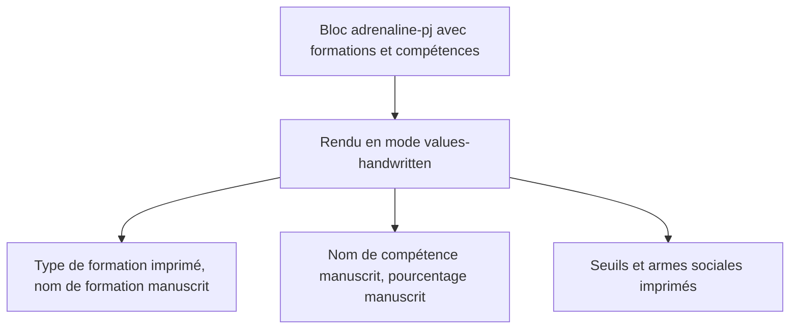
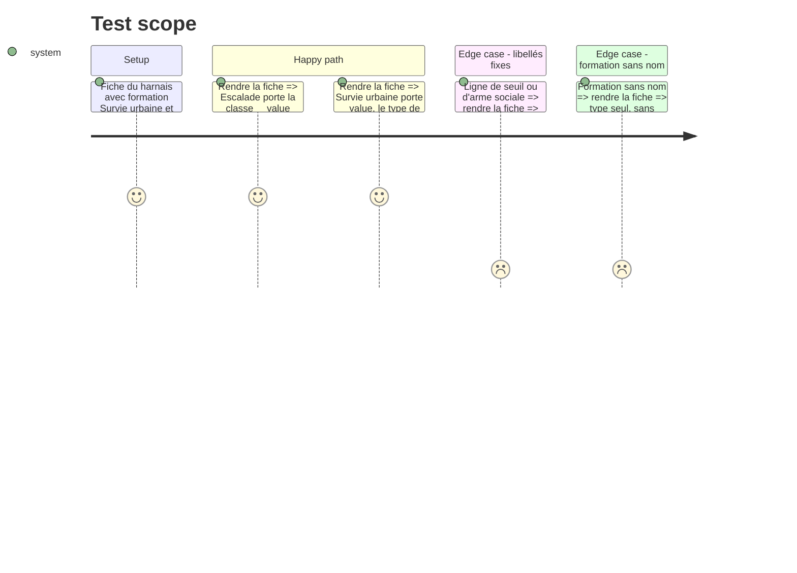

# Instruction: Handbook — noms saisis en `__value`

## Architecture projection

```txt
.
├── src/features/adrenalinePj/renderer.ts        ✏️ nom de compétence et nom de formation posés en `__value`
└── tools/assertAdrenalineTheme.harness.mts      ✏️ preuve : noms saisis en `__value`, libellés fixes hors `__value`
```

## User Journey



## Test Scope



## Tasks to do

### `1)` Nom de compétence manuscrit

> Le nom d'une compétence est une valeur saisie.

1. Dans `renderFormationColumns`, poser le nom de compétence (avec sa spécialité) comme valeur (`__value`), en gardant la classe `metric-name` qui règle la mise en page de la ligne.
2. Laisser `metric()` inchangé pour les seuils et les autres libellés fixes.

### `2)` Nom de formation manuscrit

> Dans « Professionnelle (Survie urbaine) », seul « Survie urbaine » est manuscrit.

1. Composer l'intitulé de la ligne de formation : type imprimé, parenthèses imprimées, nom en `__value`.
2. Une formation sans nom garde son type seul.

### `3)` Preuve dans `assertAdrenalineTheme`

> Le harnais affirme la frontière entre saisie et texte fixe.

1. Le nom de compétence et le nom de formation rendus portent `__value`.
2. Le type de formation, les libellés de seuil et les lignes `ref-name` des armes sociales ne la portent pas.
3. Vérifier que le harnais échoue sur le code d'avant, puis passe après.

## Test acceptance criteria

| Task | Acceptance criteria |
| ---- | ------------------- |
| 1 | En mode `values-handwritten`, le nom d'une compétence s'affiche en police et encre manuscrites, à côté de son pourcentage. |
| 2 | Type de formation et parenthèses imprimés, nom entre parenthèses manuscrit ; une formation sans nom n'affiche que son type. |
| 3 | Le harnais `assertAdrenalineTheme` échoue sans le changement et passe avec ; `rtk proxy pnpm build`, `eslint src --ext .ts` et `pnpm lint` à zéro erreur. |
