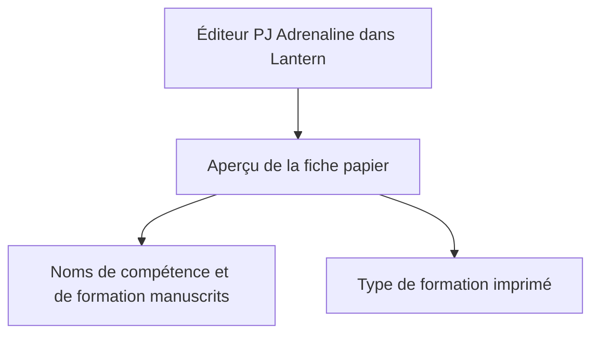
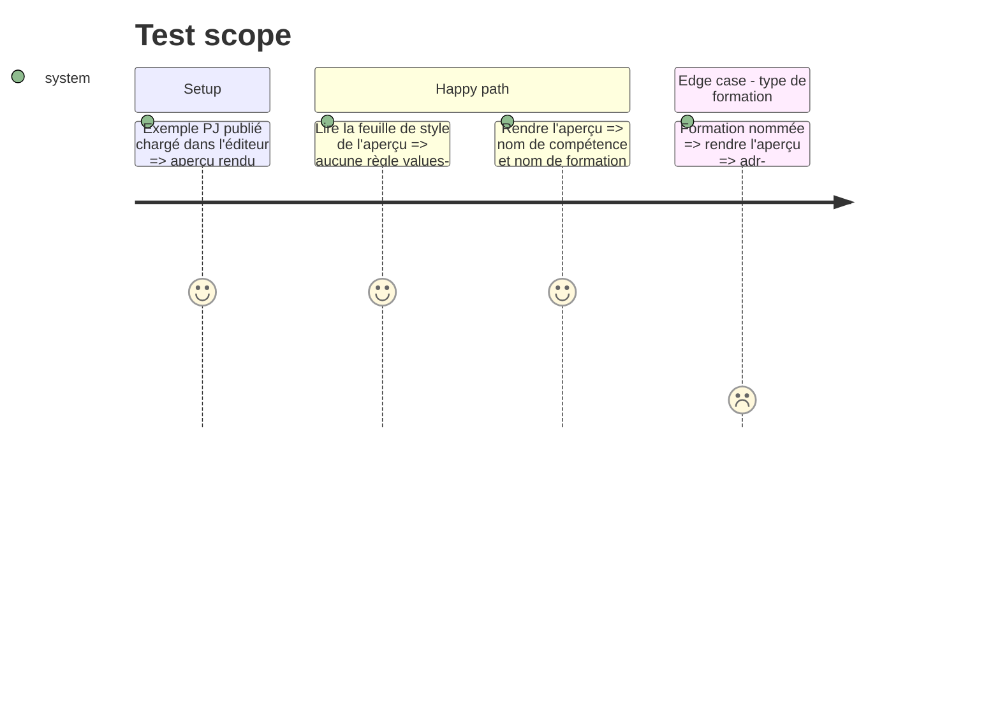

# Instruction: Lantern — retrait de l'exception imprimée

## Architecture projection

```txt
.
├── src/templates/adrenaline/shared/preview/presentationSheet.css   ✏️ retrait de la règle qui réimprime les noms de compétence et de formation
└── tools/assertAdrenalinePj.harness.mts                            ✏️ preuve : aucune règle values-handwritten ne réimprime un nom saisi
```

## User Journey



## Test Scope



## Tasks to do

### `1)` Retirer l'exception

> Les noms saisis suivent la règle des valeurs.

1. Supprimer de `presentationSheet.css` la règle `.adr-pj--values-handwritten .adr-pj__competence .adr-pj__metric-name, .adr-pj--values-handwritten .adr-pj__formation-name` et son commentaire.
2. Vérifier que `adr-pj__formation-type` ne reçoit aucun style manuscrit.

### `2)` Preuve dans `assertAdrenalinePj`

> Le harnais affirme la règle.

1. Le nom de compétence et le nom de formation rendus portent `adr-pj__value` ; le type de formation non.
2. La feuille de style ne contient aucune règle `values-handwritten` qui réimprime un nom saisi.
3. Vérifier que le harnais échoue avant le retrait et passe après.

## Test acceptance criteria

| Task | Acceptance criteria |
| ---- | ------------------- |
| 1 | Dans l'aperçu de l'éditeur, nom de compétence et nom de formation manuscrits, comme dans Handbook ; type de formation imprimé. |
| 2 | `pnpm assert:adrenaline-pj` échoue sans le retrait et passe avec ; `pnpm check` passe. |
