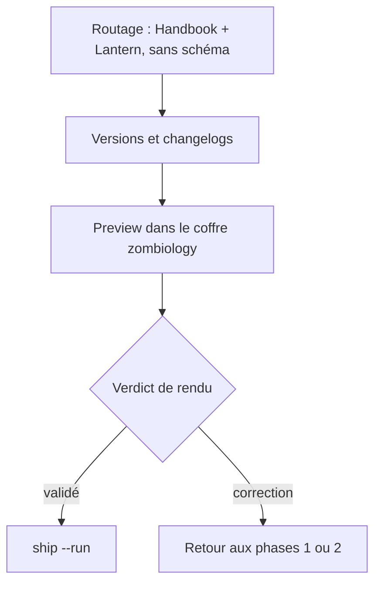
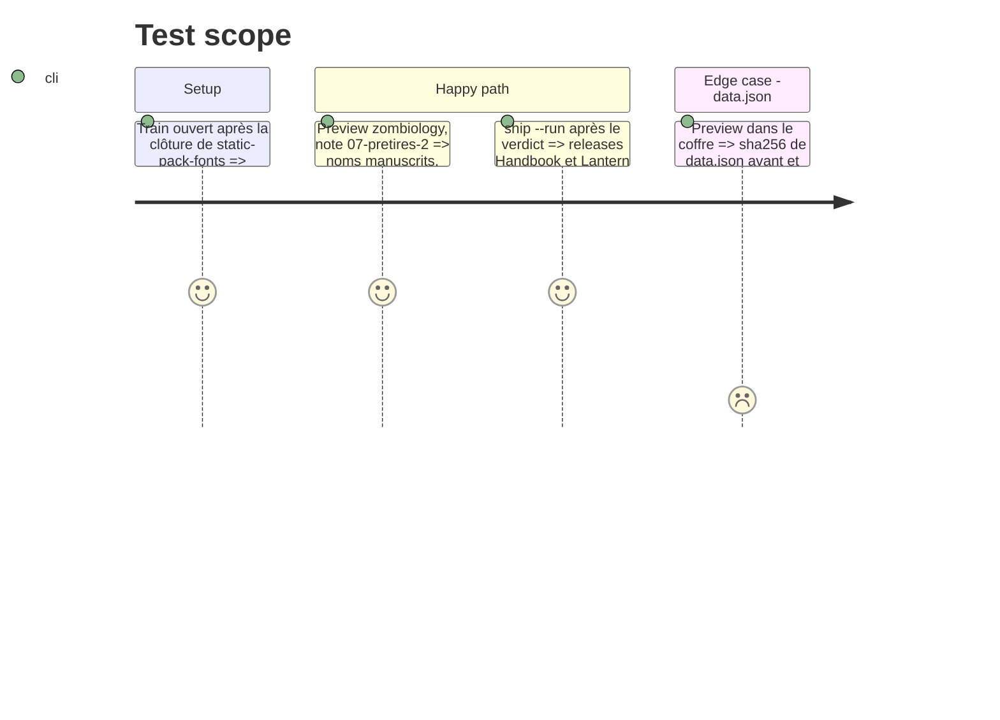

# Instruction: Train — rendu puis livraison

## Architecture projection

```txt
.
├── package.json, manifest.json, versions.json, CHANGELOG.md   ✏️ Handbook : version de correctif (`pnpm version`), préparée par ship-train
└── (lantern) package.json, CHANGELOG.md                       ✏️ Lantern : version de correctif, préparée par ship-train
```

## User Journey



## Test Scope



## Tasks to do

### `1)` Ouvrir le train

> Après la clôture de `static-pack-fonts` (#116), jamais pendant.

1. Router par `route-change`, puis porter le train par `ship-train` (Handbook et Lantern).
2. Préparer la version de correctif et le `CHANGELOG` de chaque dépôt.

### `2)` Rendu

> Verdict sur la référence papier.

1. Preview dans le coffre `zombiology`, note `2026/09/prochain-arret-japon/3. viventes-te-salutant/scenario/07-pretires-2.md`, et dans l'aperçu de Lantern.
2. Comparer avec `_sources/aides-de-jeu/Z1A01_Feuille de PJ pretires.pdf` : noms de compétence et de formation manuscrits ; type de formation, seuils et armes sociales imprimés.
3. Contrôler que le `data.json` du coffre n'a pas changé.

### `3)` Livraison

> Après le verdict, sans nouvel arrêt.

1. `pnpm supervise ship --run`.
2. Clore #118 par le commit du train (`Closes #118`).

## Test acceptance criteria

| Task | Acceptance criteria |
| ---- | ------------------- |
| 1 | Le train ne porte que Handbook et Lantern ; `present` est vert. |
| 2 | La frontière entre manuscrit et imprimé suit la feuille papier ; `data.json` du coffre inchangé. |
| 3 | Releases de Handbook et de Lantern publiées ; #118 clos. |
