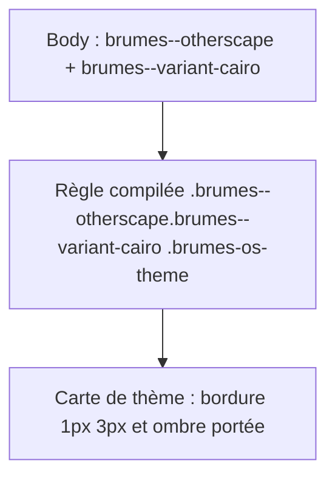
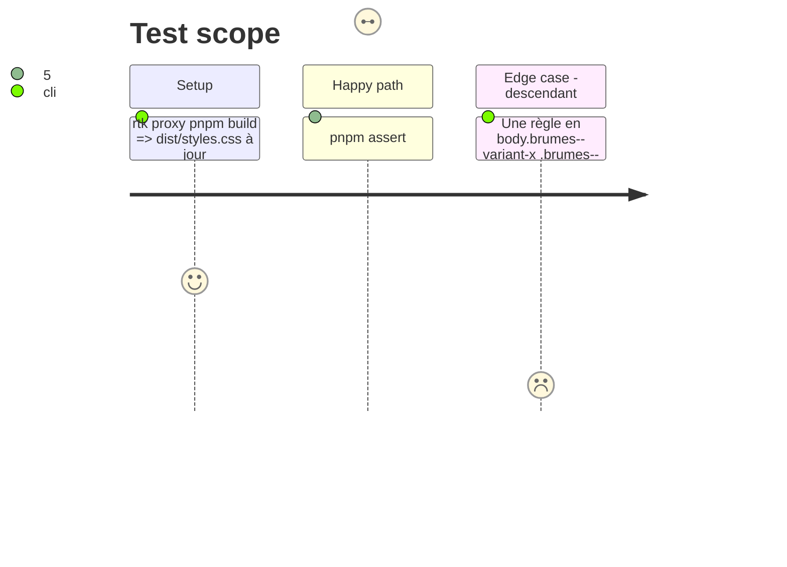

# Instruction: Handbook — sélecteurs de variante Otherscape

## Architecture projection

> Tree of the final files. ✅ create · ✏️ modify · ❌ delete

```txt
obsidian-handbook/
├── src/styles/otherscape/_themes.scss             ✏️ règles cairo et tokyo réécrites en `&.brumes--variant-<id>`
├── src/styles/otherscape/_cards.scss              ✏️ même correction pour la règle cairo des profils
├── src/styles/otherscape/_challenges.scss         ✏️ même correction pour la règle tokyo
├── src/styles/otherscape/_character-creation.scss ✏️ même correction pour la règle tokyo
└── tools/assertGameVariants.harness.mts           ✏️ affirme que chaque règle de variante compilée vise le body qui porte le mode
```

## User Journey



## Test Scope



## Tasks to do

### `1)` Corriger les cinq règles

> Le mixin est inclus sous `.brumes--otherscape`, et c'est le `body` qui porte cette classe. La classe de variante doit donc se composer avec lui au lieu de le précéder comme ancêtre.

1. Remplacer `body.brumes--variant-<id> & X` par `&.brumes--variant-<id> X` dans `_themes.scss:38-39`, `_cards.scss:23`, `_challenges.scss:11` et `_character-creation.scss:8`.

### `2)` Assertion

> Une règle de variante qui ne peut jamais s'appliquer est refusée.

1. Dans le harnais `assertGameVariants`, qui ne lit aujourd'hui que du TypeScript, lire `dist/styles.css` produit par le build, sur le modèle d'`assert-mist-font-packs.mjs`. Échouer clairement si le fichier est absent. En extraire les sélecteurs qui contiennent `brumes--variant-`. Exiger que la classe de variante et `brumes--<jeu>` appartiennent au même sélecteur composé.
2. Prouver l'échec en injectant dans le harnais un sélecteur descendant.

## Test acceptance criteria

| Task | Acceptance criteria |
| ---- | ------------------- |
| 1 | Avec Cairo sélectionnée, une carte de thème Otherscape a la bordure 1px 3px et l'ombre portée accentuée ; avec Metro, elle n'a ni l'une ni l'autre. |
| 2 | `pnpm assert:game-variants` passe sur le build. Sur une règle de variante écrite en descendant, il échoue en nommant le sélecteur. |
