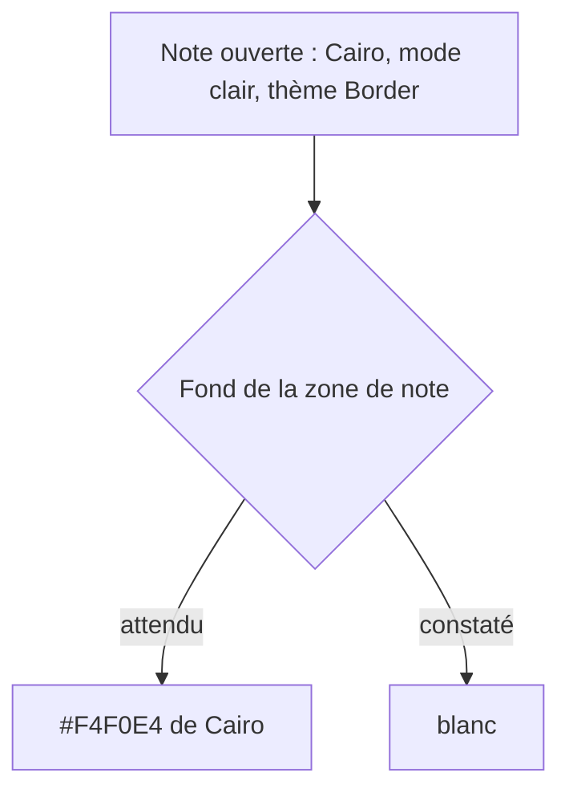
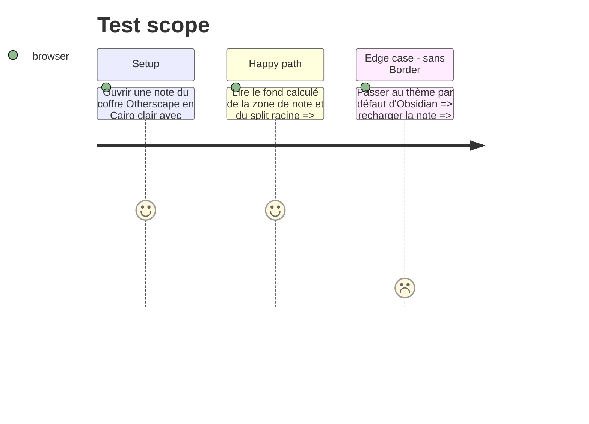

# Instruction: Handbook — fond de note écrasé en clair

## Architecture projection

> Tree of the final files. ✅ create · ✏️ modify · ❌ delete

```txt
obsidian-handbook/
├── src/features/modes/styleElement.ts   ✏️ buildGameStyle peint la feuille Markdown avec --background-primary (NOTE_PAPER)
└── tools/assertStyleScope.harness.mts  ✏️ affirme la règle pour un jeu qui fixe son papier, son absence sinon
```

## User Journey



## Test Scope



## Tasks to do

### `1)` Confirmer la cause avant de corriger

> L'hypothèse C n'est pas tranchée : Border imposerait le blanc en `!important` par une variable résolue sur le `body`.

1. Dans la console du coffre, lire le fond calculé de `.workspace-split.mod-root`, `.workspace-tab-container` et `.view-content`, ainsi que les valeurs de `--background-mod-root-split` et `--background-primary` sur le `body`.
2. Désigner l'élément, la règle et la variable qui produisent le blanc. Si Border n'est pas en cause, s'arrêter et rapporter la cause réelle avant toute modification.

### `2)` Corriger dans la couche du jeu

> Handbook ne modifie pas Border : il fournit la variable que Border consomme, au même niveau que ses autres variables. Cette tâche ne s'exécute que si la tâche 1 désigne Border. L'hypothèse est fragile : si Handbook écrit déjà `--background-primary` sur le `body`, la variable de Border, déclarée sur le même `body`, se résout vers Cairo. Si la tâche 1 désigne autre chose, réécrire cette tâche d'après la cause trouvée.

1. Faire écrire par `buildGameStyle` `--background-mod-root-split` dans chaque couche de polarité qui fixe `--background-primary`. Sa valeur est `--brumes-root-split-background` quand le pack la fixe, `--background-primary` sinon.
2. Étendre l'assertion de portée pour l'exiger.

## Cause constatée (tâche 1)

Établie par lecture, sans console : `theme.css` de Border dans le coffre, `obsidian.asar` et `styleElement.ts`.

- **Élément :** `.workspace-split.mod-root .workspace-tabs.mod-top .workspace-tab-container`.
- **Règle :** Border l. 4568-4576, `background: var(--background-mod-root-split) !important`. Border rend aussi transparents, en `!important`, `.workspace-leaf`, `.workspace-leaf-content` et `.view-content` (l. 4270-4279). C'est pourquoi la règle d'Obsidian `.workspace-split.mod-root .view-content { background-color: var(--background-primary) }`, qui donnerait le crème de Cairo, ne peint plus rien.
- **Variable :** `--background-mod-root-split`, déclarée sur le `body` (l. 4537-4539, classe `mod-root-split-background-primary-light` posée par défaut par Style Settings) en `var(--background-primary) !important`. Elle est substituée sur le `body`, où `--background-primary` est encore le blanc de Border, puisque Handbook ne l'écrit que sur la feuille Markdown et ses descendants. Les enfants héritent donc du blanc.

### Dérive par rapport à la tâche 2 prévue

Écrire `--background-mod-root-split` dans la couche du jeu, sur le `body`, perdrait contre la déclaration `!important` de Border sur ce même `body`. De plus, au niveau du split, seul le blanc de Border est connu. Le correctif retenu peint donc la feuille elle-même, là où vit le papier du jeu : `body.brumes--<mode> .workspace-split.mod-root .workspace-leaf-content[data-type="markdown"] { background-color: var(--background-primary) !important }`. La spécificité (0,5,1) l'emporte sur la transparence de Border (0,4,1). La règle n'est écrite que pour un jeu dont une couche de note fixe `--background-primary`. Elle ne nomme ni Border ni ses variables. Sous le thème par défaut, elle reproduit ce que fait déjà Obsidian.

## Test acceptance criteria

| Task | Acceptance criteria |
| ---- | ------------------- |
| 1 | L'élément, la règle et la variable à l'origine du fond blanc sont nommés et consignés dans cette phase avant tout correctif. |
| 2 | En Cairo clair avec Border, la zone de note prend le fond crème de Cairo ; le fond reste juste en sombre et à l'impression. |
