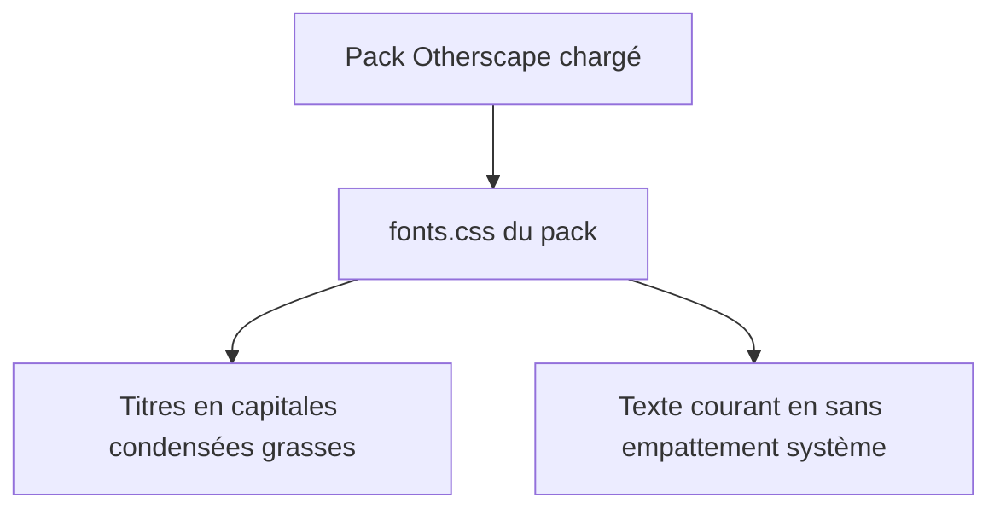
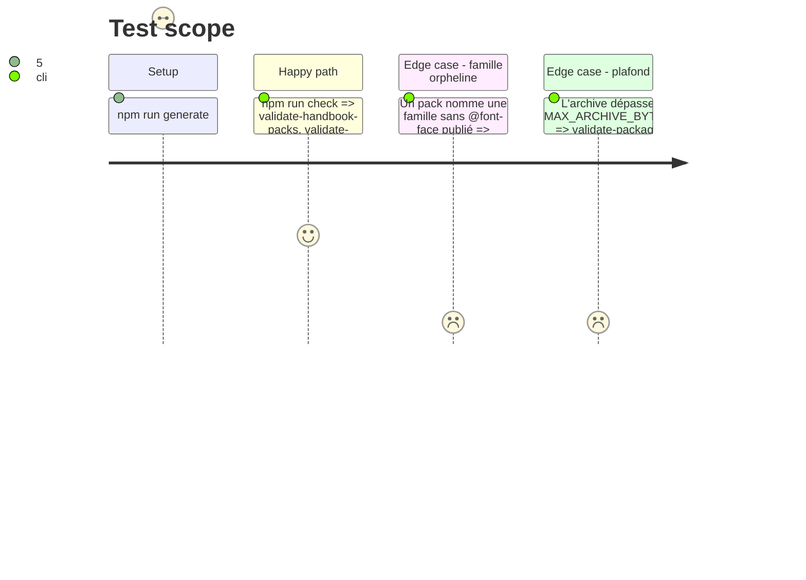

# Instruction: schema-in-the-mist — typographie condensée d'Otherscape

## Architecture projection

> Tree of the final files. ✅ create · ✏️ modify · ❌ delete

```txt
schema-in-the-mist/
├── schemas/otherscape/design/tokens.json                                  ✏️ font.family.display = face condensée ; font.family.sans = pile système
├── handbook/otherscape/pack.json                                          ✏️ --font-*, --h1-font à --h6-font, --inline-title-font régénérés ; WOFF2 ajoutée à pack.assets.resources
├── handbook/otherscape/assets/styles/fonts.css                            ✏️ ajoute le @font-face de la face condensée
├── handbook/otherscape/assets/styles/fonts/<face>-latin-700-normal.woff2  ✅ sous-ensemble latin, OFL
├── handbook/LICENSES/<Face>.LICENSE.txt                                   ✅ notice OFL
├── handbook/README.md                                                     ✏️ consigne l'exception d'Otherscape au contrat à deux faces, et sa raison
└── tools/validate-handbook-packs.ts                                       ✏️ toute famille nommée par un pack a un @font-face publié, ou est générique ou système
```

## User Journey



## Test Scope



## Tasks to do

### `1)` Choisir et mesurer la face

> Une seule face, dans la marge mesurée d'environ 27 kB.

1. Prendre Fira Sans Extra Condensed 700 (OFL) en sous-ensemble latin WOFF2, puis mesurer l'archive par `npm pack --dry-run`. Une WOFF2 ne se compresse plus dans le tgz : l'ancienne `fira-sans-extra-condensed-1.woff2` pesait 26 124 octets pour environ 27 kB de marge. Le dépassement est donc un risque attendu.
2. Si le plafond est dépassé, ne pas le relever : s'arrêter et rapporter la mesure.

### `2)` Projeter

> Les jetons portent la décision ; le pack en est généré.

1. Dans `tokens.json`, mettre `font.family.display` sur la face condensée et `font.family.sans` sur une pile système sans empattement.
2. Régénérer le pack et publier `fonts.css`, la WOFF2 et la notice. Déclarer la WOFF2 dans `pack.assets.resources`, où sont déjà les deux autres faces. Consigner l'exception au README.

### `3)` Garde de cohérence des polices

> Le défaut d'origine, un pack qui nomme une police qu'il ne publie pas, ne doit plus passer.

1. Dans `validate-handbook-packs.ts`, refuser toute famille nommée dans les `--*-font*` d'un pack qui n'a pas de `@font-face` dans ses feuilles publiées. Les familles génériques et les piles système listées en sont exemptées.

## Test acceptance criteria

| Task | Acceptance criteria |
| ---- | ------------------- |
| 1 | L'archive publiée reste sous `MAX_ARCHIVE_BYTES`, et la mesure est consignée. |
| 2 | Les titres Otherscape s'affichent en capitales condensées grasses et le texte en sans empattement, sans aucun téléchargement réseau. |
| 3 | `npm run check` refuse un pack qui nomme une famille non publiée. |

## Constats et dérives

- **Mesure :** `npm pack --dry-run` donne 439 026 octets pour 200 fichiers, sous `MAX_ARCHIVE_BYTES` (538 582). Le paquet faisait environ 511 kB avant cette phase.
- **Graisse 800 au lieu de 700 :** la face vient de l'historique du dépôt (`d8a4e84^`, `fira-sans-extra-condensed-3.woff2`, normale 800, latin), déjà publiée avant #16 avec sa notice `handbook/LICENSES/Fira.LICENSE.txt`, sans aucun téléchargement. Les titres demandent `font.weight.black` (900) : le navigateur prend la face 800, la plus proche, sans graisse synthétique.
- **IM Fell et Averia retirés d'Otherscape :** plus aucun jeton ni aucune feuille du pack ne les nommait. Les retirer libère environ 98 kB, d'où la mesure ci-dessus. Le pack ne publie plus qu'une face ; City of Mist et Legend in the Mist gardent le contrat à deux faces.
- **Projection typographique générée :** `handbook-projection.json` reçoit un bloc `base`. `tools/build-otherscape-handbook-design.ts` l'écrit dans `pack.style.base.note` (`--write`) et refuse une dérive (`--check`).
- **Garde des familles (tâche 3) :** elle couvre les jetons `--font-*-theme` et `--*-font`, ainsi que les `font-family` des feuilles hors `@font-face`. Preuve : sans l'`@font-face` de Fira, `validate:handbook-packs` échoue avec « names the font family "fira sans extra condensed", which no published @font-face declares ».
- **Gardes adaptées hors plan :**
  - `tools/validate-package.ts` attend la face Fira d'Otherscape et l'exempte de la garde du contrat à deux faces.
  - `tools/assert-mist-font-packs.mjs` (Handbook) déclare ses faces pack par pack. Il passe contre le dépôt local et échoue contre l'épingle publiée tant que le train n'a pas publié puis adopté la nouvelle version de `schema-in-the-mist`.
- `npm run check` (schema-in-the-mist) est vert ; `pnpm lint` (Handbook) aussi.
