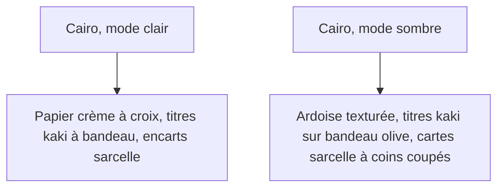
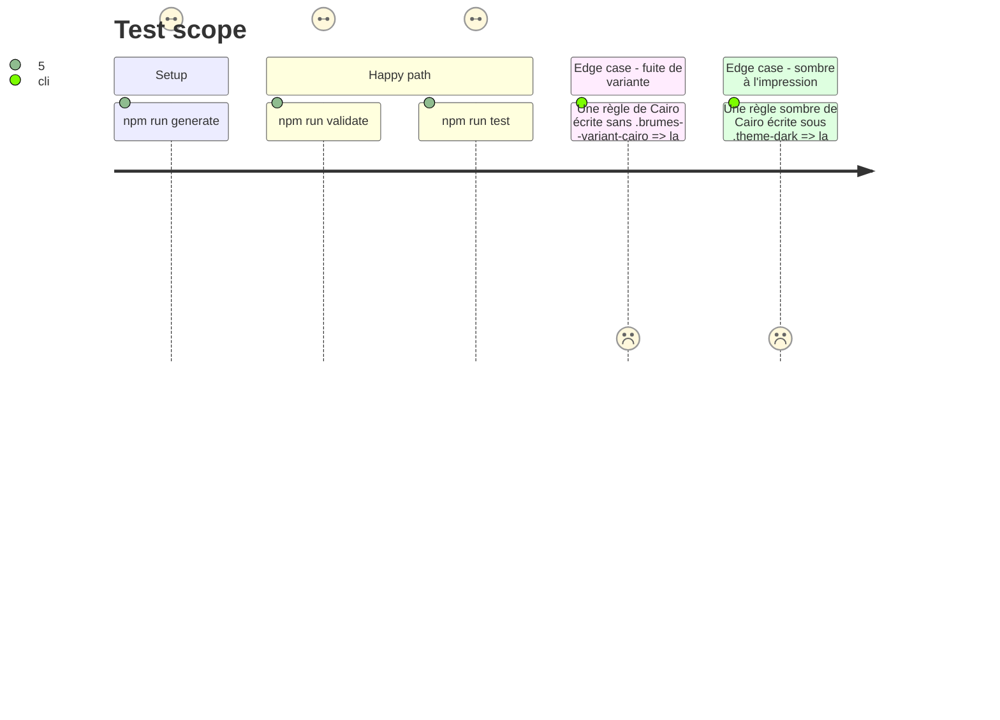

# Instruction: schema-in-the-mist — projection du design Cairo (clair et sombre)

## Architecture projection

> Tree of the final files. ✅ create · ✏️ modify · ❌ delete

```txt
schema-in-the-mist/
├── schemas/otherscape/design/tokens.json              ✏️ jetons de Cairo : papier, ardoise, kaki, sarcelle, olive
├── schemas/otherscape/design/components.json          ✏️ titre à bandeau, sous-titre surligné, encart, carte à coins coupés, étiquette de catégorie
├── schemas/otherscape/design/handbook-projection.json ✏️ projection par variante : metro inchangée ; cairo en clair et en sombre, avec ses maquettes de preuve
├── tools/build-otherscape-handbook-design.ts          ✏️ génère les règles de chaque variante projetée
├── tools/validate-otherscape-design.ts                ✏️ chaque mode projeté nomme ses maquettes de preuve
├── handbook/otherscape/assets/styles/otherscape.css   ✏️ ajoute la section body.brumes--otherscape.brumes--variant-cairo, avec le sombre sous .brumes--colour-dark comme metro (jamais .theme-dark, qui resterait sombre à l'impression)
└── handbook/otherscape/pack.json                      ✏️ couches de Cairo régénérées
```

## User Journey



## Test Scope



## Tasks to do

### `1)` Fixer la cible avant d'écrire

> Conduite de rendu : la cible est validée d'abord, avec au plus deux cycles de correction et trois points de contrôle fixés d'avance.

1. Relever sur les maquettes, composant par composant : couleurs, casse, graisse, bordures et espacements. Soumettre ce relevé à l'utilisateur.
2. Fixer les trois points de contrôle du rendu :
   - `cairo-subtags.jpg`, pour le clair : H2 à bandeau, sous-titre surligné, fond ;
   - `cairo-dark.jpg`, pour le sombre : H1, chapo, H3 en étiquettes ;
   - `cairo-tropes.jpg`, pour les cartes et l'étiquette de catégorie.

### `2)` Jetons et composants

> Le design vit dans le schéma, et le pack en est généré.

1. Ajouter les jetons et composants de Cairo listés plus haut. La texture de croix est un motif CSS, pas une image.
2. La carte à coins coupés du schéma devient la seule présentation des cartes `.brumes-os-theme` et des profils en Cairo. Elle remplace l'ombre portée et la bordure 1px 3px que Handbook pose en phase 1 ; Handbook retire ces règles en phase 5.
3. Déclarer la projection `cairo` dans `handbook-projection.json` :
   - preuves du clair : `cairo-light.jpg`, `cairo-subtags.jpg`, `cairo-list.jpg` ;
   - preuves du sombre : `cairo-dark.jpg`, `cairo-tropes.jpg`.

### `3)` Génération et garde

> Chaque variante projetée écrit ses règles sous sa propre classe, et ses règles de polarité sous un sélecteur composé.

1. Étendre le générateur et le validateur, puis vérifier `--check` et le plafond d'archive.
2. Faire refuser par le validateur toute règle sombre d'une variante qui ne passe pas par `.brumes--colour-dark`.

## Test acceptance criteria

| Task | Acceptance criteria |
| ---- | ------------------- |
| 1 | L'utilisateur approuve la cible de chaque composant et les trois points de contrôle avant toute génération. |
| 2 | Cairo a, en clair comme en sombre, ses jetons, ses composants et ses maquettes de preuve ; Metro reste inchangée. |
| 3 | `npm run check` est au vert. Aucune règle de Cairo ne s'applique hors de `.brumes--variant-cairo`, et l'export PDF d'une note en Cairo sombre sort sur papier clair. |

## Cible relevée (tâche 1, validée le 2026-11-04)

Mesures par couleur dominante d'une zone (JPEG, quantifiées au pas de 8), arrondies. Toutes les maquettes sont dans `Perso/RPG/otherscape/_sources/Design/`.

| Composant | Clair | Sombre | Forme |
| --- | --- | --- | --- |
| Fond de note | crème `#F0EDE4`, croix fines en motif CSS | ardoise `#1C2422`, texture discrète en motif CSS | — |
| Texte courant | quasi noir `#1E1E1E` | gris clair `#E6E6DE` | sans empattement système, normal |
| H1 | bandeau kaki `#D6C686`, texte brun-noir `#201408` | bandeau taupe `#48403A`, texte kaki `#D0B868` | capitales condensées 800, très grand ; coin droit coupé |
| Chapo (1er paragraphe sous H1) | brun-noir, plus grand | gris clair `#DCE2E2`, plus grand | sans empattement, normal, environ 1,3 em |
| H2 | bandeau kaki pâle `#E2D9A5`, texte brun-noir | bandeau taupe `#48403A`, texte kaki | capitales condensées 800, bandeau à la largeur du texte |
| Sous-titre (H2 suivi d'un `*italique*`) | surligné jaune pâle `#F6F2A8`, texte brun-noir italique | surligné olive `#5E6600`, texte jaune pâle | italique, largeur du texte |
| H3 | étiquette taupe `#48403A`, texte kaki | identique | capitales condensées 800, petite étiquette |
| Encart (callout) | fond sarcelle pâle `#D9E4E0`, double filet `#C2D6D4`, titre noir italique condensé | fond `#283840`, filet `#304040` | coins coupés, chevrons kaki `#D0B868` en haut et en bas |
| Carte `.brumes-os-theme` / profil | fond `#D9E4E0` | fond `#283840`, bord `#304040` | coins coupés, sans ombre ni bordure 1px 3px |
| Titre de carte | sarcelle foncée `#00756A` (déduite) | sarcelle `#37C298` | capitales condensées 800 |
| Étiquette de catégorie | taupe `#48403A`, texte kaki | identique | capitales condensées 800, petite |
| Filet de section de carte (« THEME KITS ») | sarcelle | sarcelle `#2E9A88` | filet 1px et libellé en capitales, aligné à droite |
| Surlignage (`==…==`), tag | jaune pâle `#F6F2A8` | olive `#5E6600`, texte `#E8F0B0` | — |
| Accent (liens, puces, cases) | sarcelle `#00758F` | sarcelle `#37C298` | remplace le framboise `#A82D51` / `#D54872`, absent des maquettes |

Points de contrôle du rendu :

1. `cairo-subtags.jpg` (clair) : H2 à bandeau kaki, sous-titre surligné jaune, papier crème.
2. `cairo-dark.jpg` (sombre) : H1 à bandeau taupe et texte kaki, chapo plus grand, H3 en étiquettes.
3. `cairo-tropes.jpg` (cartes) : carte ardoise à coins coupés, titre sarcelle, étiquette de catégorie taupe.

Décisions de l'utilisateur (2026-11-04) : relevé et points de contrôle approuvés tels quels ; accent framboise remplacé par la sarcelle ; en clair, les cartes prennent la peau des encarts (`#D9E4E0`, titre `#00756A`).

## Constats et dérives

- **Projection en v2.0.0.** `handbook-projection.json` passe d'une variante unique (`variant: "metro"`, `note`) à `variants.<id>` (`modes`, `note`, et pour Cairo `derived`, `workspace`, `sheet`, `contrast`). Le générateur et le validateur ne lisent plus que cette forme. Metro est inchangée : sa couche `style` dans `pack.json` est identique octet pour octet à `HEAD`.
- **Accent projeté avec sa rampe.** Un pack JSON n'a pas le calcul de `tokens.ts` : `derived` écrit `--accent-h/s/l` depuis le `--color-accent` projeté, sinon la rampe d'Obsidian restait framboise.
- **Cadre de l'espace de travail.** Cairo projette une couche `workspace` (`--background-secondary`, `--brumes-root-split-background`), que Handbook lit déjà (`fromSchema.ts`) ; Metro n'en a toujours pas.
- **`--h3-color` = couleur de titre.** L'étiquette du H3 (fond taupe, texte kaki, identique dans les deux modes) est portée par la feuille (`--os-cairo-label*`), pas par la couche note.
- **Coins coupés** : `corner-shape: bevel`, avec un repli `@supports not` en `clip-path` octogonal.
- **Texture** : deux `radial-gradient` sous `@media screen` seulement, rien à l'impression.
- **Gardes du validateur**, chacune prouvée par un échec provoqué puis restauré :
  - une règle sous `.theme-dark` est refusée ;
  - une règle hors d'une `.brumes--variant-<id>` déclarée est refusée ;
  - une variable `--os-cairo-*` lue hors de `.brumes--variant-cairo` est refusée ;
  - une paire de `contrast` sous son seuil, en clair ou en sombre, est refusée.
- **Mesures** : `npm run check` vert ; `npm pack --dry-run` à 440,3 kB, sous le plafond de 538 582 octets.
- `release.json` et `design-system.md` ne sont pas touchés : la version se prépare avec le train (phase 5).
