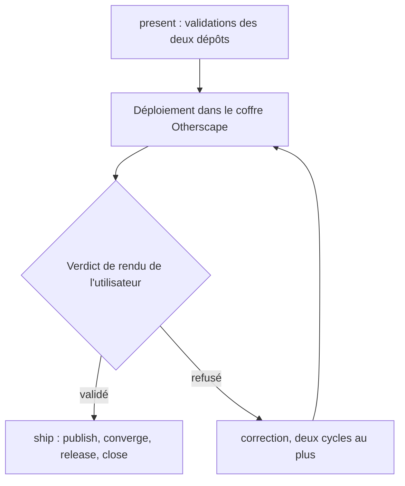
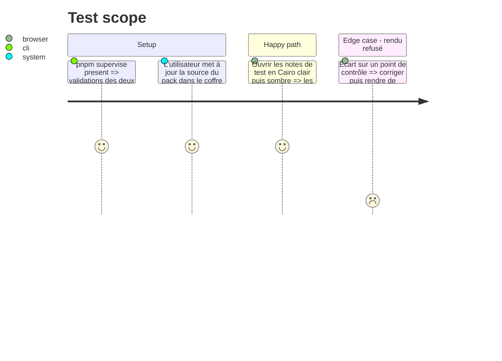

# Instruction: Train — rendu dans le coffre puis livraison

## Architecture projection

> Tree of the final files. ✅ create · ✏️ modify · ❌ delete

```txt
obsidian-handbook/
├── package.json                  ✏️ épingle schema-in-the-mist v<N+1>
├── CHANGELOG.md                  ✏️ section de la version v<M+1>
├── manifest.json, versions.json  ✏️ mis à jour par `pnpm version`
├── src/styles/otherscape/_themes.scss, _cards.scss ✏️ retire les règles Cairo remplacées par la carte du schéma (Tokyo garde les siennes)
└── supervisor/trains/otherscape-variantes-design.json ✅ topologie du train schema-in-the-mist → Handbook
```

## User Journey



## Test Scope



## Tasks to do

### `1)` Présenter et déployer

> Tout se contrôle avant le départ du train.

1. Dans Handbook, retirer les règles Cairo de `_themes.scss` et `_cards.scss`, remplacées par la carte du schéma. Les règles Tokyo restent.
2. Écrire `supervisor/trains/otherscape-variantes-design.json` (schema-in-the-mist → Handbook) et lancer `pnpm supervise present`.
3. Déployer `dist/` dans le coffre Otherscape, sans jamais écraser `data.json`. La mise à jour de la source du pack est un geste de l'utilisateur.

### `2)` Verdict de rendu

> On ne demande à l'utilisateur que le verdict de rendu.

1. Comparer le rendu aux trois points de contrôle fixés en phase 4, et présenter les captures.

### `3)` Livrer et suivre

> Après le verdict, le train s'exécute sans autre validation.

1. Lancer `pnpm supervise ship --run` ; le commit du train se termine par les `Closes #` concernés.
2. Ouvrir le ticket Tokyo : même chemin que Cairo, à partir des maquettes `tokyo-*.jpg`.

## Test acceptance criteria

| Task | Acceptance criteria |
| ---- | ------------------- |
| 1 | Une carte de thème en Cairo ne porte plus que la présentation du schéma. `present` est au vert sur les deux dépôts avant tout déploiement. |
| 2 | L'utilisateur valide Cairo, en clair et en sombre, sur les trois points de contrôle. |
| 3 | schema-in-the-mist v<N+1> et Handbook v<M+1> sont publiés, et un ticket Tokyo existe. |

## Constats et dérives

- **Premier verdict de rendu refusé** (2026-11-04) : les titres portaient le filet de couleur à gauche que Border dessine ; il est neutralisé pour Otherscape (`_headings.scss`). La capture « pas Cairo » montrait en fait Tokyo, l'univers sélectionné dans les réglages.
- **Une polarité par variante**, décision de l'utilisateur (2026-11-04) : Cairo en clair, Metro et Tokyo en sombre. Le pack déclare `polarities` par variante et ne porte que cette couche ; la projection ne nomme qu'un mode par variante, et le validateur l'impose. Handbook savait déjà tenir une polarité par variante (`effectiveColourScheme`) : aucun code consommateur ne change, le réglage « Jeu de couleurs » disparaît pour ces variantes. Le point de contrôle 2 (`cairo-dark.jpg`) ne vaut plus que pour la section `alternate`.
- **Deuxième verdict refusé** (2026-11-04) : titres trop gros et sans bandeau visible, d'après `cairo-light.jpg` — la capture montrait encore Tokyo, l'univers resté sélectionné. Cairo prend des tailles de titre propres (H1 2.4em, H2 1.35em, H3 1.05em, jetons `font.size.cairo.*`) ; le sombre de Cairo (`cairo-dark.jpg`, `cairo-tropes.jpg`) devient la section `alternate` (`style.section.note` + variables de feuille sous `.handbook-mode-alternate`, écran seulement). La copie figée du contrat `GamePack` dans schema-in-the-mist ignorait `style.section` : resynchronisée sur celle de Handbook.
