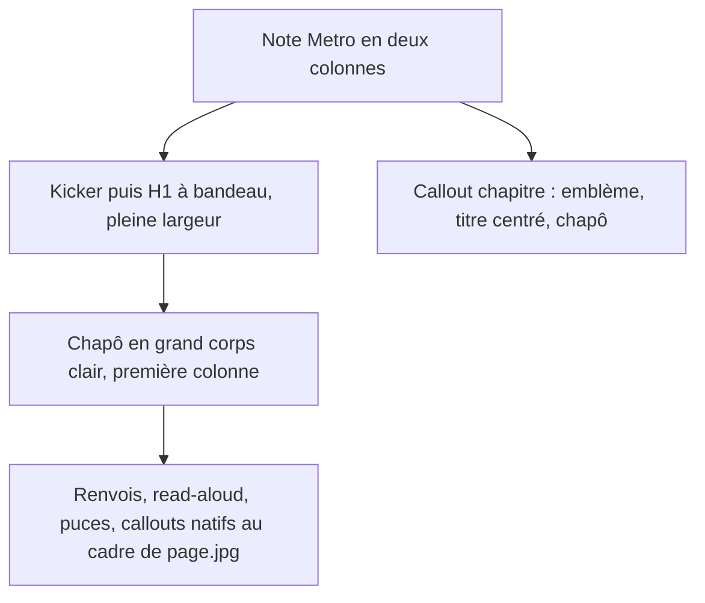
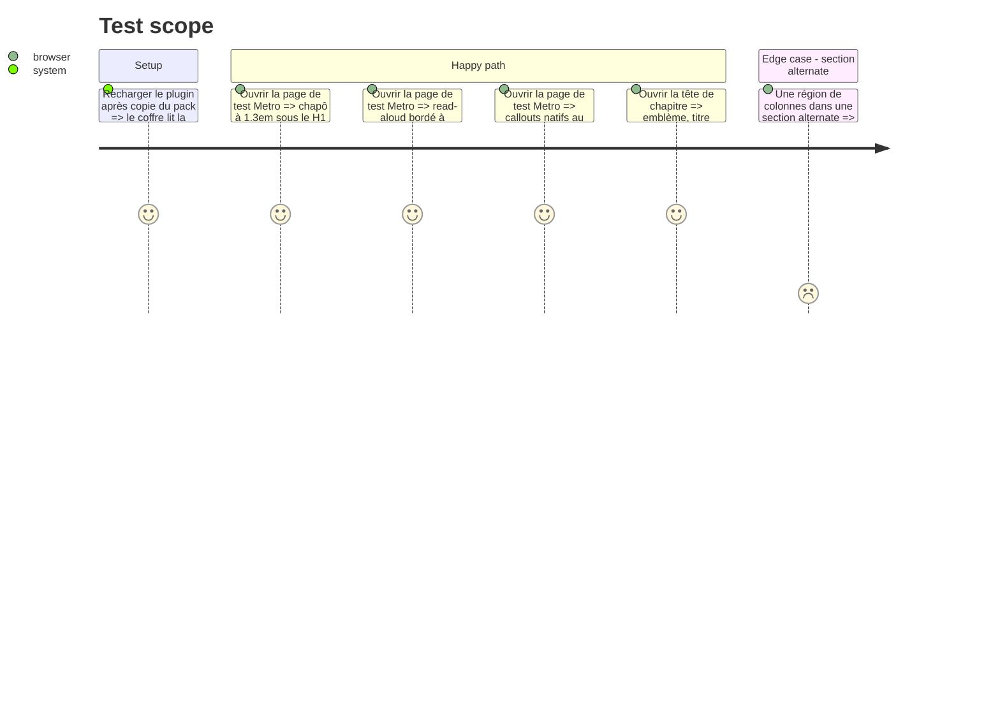

# Instruction: Metro — finir la page de scénario et la tête de chapitre

## Architecture projection

> Tree of the final files. ✅ create · ✏️ modify · ❌ delete

```txt
schema-in-the-mist/
├── tools/build-otherscape-handbook-design.ts        ✏️ chapô qui traverse un marqueur de région, callouts natifs au cadre de `page.jpg` (languette rayée), renvoi et read-aloud sans texture, puces, tête de chapitre
├── schemas/otherscape/design/handbook-projection.json ✏️ preuves `description.jpg` et `chapter-title.jpg` pour Metro, variable `--os-metro-tab`
├── schemas/otherscape/design/tokens.json              ✏️ couleur sémantique Metro `tab` (signal), dans les deux couches
├── src/callouts.ts                                   ✏️ callout `chapter` (tête de chapitre), corps seul
├── schemas/otherscape/design/components.json         (inchangé, voir Decisions)
├── schemas/otherscape/design/release.json            (inchangé, voir Decisions)
├── handbook/otherscape/assets/metro-emblem.svg       ✅ emblème de tête de chapitre, rôle `metro-emblem`
├── handbook/otherscape/assets/metro-crosshair.svg    ❌ croix de repérage retirées au cycle 2, jamais publiées
├── handbook/otherscape/pack.json                     ✏️ rôle d'image `metro-emblem`, feuille régénérée
├── handbook/otherscape/assets/styles/otherscape.css  ✏️ régénérée
└── CHANGELOG.md                                      ✏️ section v<N+1> du train #121, déjà ouverte
obsidian-handbook/
├── src/features/layoutRegions/postProcessor.ts       (inchangé : le pack traverse le marqueur, voir Decisions)
├── src/features/callouts/nativeCallouts.ts           ✏️ icône `book-open` du callout chapitre
├── src/styles/_layout-regions.scss                   ✏️ puce en position relative dans une région en colonnes (Chromium ne la peignait pas)
├── tools/assertCallouts.harness.mts                  (inchangé : générique sur la liste publiée)
└── aidd_docs/tasks/2026_11/2026_11_04_otherscape-variantes-design/phase-5.md ✏️ constat : la page Metro rejoint le verdict du train #121
coffre Otherscape/
└── Handbook - Test page Metro.md                     ✏️ chapô, puces, renvoi en ligne, tête de chapitre
```

## User Journey



## Test Scope



## Tasks to do

### `1)` Écarts de la page de scénario

> La page de test rend `act-0-crew.png` et `description.jpg` point par point.

1. Mesurer par sonde (coffre isolé, port 9241) si le marqueur `handbook-layout` laisse un bloc entre `.el-h1` et `.el-p`. S'il en laisse un, Handbook le retire du flux (une région ne doit pas changer la grammaire de la note) ; sinon, la cause est le pack non rechargé et rien ne change.
2. ~~Retirer en Metro le cadre de carte des callouts natifs.~~ Refusé au cycle 1 : les callouts natifs gardent le cadre biseauté cyan de la variante, qui est l'encadré titré de `page.jpg`, avec sa languette rayée rouge.
3. Puces de la maquette (point centré, retrait suspendu) ; renvoi en ligne (« Read outloud **Rapid Download #3** », bande grise sur une ligne) en callout `renvoi` d'une ligne.
4. Comparer l'écart de largeur de colonne entre le papier clair (278 px) et la section `alternate` (310 px) ; l'aligner s'il se voit.

### `2)` Tête de chapitre

> `chapter-title.jpg` s'écrit en Markdown et se rend.

1. Déclarer le callout `[!chapter]` (décision du plan : titre = titre du chapitre, corps = chapô), corps seul comme les autres callouts visuels ; Handbook le reconnaît par la liste publiée.
2. Dessiner `os-chapter-header` : emblème du pack (rôle `metro-emblem`, masque teinté), titre centré en display géant, chapô sur deux colonnes.
3. Ajouter un exemple à la page de test et les preuves à la projection.

## Test acceptance criteria

| Task | Acceptance criteria |
| ---- | ------------------- |
| 1 | En Metro, sur la page de test en deux colonnes, le chapô, le renvoi, le read-aloud, les puces et les callouts natifs correspondent à `act-0-crew.png`, en clair comme dans la section `alternate`. |
| 2 | Un callout chapitre rend `chapter-title.jpg` : emblème, titre centré, chapô sur deux colonnes ; sans le rôle `metro-emblem`, l'emblème est simplement absent. `npm run check` et `pnpm check` sont au vert. |

Points de contrôle du verdict (fixés d'avance) : 1) en-tête de l'acte 0 et chapô, 2) renvoi, read-aloud et puces, 3) tête de chapitre.

## Decisions

| Decision | Why |
| -------- | --- |
| Le chapô traverse le marqueur dans le sélecteur du pack (`.el-h1 + .handbook-layout-marker + .el-p > p`), sans changer le post-processeur de Handbook. | Sonde du 2026-11-06 : le commentaire `handbook-layout` devient une section Obsidian (`div.handbook-layout-marker`, `display:none`) entre le H1 et le paragraphe. Cette section appartient à Obsidian : la retirer du flux casserait la correspondance ligne ↔ section. |
| `components.json` et `release.json` restent inchangés. | `chapter-header` y est déjà déclaré ; seul son dessin manquait. `sourceHash` n'est lu par aucun outil (décision du plan corrigée). |
| La tête de chapitre est un callout `title-body` (le titre est montré), contrairement au renvoi et au read-aloud. | Son titre est le titre du chapitre. L'écriture `[!chapter] Titre` reste soumise au verdict de rendu. |
| L'écart 278 / 310 px (tâche 1.4) ne se corrige pas. | Les blocs `alternate` portent `padding: 16px` et `margin: -16px` pour que le papier sombre déborde dans la gouttière ; leur texte fait 310 − 32 = 278 px, comme en clair. |
| La puce nomme son encre (`--list-marker-color: var(--text-normal)`) et annule l'anneau (`--list-bullet-size-alt: 0px`). | `currentColor` se résolvait sur `.list-bullet`, dont la couleur est transparente ; Border dessine le premier niveau en anneau. |
| Cycle 2 : les callouts natifs gardent le cadre biseauté cyan et gagnent la languette rayée de `page.jpg` (couleur sémantique `tab`, ajoutée à `tokens.json`). | Verdict du cycle 1 (« ce n'est pas encore ça ») : le callout natif plat et gris n'existe dans aucune maquette ; l'encadré titré de `page.jpg` (« THEMATIC PILLARS ») est ce cadre. La couleur passe par le contrat, pas par un littéral. |
| Cycle 2 : le renvoi et le read-aloud perdent les lignes de balayage et les croix ; `metro-crosshair` est retiré du pack. | `act-0-crew.png` les montre unis : bande grise serrée, et texte en machine à écrire posé sur le papier avec un simple filet gauche. La trame de la maquette appartient au papier ; elle n'est pas reprise ici (fond de note au choix de l'utilisateur). |
| La puce d'une région en colonnes est corrigée dans Handbook (`_layout-regions.scss`), pas dans le pack. | Le défaut vient de Chromium (pseudo-élément `absolute` non peint dans une boîte de colonne) et touche toute région, quel que soit le jeu. |
| Un titre de callout prend l'encre de surface aussi par `--callout-title-color`. | La base Otherscape de Handbook fixe `--callout-title-color: black`, que lit `.callout-title-inner` : les titres étaient noirs sur la section sombre. |

## Constats

- Sonde du 2026-11-06 (coffre isolé, port 9241), papier clair : chapô à 20,8 px (1.3em), callout natif sans bordure ni `clip-path`, `li + li` à 0,55em, titre du chapitre à 48 px (3em) centré, emblème en masque, corps du chapitre sur deux colonnes, premier paragraphe en chapô suivi d'un saut de colonne.
- ~~Première puce non peinte~~ : au cycle 2, aucune puce n'était peinte dans la sonde, et une feuille vide n'y changeait plus rien. Rien ne les recouvrait (`elementsFromPoint`). Le `::after` absolu de `.list-bullet` n'est pas peint dans une boîte de colonne ; en position relative, il l'est, aux mêmes décalages. La marque parasite devant le chapô (capture du cycle 1) a disparu avec ce correctif.
- **Cycle de rendu 1 refusé** le 2026-11-06 (« ce n'est pas encore ça », capture de la page claire) : renvoi et read-aloud tramés, callouts natifs plats et gris, titres de callouts noirs sur la section sombre. Le cycle 2 est le dernier permis.
- **Cycle de rendu 2 validé** le 2026-11-07 (« beaucoup mieux, continue », capture de l'acte 0 : en-tête, chapô, renvois, read-aloud et callouts natifs à languette). La phase attend le train #121 pour se clore.
- `assert:provider-capabilities` reste rouge en local : `schema-pbta` porte des modifications non commitées qui empêchent son `pull --ff-only`. `schema-adrenaline` a été avancé. Le reste de `pnpm check` est vert (`HANDBOOK_CHECK_SKIP=assert:provider-capabilities`), tout comme `npm run check`, le build et les deux portées de lint.
