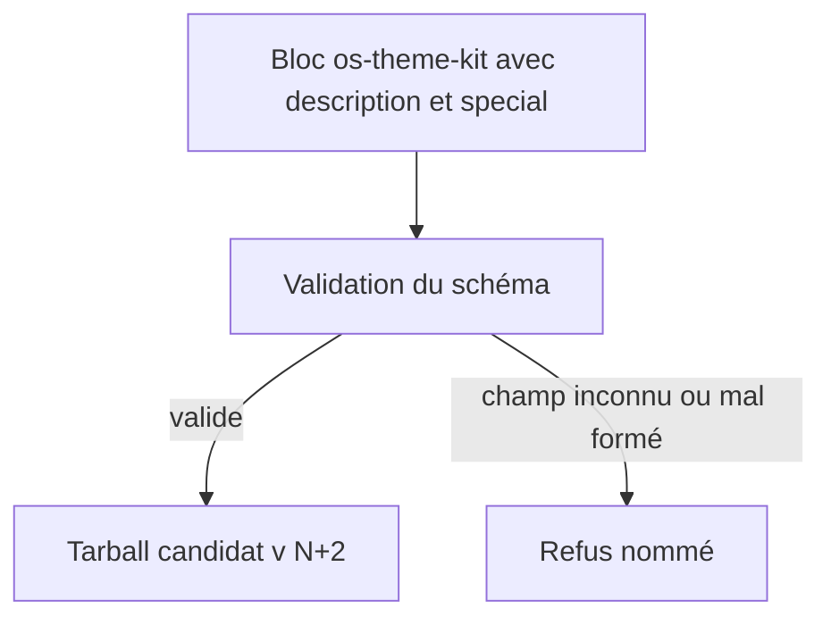
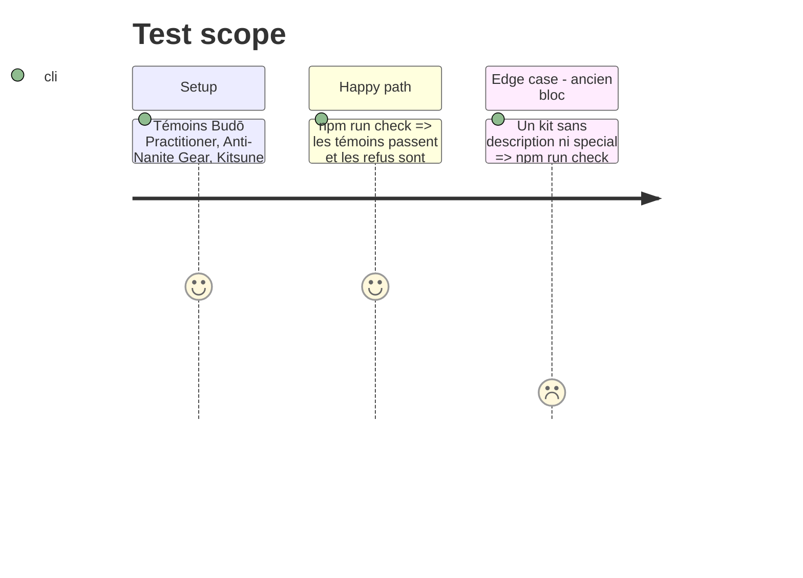

# Instruction: schema-in-the-mist — contrat des kits et des power sets

## Architecture projection

> Tree of the final files. ✅ create · ✏️ modify · ❌ delete

```txt
schema-in-the-mist/
├── schemas/otherscape/theme-kit.schema.json   ✏️ `description` (Markdown), `special` (`name`, `description`)
├── schemas/otherscape/power-set.schema.json   ✏️ `tags_and_statuses`, marque de limite d'après la règle
├── schemas/otherscape/character-trope.schema.json ✏️ `page` optionnel sur chaque kit cité (renvoi de page de `tokyo-theme-set.jpg`)
├── src/zod/otherscape/                         ✏️ types zod des deux blocs, métadonnées de présentation (zones, intitulés)
├── src/codecs/                                 ✏️ lecture et écriture TOML des nouveaux champs
├── examples/otherscape/theme-kit/, power-set/  ✏️ exemples des maquettes (Budō Practitioner, Kitsune Charm…)
├── corpus/contract/valid/, invalid/, cases.json ✏️ témoins et refus des nouveaux champs
└── CHANGELOG.md                                ✏️ section v<N+2>, champs ajoutés (mineure, rien de retiré)
```

## User Journey



## Test Scope



## Tasks to do

### `1)` Kit de thème

> Un kit porte sa description et son Special, comme dans `tokyo-self-theme-kits.jpg`.

1. Ajouter `description` (une chaîne, Markdown en ligne, sauts de ligne) et `special` (`name`, `description`), tous deux optionnels.
2. Publier les intitulés de zone (« Power tags », « Weakness tags », « Identity / Ritual / Itch », « Special ») dans les métadonnées, en version française d'abord, avec l'anglais à côté.

### `2)` Power set

> Un power set porte ce que montrent `tokyo-dark-*-set.jpg`.

1. Lire dans `_sources/1. Metro-Otherscape_Core_Book.pdf` la règle des power sets et de la marque `+⊕(⊕)` avant de la modéliser ; si le texte ne la définit pas, l'écarter et le noter dans le CHANGELOG, sans rien inventer.
2. Ajouter `tags_and_statuses` sur le modèle de `challenge`.

### `3)` Trope

> Chaque kit cité par une trope peut porter sa page.

1. Ajouter `page` (entier ≥ 1, optionnel) aux références de kit ; `meta.page` reste la page de la trope elle-même.

### `4)` Candidat

> Le contrat est figé avant tout travail consommateur ; le train le publie avant de faire converger les consommateurs.

1. Témoins et refus ; `npm run check` au vert.
2. Produire le tarball candidat v<N+2>, sur lequel Handbook (phase 3) et Lantern (phase 4) se construisent.

## Test acceptance criteria

| Task | Acceptance criteria |
| ---- | ------------------- |
| 1 | Un kit avec `description` et `special` est valide ; un kit d'avant reste valide. |
| 2 | Un power set avec tags & statuts est valide ; la marque de limite suit le texte de la règle, ou elle est écartée avec sa raison. |
| 3 | Une trope dont les kits portent une page est valide ; une page nulle ou négative est refusée. |
| 4 | Le tarball candidat déclare les nouveaux champs et leurs intitulés de zone. |

## Decisions

| Decision | Why |
| -------- | --- |
| La marque de limite devient `rating` (1 à 5) et `optional_rating` (1 à 4), deux entiers. | Livre de base p. 301 : un Challenge vaut de une à cinq étoiles ; p. 328 : un power set ajoute `+⊕` ou `+⊕⊕`. Tokyo imprime `+⊕(⊕)` : l'étoile entre parenthèses ne s'applique qu'avec la menace qui la porte. Deux entiers évitent une chaîne à analyser. |
| Les intitulés vivent dans `src/presentation.ts` (`OTHERSCAPE_THEME_TYPE_LABELS`, `OTHERSCAPE_QUEST_LABELS`, `OTHERSCAPE_ZONE_LABELS`), exportés par l'index, `fr` puis `en`. | Les consommateurs lisent les libellés publiés, sans repli local. La quête d'un thème d'équipe se dit « Identité » (le livre l'imprime ainsi). |
| Le CHANGELOG ouvre une section `Unreleased` ; le numéro est posé par le train. | Versions désignées par rôle (v<N+2>) tant que le train n'est pas parti. |
| Refus ajoutés : page de kit à 0, `rating = 6` (`canonical: reject`, `handbook: degraded`). | Les deux moitiés du corpus sont nécessaires. |

## Constats

- Le worktree `os-reste` est extrait en CRLF : `--check` de la feuille Otherscape signalait une dérive ; `npm run generate:otherscape-design` l'a levée sans diff de contenu.
- `npm run check` au vert ; tarball candidat produit dans le scratchpad de la session et branché dans `os-reste/obsidian-handbook/node_modules`.
