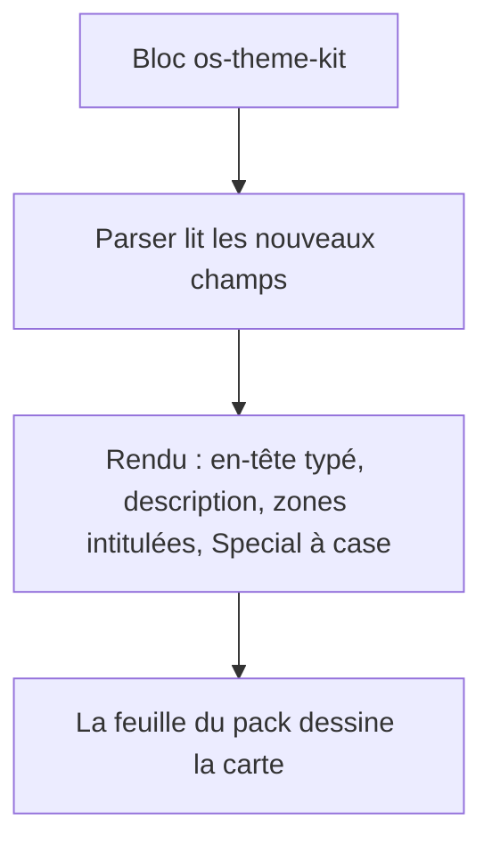
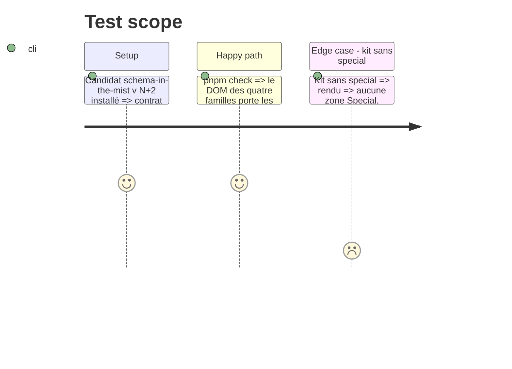

# Instruction: Handbook — consommer le contrat et poser les points d'accroche

## Architecture projection

> Tree of the final files. ✅ create · ✏️ modify · ❌ delete

```txt
obsidian-handbook/
├── package.json                                ✏️ épingle schema-in-the-mist v<N+2> (candidat local jusqu'au train, version publiée à la convergence)
├── src/features/osThemes/parser.ts, shape.ts, renderer.ts          ✏️ description, special à case, intitulés de zone publiés, emplacement d'icône (le type reste porté par la classe `brumes-os-theme--<type>`)
├── src/features/osChallenges/parser.ts, shape.ts, renderer.ts      ✏️ tags & statuts du power set, étiquette « POWER SET » par type, marque de limite
├── src/features/osCharacterCreation/parser.ts, shape.ts, renderer.ts ✏️ « Choose One » à cases, `page` des kits cités, loadout en tags surlignés, cellules nommées de l'objet
├── src/features/blocks/tomlExports.ts          ✏️ exports TOML des nouveaux champs
├── tools/assert*.harness.mts                   ✏️ DOM attendu des quatre familles
└── corpus/                                     ✏️ témoins Handbook des nouveaux champs
```

## User Journey



## Test Scope



## Tasks to do

### `1)` Kits et thèmes

> Le DOM porte tout ce que la carte dessinera, sans aucune couleur.

1. En-tête : nom, ligne « catégorie + type » en deux `span` (le type seul prend la couleur), emplacement vide `brumes-os-theme__icon` ; le type reste lu sur la classe `brumes-os-theme--<type>` déjà rendue.
2. Zones intitulées depuis les métadonnées publiées ; description ; Special avec sa case.

### `2)` Power sets

> Même famille de points d'accroche que le kit.

1. Étiquette « <TYPE> POWER SET », titre, marque de limite si la phase 2 l'a retenue, tags & statuts.

### `3)` Tropes et objets

> La trope rend ses cases et son loadout ; l'objet rend ses quatre cellules.

1. « Choose One » en liste à cases ; renvois de page des kits ; loadout en tags surlignés.
2. Objet : nom, description, feature tags, faiblesse, dans quatre éléments nommés pour une grille.

## Test acceptance criteria

| Task | Acceptance criteria |
| ---- | ------------------- |
| 1 | Un kit rend sa description, ses zones intitulées et son Special à case, sous sa classe de type. `rtk proxy pnpm build`, `pnpm lint` et `eslint src --ext .ts` sont à zéro erreur. |
| 2 | Un power set rend son étiquette typée et ses tags & statuts. |
| 3 | Une trope rend ses choix à cocher ; un objet rend quatre cellules nommées. Aucune couleur n'est écrite par Handbook. |

## Decisions

| Decision | Why |
| -------- | --- |
| L'emplacement d'icône est un `span.brumes-os-theme__icon` vide ; le type reste lu sur `brumes-os-theme--<type>`. | Handbook pose le point d'accroche ; la couleur et le masque viennent du pack (phase 5). Handbook n'écrit aucune couleur. |
| Les intitulés de zone et de type viennent des libellés publiés `OTHERSCAPE_*_LABELS`, en français d'abord. | Libellés publiés, sans repli local. |
| Les intertitres des Challenges restent locaux. | Le schéma ne publie pas encore leurs libellés : c'est un constat, pas un repli sémantique. |
| Le loadout de la trope est rendu en `<mark>`. | Le surlignage est une sémantique HTML ; le pack le peint. |
| Le Special est rendu avec sa case ; un kit sans Special n'a ni zone ni case orpheline. | Le kit garde la case du livre, et un kit ancien reste propre. |
| Preuve : `assert:otherscape-cards` (DOM des quatre familles et export TOML). | Une exigence s'affirme par un harnais. |

## Constats

- `pnpm check` est vert sur le worktree `os-reste/obsidian-handbook` (« Handbook core check passed »), avec quatre gardes écartées par `HANDBOOK_CHECK_SKIP` : `assert:provider-capabilities`, `assert:game-variants`, `assert:mist-contract` et `assert:release-train-schema-in-the-mist`. Elles étaient rouges avant cette phase, et c'est le train #121 qui les remet au vert.
