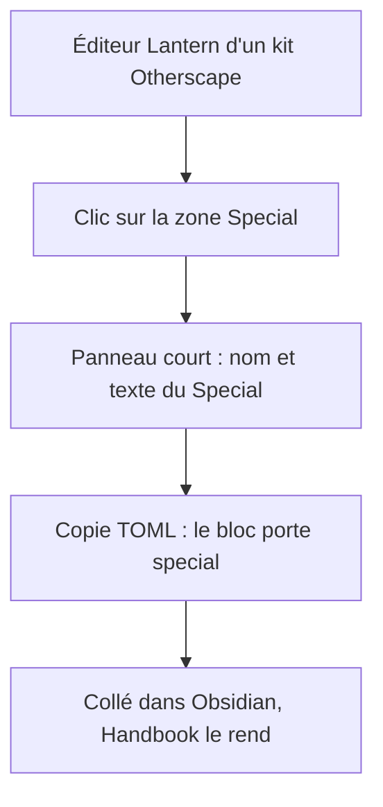
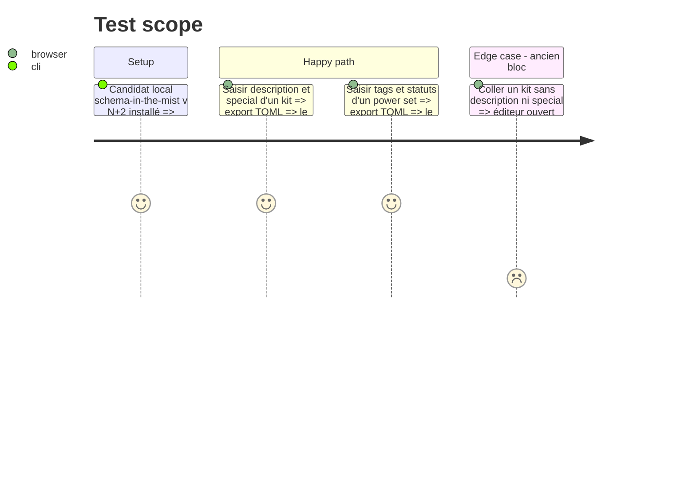

# Instruction: Lantern — saisir les nouveaux champs des kits et des power sets

## Architecture projection

> Tree of the final files. ✅ create · ✏️ modify · ❌ delete

```txt
lantern/
├── package.json                                              ✏️ épingle schema-in-the-mist v<N+2> (candidat local jusqu'au train)
├── src/templates/otherscape/theme-kit/model.ts, toml.ts, sample.ts       ✏️ `description`, `special`
├── src/templates/otherscape/theme-kit/editor/                ✏️ zone Description et zone Special, chacune n'ouvre que ses champs
├── src/templates/otherscape/theme-kit/preview/               ✏️ aperçu des deux zones
├── src/templates/otherscape/power-set/model.ts, toml.ts, sample.ts       ✏️ `tags_and_statuses` (et marque de limite si la phase 2 la retient)
├── src/templates/otherscape/power-set/editor/, preview/      ✏️ zone Tags & statuts
├── src/templates/otherscape/character-trope/model.ts, toml.ts, editor/   ✏️ page de chaque kit cité
├── src/i18n/locales/fr/otherscape/themeKitForms.ts, powerSetForms.ts, characterTropeForms.ts ✏️ libellés français d'abord
└── src/i18n/locales/en/otherscape/themeKitForms.ts, powerSetForms.ts, characterTropeForms.ts ✏️ libellés anglais
```

## User Journey



## Test Scope



## Tasks to do

### `1)` Kit de thème

> Le modèle de l'éditeur de Legend in the Mist est la référence : un clic sur une zone n'ouvre que ses champs.

1. Modèle, TOML, échantillon : `description` et `special`.
2. Zones d'édition et aperçu ; libellés en français d'abord.

### `2)` Power set

> Même chemin pour `tags_and_statuses`.

1. Modèle, TOML, échantillon, zone d'édition, aperçu.

### `3)` Trope

> La page d'un kit cité se saisit à côté de son nom.

1. Champ numérique optionnel dans la liste des kits de la trope.

## Test acceptance criteria

| Task | Acceptance criteria |
| ---- | ------------------- |
| 1 | Un kit saisi dans Lantern exporte `description` et `special`, et le TOML passe la validation du schéma. |
| 2 | Un power set saisi dans Lantern exporte ses tags & statuts, validés par le schéma. |
| 3 | Une trope saisie avec des pages de kit les exporte en TOML valide. Lantern passe sa porte (typecheck et tests). |

## Decisions

| Decision | Why |
| -------- | --- |
| Kit : deux zones distinctes, Description (en tête du corps) et Special (après la quête), chacune ouvrant son seul panneau. | Référence LitM : un clic sur une zone n'ouvre que ses champs. |
| Un Special à moitié rempli (nom sans texte, ou l'inverse) n'est pas écrit ; l'aperçu le signale comme incomplet. | Le schéma exige les deux champs ; exporter la moitié rendrait un TOML refusé. |
| Power set : `rating` et `optional_rating` saisis dans le panneau de base par deux groupes segmentés (`⊕` à `⊕⊕⊕⊕⊕`, puis `⊕` à `⊕⊕⊕⊕`) ; le second n'apparaît qu'avec le premier, et vider le premier vide le second. | `optional_rating` n'a de sens qu'à côté de `rating` (phase 2). L'aperçu imprime `+⊕(⊕)` dans le bandeau, comme Tokyo. |
| Tags & statuts : une zone propre, saisie dans une zone de texte à raison d'une entrée par ligne, accolades comprises. | Le schéma garde les accolades dans la chaîne ; l'aperçu les passe au rendu inline comme un Challenge. |
| Trope : la page est un champ numérique facultatif à côté de chaque kit et de chaque choix ; vide ou illisible, l'entrée part sans page. L'aperçu imprime « p. N ». | Le schéma commence à 1 ; un 0 serait refusé. |
| L'épingle de `package.json` ne change pas dans cette phase : le candidat est branché par jonction dans `node_modules`. | L'épingle se pose au train, une fois le schéma publié. |
| Preuve : `assert:otherscape-fields` (ajouté à `check:project`) fait l'aller-retour des trois échantillons et des trois fichiers valides du corpus par le contrat, refuse les deux refus ajoutés en phase 2, et vérifie qu'aucune saisie à moitié faite n'atteint le fichier. | Une exigence de validation s'affirme par un harnais, sans dépendance neuve. |

## Constats

- Lantern : `typecheck`, `eslint src/templates/otherscape src/i18n`, Prettier sur les fichiers touchés, et `check:project` au vert. `assert:candidate-pins` échoue, comme attendu : l'épingle n'est pas un candidat tant que le train n'est pas parti.
- Le worktree `os-reste/lantern` est extrait en CRLF : `prettier --check` y signale 146 fichiers, uniquement pour les fins de ligne ; avec `--end-of-line auto`, les fichiers touchés sont conformes.
- Le parcours navigateur (saisie et copie TOML dans Lantern) n'a pas été rejoué à la main ; l'export validé par le schéma est prouvé par le harnais. Le rendu se juge à la préversion du train.
