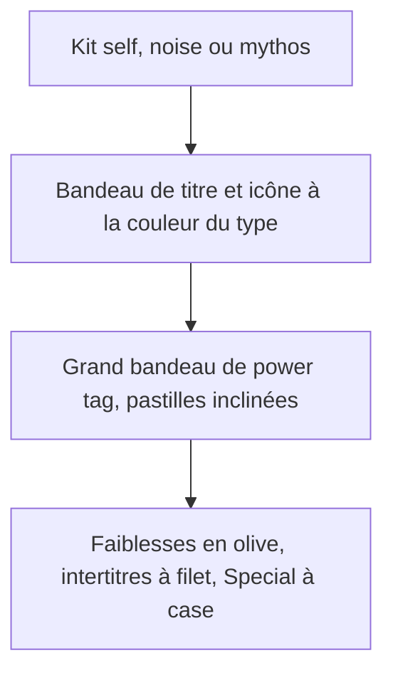
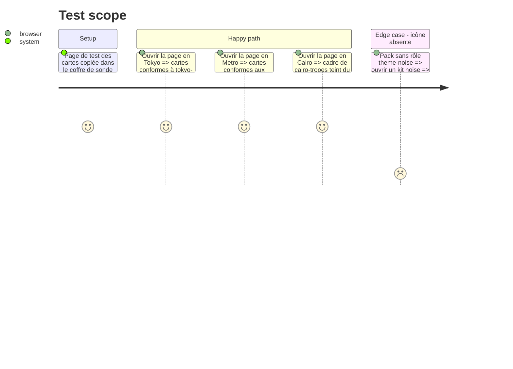

# Instruction: schema-in-the-mist — cartes de kit et de power set, couleur par type

## Architecture projection

> Tree of the final files. ✅ create · ✏️ modify · ❌ delete

```txt
schema-in-the-mist/
├── handbook/otherscape/assets/theme-self.svg     ✅ cœur, rôle `theme-self`
├── handbook/otherscape/assets/theme-noise.svg    ✅ puce, rôle `theme-noise`
├── handbook/otherscape/assets/theme-mythos.svg   ✅ œil, rôle `theme-mythos`
├── handbook/otherscape/pack.json                 ✏️ rôles d'image, feuille régénérée
├── schemas/otherscape/design/tokens.json         ✏️ olive des faiblesses, surfaces de carte par variante
├── schemas/otherscape/design/components.json     ✏️ `theme-card` : éléments icône, pastille, intertitre, special
├── schemas/otherscape/design/release.json        ✏️ versions et `sourceHash` de `tokens.json` et `components.json`
├── schemas/otherscape/design/handbook-projection.json ✏️ preuves des maquettes de kit et de power set
├── tools/build-otherscape-handbook-design.ts     ✏️ générateur de carte commun aux trois variantes, couleur par `--brumes-theme-<type>`
├── tools/validate-otherscape-design.ts           ✏️ chaque type a sa couleur et son icône
└── handbook/otherscape/assets/styles/otherscape.css ✏️ régénérée
coffre Otherscape/
└── Handbook - Test cartes Otherscape.md          ✅ un kit et un power set par type, dans chaque variante
```

## User Journey



## Test Scope



## Tasks to do

### `1)` Icônes et couleurs

> Une couleur et une icône par type, prises dans le pack.

1. Dessiner les trois SVG (cœur, puce, œil) à partir des maquettes, en un seul tracé noir.
2. Déclarer les rôles ; poser l'icône en masque teinté par `currentColor` ; repli : rien.

### `2)` Carte Tokyo

> Point de contrôle 1 : `tokyo-self-theme-kits.jpg` ; point de contrôle 2 : `tokyo-dark-power-set.jpg`.

1. Bandeau de titre avec biseau et cartouche d'icône, ligne « EXPERTISE SELF », intertitres à filet, grand bandeau de power tag, pastilles inclinées, faiblesses en olive.
2. Power set : étiquette à droite au-dessus du titre, titre italique à icône, sections menaces / conséquences.

### `3)` Cartes Metro et Cairo

> Point de contrôle 3 : les cartes de `sheet1.jpg` en Metro.

1. Metro : cartes de la fiche (bord coupé, bandeau de type, pastilles à pointe).
2. Cairo : cadre de `cairo-card`, teint du type.

## Test acceptance criteria

| Task | Acceptance criteria |
| ---- | ------------------- |
| 1 | Chaque type montre sa couleur et son icône ; sans le rôle d'image, la carte reste entière. |
| 2 | En Tokyo, un kit et un power set correspondent à leurs maquettes sur les points de contrôle 1 et 2. |
| 3 | En Metro, une carte correspond à `sheet1.jpg` ; en Cairo, au cadre de `cairo-tropes.jpg` dans la couleur du type. `npm run check` est au vert. |

## Constats

- Une seule feuille de cartes (`cardCss` de `build-otherscape-handbook-design.ts`) sert les trois variantes, lue dans les `--os-<id>-*` de chacune ; seul le cadre change (Metro et Tokyo en filet, Cairo en double filet). L'ancien bloc propre à Metro est supprimé.
- Écart au plan : la couleur de type passe par `--os-<id>-type-{self,mythos,noise}` et non par `--brumes-theme-*`. Sur l'ardoise de Tokyo, la couleur de base n'est pas lisible ; Tokyo lit donc `color.theme-bright.*`. Le contraste type/surface (3:1) est tenu par le validateur, dans le mode peint et dans l'alterne.
- Icônes : `theme-self.svg`, `theme-mythos.svg` et `theme-noise.svg`, déclarées par rôle dans `pack.json`, peintes en masque de la couleur du type. Si le fichier manque, `brumes-missing--theme-<type>` masque l'icône seule.
- Ajout demandé par l'utilisateur hors plan : le texte est resserré au niveau de la note (`--p-spacing`, `--line-height-normal`, `--list-spacing` et `--heading-spacing` par variante) et plus encore dans les cartes. Les pastilles ont un biseau à gauche, comme les bandeaux de titre.
- Validateur : le découpage des listes de sélecteurs se fait désormais à profondeur de parenthèses (`splitSelector`), car la regex coupait `:is(.a, .b:not(.c))`.
- Rendu à valider dans `Handbook - Test cartes Otherscape.md` (coffre otherscape) : points de contrôle 1 à 3.
- **Metro passe en clair** (2026-11-07, décision de l'utilisateur, qui remplace celle du 2026-11-04) : les trois variantes sont claires, avec une section `alternate` sombre. Metro projette `light` (`page.jpg`, `light-chapo.jpg`) et son alterne `dark` (`dark.jpg`, `dark-chapo.jpg`) ; le validateur attend désormais `light` pour les trois.
- **Carte de kit Lantern** (2026-11-07, ajout hors plan demandé par l'utilisateur) : `ThemeKitPreview` et ses blocs suivent `tokyo-self-theme-kits.jpg`. Le cartouche reprend les tracés SVG des icônes du pack ; crew garde ses deux silhouettes. Les tags s'affichent sans accolades ni marque `!`. Une carte d'ardoise est propre au kit (`--os-surface` composé avec `.os-card.theme-kit-sheet`). Le power set, les tropes et le loadout de Lantern sont ensuite alignés sur leurs maquettes Tokyo : le power set, repris après un premier verdict « pas assez proche » (2026-11-07), en panneau teinté par le type dans un cadre sombre à onglet et pastille néon, titre en Fira Sans Extra Condensed 900 italique (déjà fournie par l'app), intitulés discrets, tags et statuts en mots italiques surlignés (lime, vert) propres à cette carte, menaces en italique séparées par des filets, conséquences en gras derrière `»`, conséquences générales enchaînées sous les menaces sans intitulé ; la trope en ardoise bleue, avec accent crew, kits sur la forme « **Titre** (CATÉGORIE, p. N) », « Choose One » à pastilles rondes et loadout en italiques surlignées ; le loadout comme une ligne de catalogue grise (nom en cartouche lime, prose, tags en italiques jaunes, faiblesse en boîte biaisée grise), sur quatre colonnes, deux en conteneur étroit avec les tags en pleine largeur. Pièces partagées : `shared/preview/components/TypeGlyph.tsx`, `shared/preview/bareTag.ts`, `SectionHeader align="end"`. Typecheck et ESLint de Lantern verts ; verdict de rendu de l'utilisateur en attente.
- **Power set validé, tropes et loadout repris** (2026-11-08) : verdict de l'utilisateur sur la carte du power set : « oui c'est bon ». Les puces des menaces et des conséquences prennent la couleur du type de thème, et non le lime du livre (demande de l'utilisateur). La note du rating est une mire SVG à la place de `⊕`. La trope est refaite d'après `cairo-tropes.jpg` : catégorie sur un onglet or au-dessus du panneau ; panneau ardoise dont les deux coins du haut et le coin bas gauche sont coupés, avec un cadre clair et des tirets bleus ; titre et intitulés en turquoise `#38c398` ; kits en graisse normale ; badge « ? » carré ; cases arrondies ; loadout en italiques jaune pâle sur olive. L'accent crew est abandonné. Le loadout est refait d'après `tokyo-list-items.jpg` : page claire ; têtes de colonnes grises sous un filet, seulement sur quatre colonnes ; rangée sur bande grise ; nom en cartouche lime à pied coupé, dans la casse saisie ; feature tags en italiques sur jaune pâle, le tag-nom en tête et en gras, comme dans le livre (il était sauté jusque-là) ; faiblesse en boîte gris moyen pointue à gauche, ses mots sur le même surlignage. Les tags deviennent des `span role="button"`, qui se coupent en fin de ligne comme le texte du livre, ce qu'un `<button>` ne permet pas. Typecheck et ESLint de Lantern verts. Verdict de rendu des tropes et du loadout en attente.
- **Apparence générale et variantes dans Lantern** (2026-11-08) : l'utilisateur signale que les boutons d'« Apparence générale » fonctionnent mal pour Otherscape. Trois défauts sont corrigés. (1) La largeur d'aperçu de la trope et du power set gardait les bornes du défi (700–1400) : au-delà de la largeur de la scène, le curseur ne faisait rien. Elle passe à 320–720 (défaut 480), et un onglet enregistré sous les anciennes bornes y est ramené. (2) Le fond Néon/Uni du loadout n'avait aucun effet (la rangée du catalogue n'a qu'un fond) : le choix est retiré. (3) Les libellés anglais écrits en dur de la trope, du défi et du power set passent par l'i18n, en français. Les variantes : un module partagé `templates/otherscape/shared/variants.ts` lit la liste et la variante par défaut dans le pack Handbook épinglé (`schema-in-the-mist/handbook/otherscape/pack.json`), sans liste locale. Un sélecteur « Variante » est ajouté à l'« Apparence générale » de la trope et du loadout ; il est enregistré avec l'onglet, et metro est la valeur par défaut. Ce sont les deux seules cartes dont une maquette existe pour une autre variante : loadout Cairo d'après `cairo-list-items.jpg` (cartouche menthe, page crème), trope Tokyo d'après `tokyo-theme-set.jpg` (panneau marine, titre, intitulé et filet lime, onglet de catégorie lime sur indigo). Les teintes sont relevées sur les maquettes. Toute autre combinaison garde le dessin actuel. Typecheck, ESLint et Prettier de Lantern verts. Verdict de rendu en attente.
- **Carte de défi Lantern refaite d'après Metro** (2026-11-08) : verdict de l'utilisateur sur l'ancienne carte : « défi on n'est pas bon ». Elle avait un bandeau rouge, deux colonnes et des capsules. Elle suit maintenant le livre de base (pp. 302-303), en une seule colonne et dans l'ordre du livre : description, limites, tags et statuts, specials, menaces et conséquences. Le panneau ardoise est dans un cadre gris-bleu. Son bord haut descend en marche après un onglet lime ; le coin haut droit est chanfreiné, le coin bas gauche coupé. Le titre est en capitales italiques lime avec une lueur. Les limites sont des pastilles lime en rangée, avec un grand chiffre. Sous la rangée, une boîte ardoise claire « NOM: » est rattachée à la première pastille. Tags, statuts et limites citées sont des mots italiques surlignés (olive, vert, rose), passés en `display: inline` : ils se coupent avec la ligne et n'héritent plus du retrait suspendu des specials. Le même correctif est porté au power set, où un jeton dans un special chevauchait le mot précédent. Les menaces suivent « › » et les conséquences « » » ; les conséquences générales ferment la liste des menaces. Intitulés à droite, discrets. La largeur passe à 320–720 (défaut 520) et un onglet enregistré sous les anciennes bornes y est ramené. Le sélecteur de variante est ajouté : Tokyo (p. 99) imprime la même carte que Metro, Cairo (p. 108) la même en sarcelle. Teintes relevées sur les pages. **Écart de schéma** : le livre imprime la note du défi (les mires) dans l'onglet, mais le schéma du défi n'a pas de `rating`, seulement `scale`. L'onglet affiche donc « SCALE n », ou reste vide. Ajouter `rating` relève de `schema-in-the-mist` (schéma d'abord), comme `rating` du power set. Typecheck, ESLint et Prettier de Lantern verts. Verdict de rendu en attente.
- **Metro, dessin de base de la trope et du loadout Lantern** (2026-11-08) : suite à la consigne « pour Metro, c'est le design de base, il faut qu'il y soit ». **Trope** : référence livre de base p. 178 (Character Tropes). La carte Metro garde la structure de Cairo : panneau à coins coupés, filet fin, tirets bleus, nom droit condensé, kits, « ? Choose One », loadout surligné olive. Seules les couleurs changent : nom `#9ecb3b`, catégorie, intitulé « Theme kits » et filet `#acff00`, catégorie sur un onglet indigo `#353151`, pastille « ? » lime, panneau ardoise à bleu-sarcelle (`#2a323d` → `#223f4f`), cadre `#686d81`, tirets `#1e5d77`. Le dessin Cairo (sarcelle, onglet or) passe en bloc `os-variant-cairo` ; le bloc Tokyo est conservé et lit les mêmes propriétés (`--ct-label`, `--ct-badge`, `--ct-dash`). **Loadout** : référence livre de base pp. 252-254 (Street Catalog). La ligne Metro est celle déjà dessinée d'après Tokyo : boîte lime du nom, bande grise, surlignage jaune pâle, boîte grise de faiblesse. Seules les teintes relevées diffèrent, de quelques unités (lime `#d2ef8d`, page `#edf1f4`, bande `#dadfe1`, surlignage `#f4eda9`, faiblesse `#b1b2b7`). Les anciennes valeurs passent en bloc `os-variant-tokyo` ; Cairo (boîte menthe) est inchangé. Écart restant : dans le livre, la boîte du nom déborde à gauche de la bande, et celle de la faiblesse à droite ; la carte les garde alignées sur la bande. Captures des trois variantes faites. Typecheck, ESLint et Prettier de Lantern verts. Verdict de rendu en attente.
- **Boîtes du loadout qui débordent de la bande** (2026-11-08) : demande de l'utilisateur, « fais déborder les boîtes du loadout comme dans le livre ». Comme dans le livre (pp. 252-254), la boîte lime du nom part du bord haut de la bande grise et dépasse son bord gauche. La boîte grise de la faiblesse dépasse son bord droit. Le débordement est tenu par `--li-overhang` (0.4rem, environ 1 % de la bande, relevé sur la page). En vue étroite, la faiblesse franchit aussi le retrait droit de la rangée. Contrôlé en capture, en vue étroite et à 720 px. Verdict de rendu en attente.
