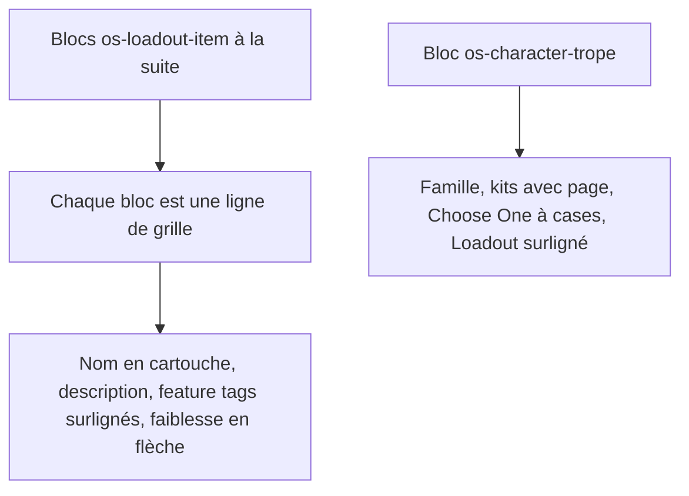
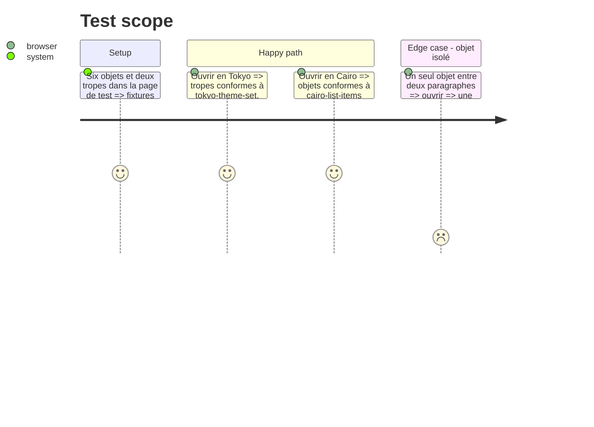

# Instruction: schema-in-the-mist — tropes et tables d'objets

## Architecture projection

> Tree of the final files. ✅ create · ✏️ modify · ❌ delete

```txt
schema-in-the-mist/
├── schemas/otherscape/design/components.json          ✏️ `trope-card`, `item-table` (lignes, cellules, en-tête)
├── schemas/otherscape/design/release.json             ✏️ version et `sourceHash` de `components.json`
├── schemas/otherscape/design/handbook-projection.json ✏️ preuves `tokyo-theme-set`, `tokyo-list-items`, `cairo-list-items`
├── tools/build-otherscape-handbook-design.ts          ✏️ carte de trope Tokyo et Metro, ligne d'objet en grille
└── handbook/otherscape/assets/styles/otherscape.css   ✏️ régénérée
coffre Otherscape/
└── Handbook - Test cartes Otherscape.md               ✏️ deux tropes et six objets à la suite
```

## User Journey



## Test Scope



## Tasks to do

### `1)` Tropes

> Les tropes Tokyo et Metro rejoignent la carte Cairo déjà projetée.

1. Étiquette de famille, titre display, filet « THEME KITS », renvois de page, cases du « Choose One », loadout surligné.

### `2)` Tables d'objets

> Point de contrôle : `tokyo-list-items.jpg` et `cairo-list-items.jpg`.

1. Chaque bloc en ligne de grille à quatre colonnes ; l'en-tête de colonnes est rendu sur chaque objet et masqué sur les suivants d'une suite (`.el-pre:has(.os-item) + .el-pre:has(.os-item)`, chaque bloc de code étant son propre `.el-pre`) ; cartouche du nom, faiblesse en flèche grise.

## Test acceptance criteria

| Task | Acceptance criteria |
| ---- | ------------------- |
| 1 | Une trope rend sa famille, ses kits, ses choix à cocher et son loadout comme la maquette de sa variante. |
| 2 | Des objets consécutifs forment une table à en-tête unique conforme aux maquettes ; un objet isolé reste une table d'une ligne. |

## Constats

- Tropes et objets sont dessinés par la même `cardCss` que la phase 5.
- Libellés d'en-tête mixtes : « Objet » et « Description » viennent des pseudo-éléments, mais les intertitres de Handbook restent en anglais (« Feature tags », « Weakness »). Les traduire relève de Handbook, pas de la feuille.
- La carte objet sort de la surface commune (`.brumes-os-creation:not(.brumes-os-creation--loadout-item)`) : elle est une ligne de table, sans cadre.
- Rendu à valider dans `Handbook - Test cartes Otherscape.md` : six objets à la suite, puis un objet isolé.
