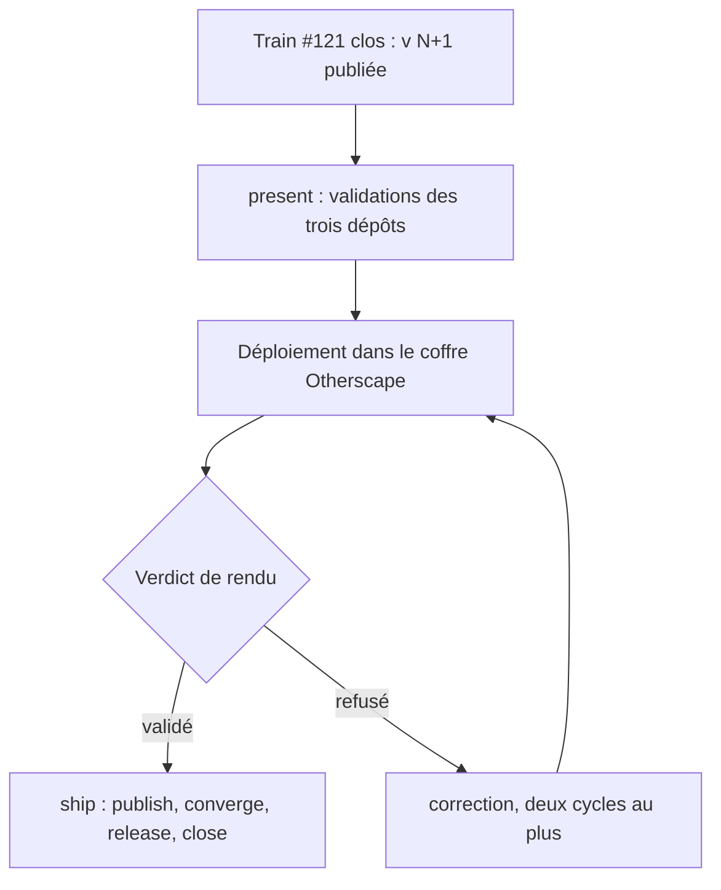
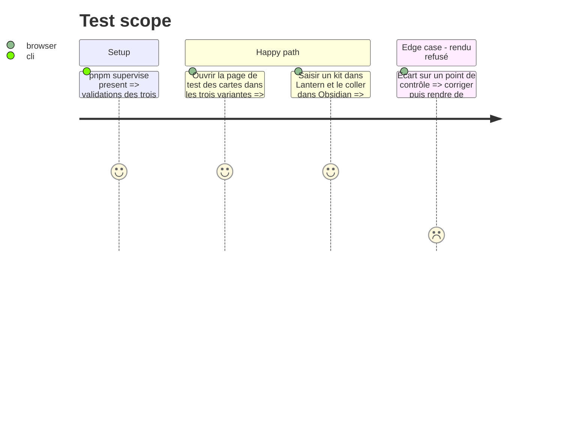

# Instruction: Train — rendu dans le coffre puis livraison

## Architecture projection

> Tree of the final files. ✅ create · ✏️ modify · ❌ delete

```txt
obsidian-handbook/
├── package.json, manifest.json, versions.json   ✏️ v<M+2> par `pnpm version`, épingle schema-in-the-mist v<N+2> publiée
├── CHANGELOG.md                                 ✏️ section v<M+2>
└── supervisor/trains/otherscape-design-reste.json ✅ topologie schema-in-the-mist → Lantern, Handbook
lantern/
├── package.json                                 ✏️ v<L+1>, épingle schema-in-the-mist v<N+2> publiée
└── CHANGELOG.md                                 ✏️ section v<L+1>
schema-in-the-mist/
└── package.json                                 ✏️ v<N+2>
```

## User Journey



## Test Scope



## Tasks to do

### `1)` Présenter et déployer

> Tout se contrôle avant le départ du train.

1. Attendre la clôture du train #121 (la phase 1 y voyage), puis écrire la topologie (schema-in-the-mist, puis Lantern et Handbook) et lancer `pnpm supervise present`. Si un autre travail occupe les checkouts, passer par `pnpm supervise worktree`.
2. Déployer `dist/` dans le coffre sans écraser `data.json` ; la mise à jour de la source du pack est un geste de l'utilisateur, suivi d'un rechargement du plugin.

### `2)` Verdict et livraison

> Seul le verdict de rendu est demandé.

1. Présenter les captures par point de contrôle ; après verdict, `pnpm supervise ship --run`, le commit du train se termine par les `Closes #` concernés.
2. Ouvrir le ticket « fiche de personnage Otherscape » (`sheet1.jpg` : upgrades, tag combos, loadout).

## Test acceptance criteria

| Task | Acceptance criteria |
| ---- | ------------------- |
| 1 | `present` est au vert sur les trois dépôts avant tout déploiement. |
| 2 | L'utilisateur valide le rendu ; schema-in-the-mist v<N+2>, Lantern v<L+1> et Handbook v<M+2> sont publiés ; le ticket de la fiche existe. |

Points de contrôle du verdict (fixés d'avance) : 1) kit Tokyo contre `tokyo-self-theme-kits.jpg`, 2) power set Tokyo contre `tokyo-dark-power-set.jpg`, 3) carte Metro contre `sheet1.jpg`. Les tropes et objets sont vérifiés par sonde, hors verdict.

## Constats

- Le 2026-11-08, trois `ship --run` ont été lancés. Les deux premiers se sont arrêtés à `present`, sans rien publier :
  - `SCHEMA_RELEASE_TAG` était resté en v1.4.0 ;
  - le `package-lock.json` de Lantern était à l'ancienne version ;
  - le lien fournisseur était resté cassé, après l'arrêt de `preview` pendant son remplacement ;
  - la liste des faces de `assert:mist-font-packs` n'était pas à jour ;
  - les worktrees `schema-pbta` et `schema-adrenaline` manquaient sous `--root`.
- Le troisième a tout livré, en 14 min : schema-in-the-mist v1.5.0, Lantern v0.30.0 et Handbook v2.47.0.
- Le verdict de rendu n'a pas été donné : le train est parti sur « il faut terminer le train ».
- Ticket de la fiche de personnage : #125.
