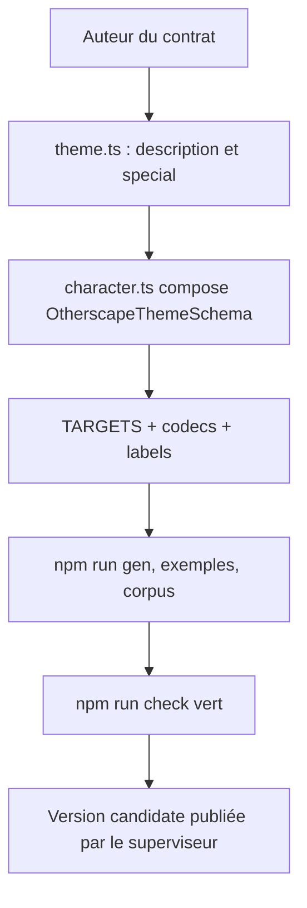
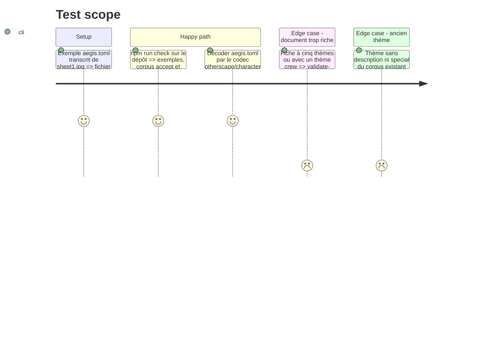

# Instruction: Contrat — thème enrichi et cible `otherscape/character`

## Architecture projection

> Tree of the final files. ✅ create · ✏️ modify · ❌ delete

```txt
schema-in-the-mist/
├── src/zod/otherscape/theme.ts                         ✏️ description?, special? (ThemeKitSpecialSchema : { name, description })
├── src/zod/otherscape/theme-kit.ts                     ✏️ ThemeKitSpecialSchema exporté pour réemploi
├── src/zod/otherscape/loadout-item.ts                  ✏️ champs d'objet exportés pour réemploi
├── src/zod/otherscape/character.ts                     ✅ name, themes[0..4] sans crew, tag_combos[], loadout[], meta
├── src/zod/constants.ts                                ✏️ MistEngineDocumentTarget + TARGETS
├── src/index.ts                                        ✏️ schéma, type, codec, MIST_ENGINE_CODECS
├── src/presentation.ts                                 ✏️ zones FR/EN de la fiche, texte de règle Upgrades
├── schemas/otherscape/character.schema.json            ✅ généré (npm run gen)
├── schemas/v1/otherscape/character.schema.json         ✅ généré
├── schemas/otherscape/theme.schema.json, v1/…          ✏️ régénérés
├── examples/otherscape/character/aegis.json, .toml     ✅ la fiche de sheet1.jpg
├── examples/otherscape/theme/…                         ✏️ un exemple avec description et special
├── corpus/contract/cases.json                          ✏️ cas accept / reject de la fiche, handbook: render
├── corpus/contract/valid/otherscape--character.toml    ✅
├── corpus/contract/invalid/otherscape--character.toml  ✅ (ex. 5 thèmes, thème crew, power négatif)
├── handbook/otherscape/pack.json                       ✏️ requires "block:os-character"
├── schemas/otherscape/design/components.json           ✏️ apparence de la fiche : bandeaux, combos, objets chargés / non chargés
├── tools/build-otherscape-handbook-design.ts           ✏️ CSS d'apparence de la fiche ; otherscape.css régénéré
├── tools/validate-examples.ts, validate-package.ts, validate-contract.ts  ✏️ comptes dérivés de TARGETS
├── docs/compatibility.md, README.md                    ✏️
└── CHANGELOG.md, package.json                          ✏️ version mineure v<N+1>, candidate rc
```

## User Journey



## Test Scope



## Tasks to do

### `1)` Thème enrichi

> La carte de thème porte sa description et son Theme Special.

1. `description` : chaîne, Markdown en ligne, optionnelle.
2. `special` : `ThemeKitSpecialSchema` réemployé tel quel (`{ name, description }`, exporté depuis `theme-kit.ts`), optionnel.
3. Exemples et un cas accept supplémentaire.

### `2)` Cible `otherscape/character`

> Une fiche s'écrit en un seul document.

1. `name` (requis), `themes` (0 à 4, `OtherscapeThemeSchema`, `theme_type: crew` refusé), `tag_combos` (`{ label, tags[], power ≥ 0, effect }`), `loadout` (objets aux champs de `loadout-item` : `name`, `feature_tags`, `weakness_tag`, plus `loaded`, `false` par défaut), `meta`.
2. Enregistrement dans `constants.ts`, `index.ts`, et libellés de zones dans `OTHERSCAPE_ZONE_LABELS.character` (upgrades, tag combos, loadout), avec le texte de règle Upgrades : EN de `sheet1.jpg`, FR du kit d'intro ramené au glossaire validé (voir Decisions).
3. `npm run gen`, exemple Aegis (JSON et TOML), corpus accept et reject.

### `3)` Gardes par rôle

> Ajouter une cible ne demande pas de modifier un chiffre.

1. Remplacer les 14 écrits en dur par la longueur de `TARGETS` (`validate-examples.ts`, `validate-package.ts`, le message de `validate-contract.ts`).

### `4)` Présentation Handbook du pack

> Le pack Otherscape porte le style de la fiche.

1. Composants dans `components.json`, CSS généré, `requires` de `pack.json`.
2. Version v<N+1> en candidate, CHANGELOG, compatibilité.

## Test acceptance criteria

| Task | Acceptance criteria |
| ---- | ------------------- |
| 1 | Un thème avec `description` et `special` valide ; tous les thèmes déjà publiés valident encore. |
| 2 | L'exemple Aegis se décode et se réencode sans perte ; un objet sans `loaded` est lu non chargé ; une fiche à cinq thèmes, avec un thème crew ou à power négatif est refusée. |
| 3 | Ajouter la cible ne touche aucun nombre littéral dans les outils de validation. |
| 4 | `npm run check` et `validate:package` sont verts ; la version candidate est publiée et Lantern / Handbook peuvent l'épingler. |
