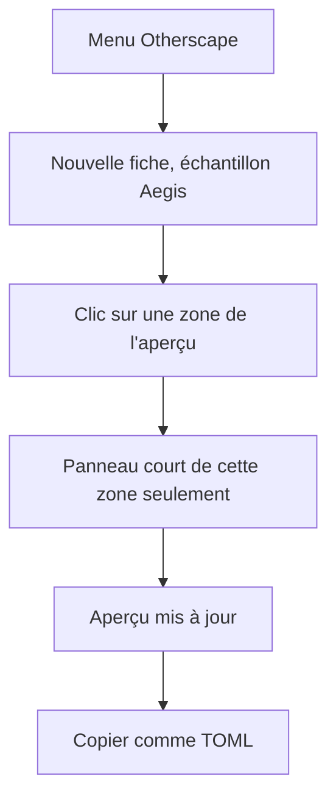
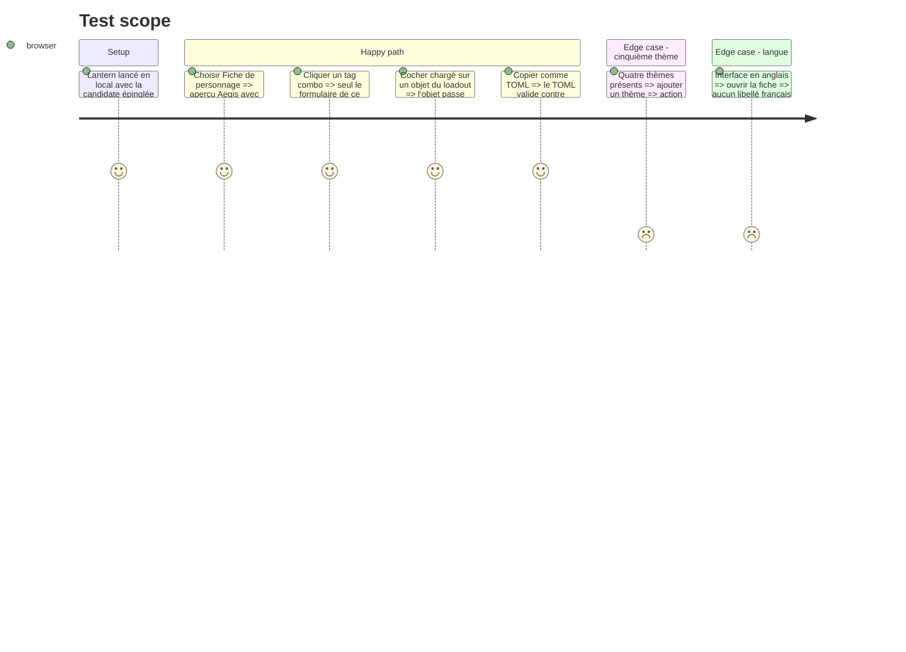

# Instruction: Éditeur Lantern de la fiche Otherscape

## Architecture projection

> Tree of the final files. ✅ create · ✏️ modify · ❌ delete

```txt
lantern/
├── package.json, pnpm-lock.yaml                                 ✏️ épingle la candidate schema-in-the-mist v<N+1>
├── src/contracts/mist-engine.ts                                 ✏️ réexport du type, commentaires sans compte
├── src/templates/otherscape/theme-kit/editor/forms/{Description,Special}Form.tsx  ✏️ déplacés vers otherscape/shared, réemployés par le kit et le thème
├── src/templates/otherscape/theme/{model,toml,sample,metadata}.ts  ✏️ deux champs neufs
├── src/templates/otherscape/theme/preview/                       ✏️ réemploie le bloc Special de l'aperçu du kit
├── src/templates/otherscape/character/                          ✅ descriptor, definition, model, metadata, sample, toml, warnings, hooks
│   ├── editor/CharacterEditorPanel.tsx                          ✅ zones courtes, une zone = ses champs
│   ├── editor/forms/{Header,TagCombo,Loadout,Theme}Form.tsx      ✅ ThemeForm réemploie les forms du thème
│   └── preview/{CharacterPreview,blocks/*}.tsx, characterTheme.css  ✅ thèmes rendus par les blocs du thème
├── src/core/templates/registry.tsx, templateLoader.ts           ✏️ enregistrement et loader paresseux
├── src/i18n/locales/{fr,en}/otherscape.ts, otherscape/characterForms.ts  ✏️ ✅ aucune chaîne en dur
├── tools/assert-visibility-protocol.mjs                         ✏️ hooks.ts de la fiche
├── tools/assertCrossRepo.harness.mts                            ✏️ HANDBOOK_RENDERERS : otherscape/character → os-character
└── tools/assertOtherscapeFields.harness.mts                     ✏️ codec de la fiche sur le corpus
```

## User Journey



## Test Scope



## Wireframe

```txt
┌────────────────────────────────────────────────────────────────────────┐
│ [1] AEGIS                                                              │
├───────────────┬──────────────────────────────────────┬─────────────────┤
│ [2] UPGRADES  │ [3] TAG COMBOS                       │ [4] LOADOUT     │
│ règle (lecture│ ┌──────┐┌──────┐┌──────┐┌──────┐      │ ▌objet   · ▌objet│
│ seule)        │ │combo ││combo ││combo ││combo │ [+]  │ ▌objet   · ▌objet│
│ ☐ tag ☐ spéc. │ └──────┘└──────┘└──────┘└──────┘      │ [+]             │
├───────────────┴──┬───────────────┬───────────────┬────┴─────────────────┤
│ [5] THÈME 1      │ THÈME 2       │ THÈME 3       │ THÈME 4         [+]  │
│ (carte du thème, │               │               │                      │
│  description,    │               │               │                      │
│  Theme Special)  │               │               │                      │
└──────────────────┴───────────────┴───────────────┴──────────────────────┘
 Panneau latéral : seuls les champs de la zone cliquée
 ┌─────────────────────────┐
 │ [6] Tag combo 2         │
 │ intitulé · tags · power │
 │ effet                   │
 └─────────────────────────┘
```

1. En-tête : le nom.
2. Upgrades : texte publié par le schéma, non éditable.
3. Tag combos : un clic sur un combo ouvre ce combo ; `[+]` ajoute un combo.
4. Loadout : un objet par ligne (tag, jeu de tags, faiblesse) et une case « chargé » ; `·` marque un objet non chargé.
5. Thèmes : un clic ouvre la zone touchée du thème (tags, quête, description, special, pistes), avec les forms de l'éditeur de thème.
6. Panneau latéral court, une zone à la fois (modèle LitM).

## Tasks to do

### `1)` Thème enrichi

> L'éditeur de thème autonome écrit description et Theme Special.

1. `DescriptionForm` et `SpecialForm` du kit passent dans `otherscape/shared` et servent au thème ; champs dans le modèle, le TOML et l'échantillon ; l'aperçu réemploie le bloc Special du kit.

### `2)` Template de la fiche

> La fiche s'édite par zones courtes.

1. Dossier `otherscape/character` selon `docs/adding-a-template.md`.
2. Zones par section de `presentation.ts` publié (comme `adrenaline/pj/editor/zone.ts`) ; thèmes rendus et édités par les composants du thème.
3. Libellés FR et EN dans les locales ; les types de carte restent en anglais.

### `3)` Harnais

> Les harnais connaissent la nouvelle cible.

1. `assert-visibility-protocol`, `assertCrossRepo` (`HANDBOOK_RENDERERS`, table statique : elle ne dépend pas du build de Handbook), `assertOtherscapeFields`.

### `4)` Version

> La version se prépare avec le changement.

1. `pnpm version` v<N+1> et section du CHANGELOG de Lantern.

## Test acceptance criteria

| Task | Acceptance criteria |
| ---- | ------------------- |
| 1 | Un thème édité avec description et special s'exporte en TOML valide et s'affiche dans l'aperçu. |
| 2 | Un clic sur une zone n'ouvre que ses champs ; le TOML copié de la fiche valide contre le contrat ; l'interface anglaise n'affiche aucun libellé français. |
| 3 | La vérification complète de Lantern est verte, typecheck inclus. |
| 4 | `package.json` et la dernière section du CHANGELOG de Lantern portent v<N+1>. |
