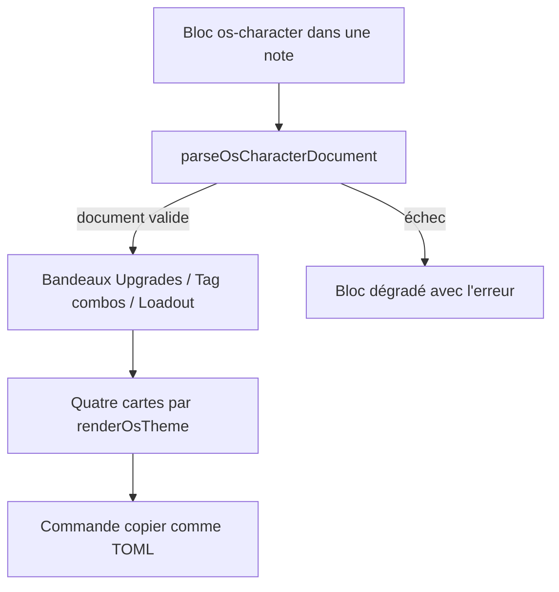
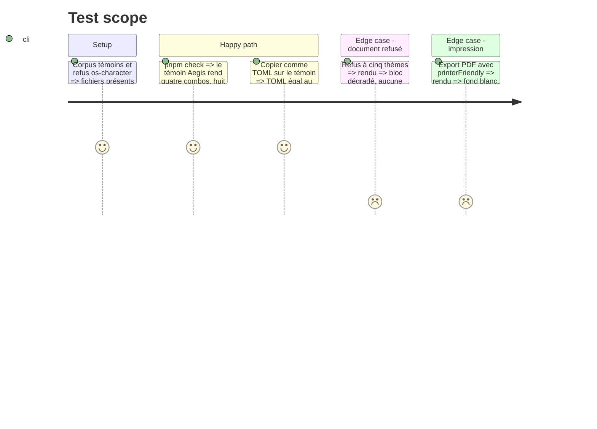

# Instruction: Bloc Handbook `os-character`

## Architecture projection

> Tree of the final files. ✅ create · ✏️ modify · ❌ delete

```txt
obsidian-handbook/
├── package.json, pnpm-lock.yaml                     ✏️ épingle la candidate schema-in-the-mist v<N+1>
├── src/features/osThemes/{schema,shape}.ts           ✏️ le thème lit description et special ; zones déjà rendues pour le kit
├── src/features/osCharacter/block.ts                ✅ BrumesBlock os-character
├── src/features/osCharacter/parser.ts               ✅ OsCharacterData
├── src/features/osCharacter/schema.ts               ✅ parseOsCharacterDocument (null si échec), osCharacterToToml
├── src/features/osCharacter/shape.ts                ✅ zones header, upgrades, tag-combos, loadout, themes
├── src/features/osCharacter/renderer.ts             ✅ bandeaux + renderOsTheme par thème
├── src/features/blocks/registry.ts                  ✏️ BRUMES_BLOCKS
├── src/features/blocks/tomlExports.ts               ✏️ copier comme TOML (validatedMistSerializer)
├── src/features/otherscape/types.ts                 ✏️ OS_BLOCK_IDS, OS_FEATURE_FLAGS
├── src/settings/types.ts, gameSettings.ts           ✏️ drapeau features.osCharacter
├── src/games/capabilities.ts                        ✏️
├── src/locales/fr.ts, en.ts                         ✏️ libellés (zones lues dans presentation.ts publié)
├── src/styles/otherscape/_character.scss            ✅ géométrie seule (grille des bandeaux, colonnes) ; l'apparence vient du pack
├── corpus/temoins/os-character*.md                  ✅ fiche Aegis, fiche minimale
├── corpus/refus/os-character*.md                    ✅ TOML invalide, cinq thèmes
├── tools/mistContractCorpus.mts                     ✏️ MIST_TARGET_TO_BLOCK
├── tools/assertMistContract.harness.mts             ✏️ comptes dérivés, plus de littéral
└── tools/assertOtherscapeTheme.harness.mts          ✏️ description et Theme Special rendus
```

## User Journey



## Test Scope



## Wireframe

```txt
┌──────────────────────────────────────────────────────────────────────┐
│ [1] AEGIS                                                            │
├────────────────┬───────────────────────────────────────┬─────────────┤
│ [2] UPGRADES   │ [3] TAG COMBOS                        │ [4] LOADOUT │
│ règle          │ intitulé │ intitulé │ intitulé │ ...    │ ▌tag  ▌tag   │
│ ☐ tag ☐ spéc.  │ tags+    │ tags+    │ tags+    │        │ ▌tag  ▌tag   │
│                │ POWER n  │ POWER n  │ POWER n  │        │             │
│                │ effet    │ effet    │ effet    │        │             │
├────────────────┴──┬────────────────┬──────────┴──────┬─┴─────────────┤
│ [5] carte thème   │ carte thème    │ carte thème     │ carte thème    │
│ tags · quête      │                │                 │                │
│ description       │                │                 │                │
│ THEME SPECIAL     │                │                 │                │
└───────────────────┴────────────────┴─────────────────┴────────────────┘
```

1. En-tête : le nom, dans la police de titre du pack.
2. Upgrades : texte de règle publié, avec ses deux cases.
3. Tag combos : une colonne par combo, effet en Markdown en ligne.
4. Loadout : deux colonnes, objets non chargés estompés, faiblesse éventuelle sous l'objet.
5. Cartes de thème aux couleurs de leur type, comme le bloc `os-theme`.

## Tasks to do

### `1)` Carte de thème enrichie

> `os-theme` rend la description et le Theme Special.

1. Le schéma lit `description` et `special` du thème vers `OsThemeData` (champs déjà présents) ; les zones `description` et `special` existantes s'ouvrent au thème ; harnais.

### `2)` Bloc `os-character`

> La fiche se rend selon la checklist de `schema-design.md`.

1. Lecture tolérante, forme en zones nommées, renderer qui délègue les cartes à `renderOsTheme`.
2. Enregistrement : `BRUMES_BLOCKS`, drapeau, réglage, capacité, commande de copie, libellés.
3. SCSS de géométrie seule, partagée par `@mixin` ; une échappatoire éventuelle est déclarée et motivée.

### `3)` Preuves

> Les harnais exercent la nouvelle cible.

1. Témoins et refus, `MIST_TARGET_TO_BLOCK`, comptes de `assertMistContract` dérivés.
2. `assert:style-scope` couvre `_character.scss`.

### `4)` Version

> La version se prépare avec le changement.

1. `pnpm version` v<N+1> et section du CHANGELOG de Handbook ; Lantern fait de même en fin de phase 2.

## Test acceptance criteria

| Task | Acceptance criteria |
| ---- | ------------------- |
| 1 | Un thème avec description et special les montre sous la quête ; un thème sans eux se rend comme avant. |
| 2 | Le témoin Aegis se rend avec les zones de la référence ; un refus se dégrade sans exception ; la copie TOML retrouve le document. |
| 3 | `rtk proxy pnpm build`, `eslint src --ext .ts`, `pnpm lint` et `pnpm check` sont verts ; `dist/styles.css` reste sous le plafond de `assert:mist-font-packs`. |
| 4 | `pnpm assert:release-version` est vert : `package.json`, `manifest.json`, `versions.json` et la dernière section du CHANGELOG portent v<N+1>. |
