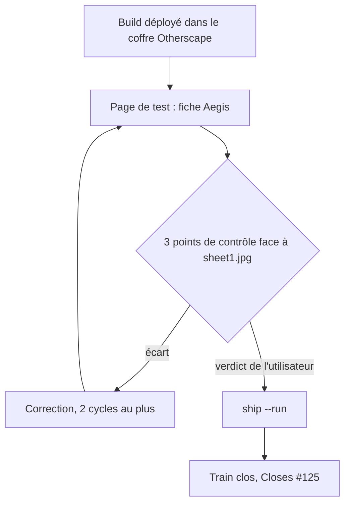
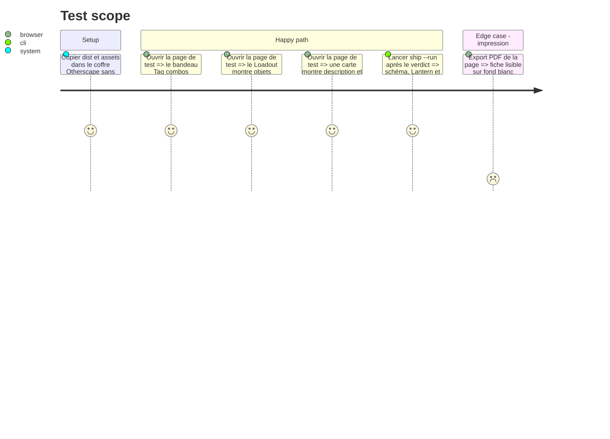

# Instruction: Rendu dans le coffre, verdict, train

## Architecture projection

> Tree of the final files. ✅ create · ✏️ modify · ❌ delete

```txt
supervisor/trains/otherscape-fiche-personnage.json   ✅ topologie : schema-in-the-mist → lantern → obsidian-handbook
coffre otherscape/Handbook - Test blocs otherscape.md ✏️ section Fiche de personnage (Aegis)
```

## User Journey



## Test Scope



## Tasks to do

### `1)` Préparer le rendu

> L'utilisateur voit la fiche dans Obsidian.

1. Section Aegis dans la page de test du coffre Otherscape ; build déployé (jamais `data.json`).
2. Trois captures face à `sheet1.jpg` (points de contrôle du plan), plus la VF des zones neuves (texte du kit d'intro ramené au glossaire) à valider.

### `2)` Verdict

> Seul le rendu attend l'utilisateur.

1. Verdict de rendu ; au plus deux cycles de correction avant de revenir vers lui.

### `3)` Train

> Le contrôle se fait dans `present`, puis le train exécute.

1. Topologie du train ; les versions sont prêtes depuis les phases 2 et 3.
2. `pnpm supervise ship --run` ; le dernier commit finit par « Closes #125 ».
3. Un échec se lit dans le journal `Whole output:`.

## Test acceptance criteria

| Task | Acceptance criteria |
| ---- | ------------------- |
| 1 | La fiche Aegis s'affiche dans le coffre Otherscape, `data.json` intact. |
| 2 | L'utilisateur a validé le rendu des trois points de contrôle et la VF des zones neuves (libellés et texte Upgrades). |
| 3 | Schéma v<N+1>, Lantern et Handbook sont publiés ; #125 est clos. |
