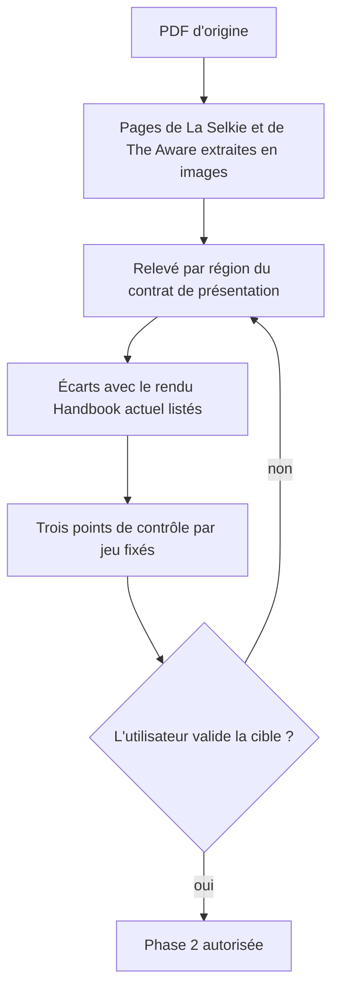
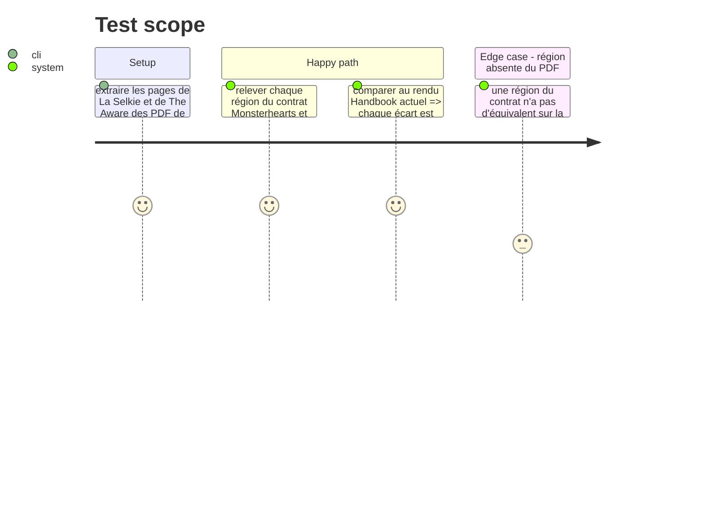

# Instruction: Relever la référence de rendu dans les PDF

## Architecture projection

> Tree of the final files. ✅ create · ✏️ modify · ❌ delete

```txt
../obsidian-handbook/aidd_docs/tasks/2026_11/2026_11_09_pbta-playbook-shared-styles/
├── reference.md ✅ relevé région par région des deux playbooks de référence, écarts du Handbook actuel, trois points de contrôle par jeu
└── reference/ ✅ captures PNG des pages de référence (La Selkie, The Aware), recadrées par région
```

## User Journey



## Test Scope



## Tasks to do

### `1)` Extraire les pages de référence

> Avoir sous les yeux exactement ce qui fait foi.

1. Monsterhearts : rendre les deux pages de `Perso/RPG/monsterhearts/_sources/mues/Monsterhearts_mues_Selkie.pdf` (la mue VF de La Selkie) ; reprendre les relevés déjà faits dans `_sources/design/` (`callout*.png`, `listes1.png`, `move*.png`, `mue*.jpg`, `titres.png`) pour les détails. Les pages sont rendues par `pdftoppm` (présent avec MiKTeX).
2. Urban Shadows : rendre les deux faces de The Aware, pages 1 et 2 de `Perso/RPG/urban-shadows/_sources/Playbooks/US-Playbooks-web20241126.pdf` et de `US-Playbooks-PrinterFriendly-20250325.pdf` (le titre est une image : la page se reconnaît à « AWARE MOVES »).
3. Les rendre en PNG dans `reference/`, une image par page, puis un recadrage par région.

### `2)` Relever région par région

> Une ligne par région des contrats publiés, sans région inventée.

1. Lister les régions depuis `schema-pbta/packs/monsterhearts/presentation-contract.json` et `packs/urban-shadows/presentation-contract.json`.
2. Pour chaque région, noter : police (famille du pack correspondante), taille relative au corps, casse, encadré (trait, fond, trame), tableau ou cases (forme, nombre), puce ou case à cocher, alignement.
3. Noter la page entière : marges, filets de colonnes, bandeau ou nom latéral, illustration, papier.

### `3)` Lister les écarts du Handbook actuel

> Savoir d'avance ce que le CSS partagé doit corriger.

1. Capturer le rendu Handbook actuel de La Selkie et de The Aware dans Obsidian (coffre temporaire piloté par CDP) : les aperçus statiques du pack n'émettent pas le DOM du bloc.
2. Pour chaque région, inscrire « conforme » ou l'écart avec la valeur du PDF.
3. Inscrire les écarts de Lantern déjà constatés dans lantern#76.

### `4)` Fixer les points de contrôle et faire valider la cible

> Le verdict de rendu porte sur des points connus d'avance.

1. Choisir trois points de contrôle par jeu parmi les régions les plus visibles, d'après le PDF et non l'aperçu statique : ils sont fixés dans `reference.md`.
2. Présenter `reference.md` et les captures à l'utilisateur, et ne commencer la phase 2 qu'après validation de la cible.

## Test acceptance criteria

| Task | Acceptance criteria |
| ---- | -------------------- |
| 1 | `reference/` contient les pages de La Selkie (VF) et des deux faces de The Aware (web et imprimable), plus un recadrage par région. |
| 2 | Chaque région des deux contrats de présentation a une ligne dans `reference.md`, et aucune ligne ne nomme une région hors contrat. |
| 3 | Chaque région porte « conforme » ou un écart chiffré (police, taille, trait, forme) par rapport au rendu Handbook actuel. |
| 4 | `reference.md` fixe trois points de contrôle par jeu, et l'utilisateur a validé la cible avant tout changement de CSS. |
